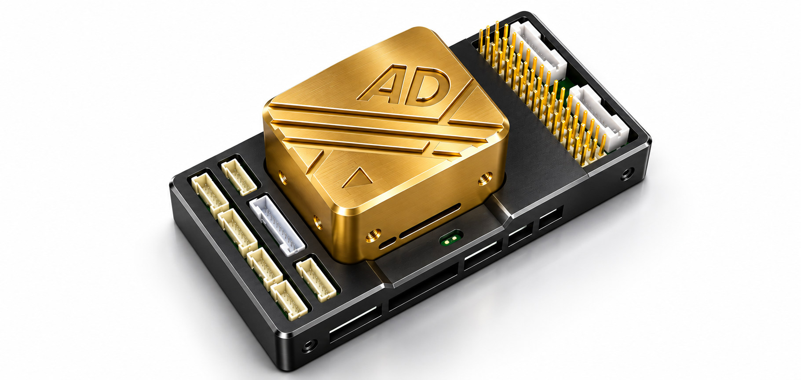

# AD-TALON V6 BASE IOMCU

This hardware definition supports the STM32F103
I/O microcontroller integrated into the
AD-TALON V6 flight controller.

The IOMCU uses a 12 MHz external oscillator
and provides eight MAIN PWM outputs,
RC input, SBUS output and safety switch handling.

The IOMCU firmware is included in the
AD-TALON V6 FMU firmware.

For specifications, connector pinouts and
configuration instructions, see the
[AD-TALON V6 README](../AD-TALON-V6/README.md).
