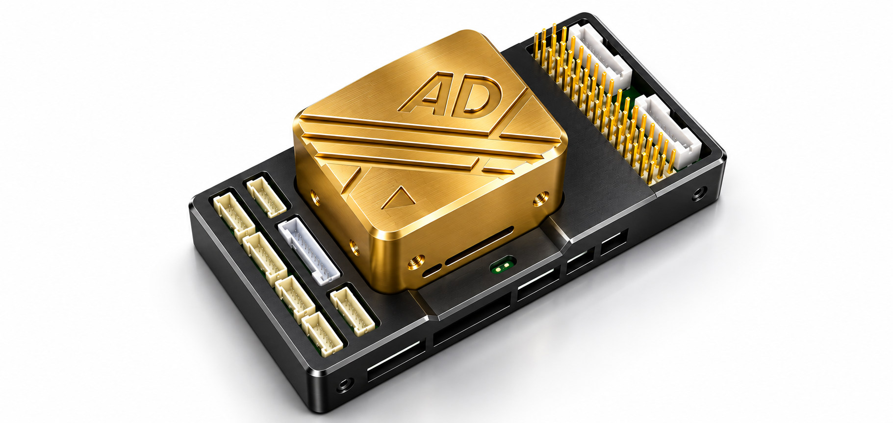
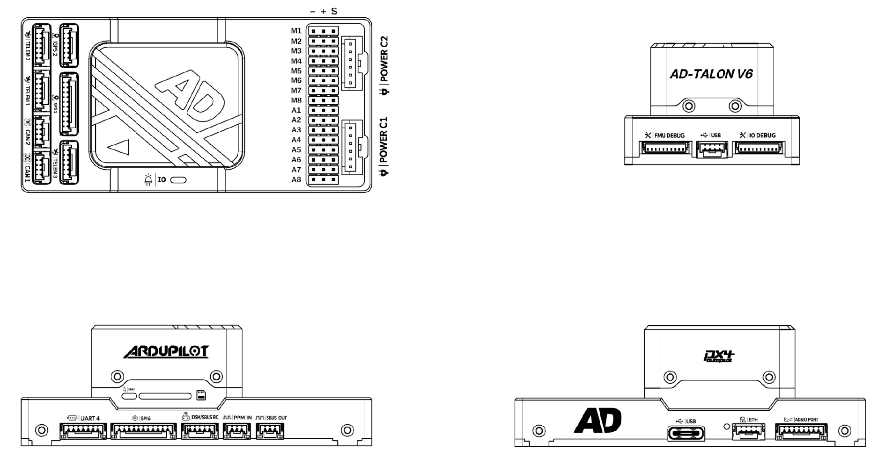
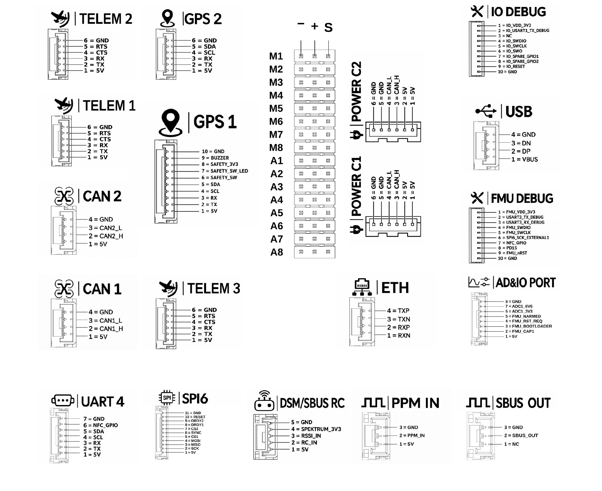

# AD-TALON V6

The AD-TALON V6 flight controller is developed by
[AD SYSTEM](https://adsystem.kr/).

It uses an STM32H753 flight management unit (FMU)
and a dedicated STM32F103 I/O microcontroller (IOMCU).

## Where to Buy

Contact [AD SYSTEM](https://adsystem.kr/) for product
availability and purchasing information.

## Specifications

- Processors
  - STM32H753 FMU
  - STM32F103 IOMCU
  - 2 MB FMU flash
  - 32 KB FRAM for nonvolatile parameter storage

- Sensors
  - ICM-20649 IMU
  - ICM-42688-P IMU
  - BMI088 IMU
  - Two ICP-20100 barometers
  - RM3100 magnetometer
  - IMU heater

- Interfaces
  - USB-C
  - External USB connector
  - MicroSD card slot
  - Seven UARTs, three with hardware flow control
  - External I2C interfaces
  - Two CAN interfaces
  - Ethernet with LAN8742A PHY
  - External SPI interface
  - 16 PWM outputs
  - SBUS/DSM RC input
  - PPM input
  - SBUS output
  - Analog RSSI input
  - Analog and digital I/O
  - FMU and IOMCU debug interfaces
  - Safety switch and buzzer interfaces

- Power
  - Two redundant 5V power module inputs
  - USB power input
  - Controlled 5V peripheral power supplies
  - DroneCAN power module interfaces

## Pinout

Check the connector orientation and hardware revision
before connecting peripherals.

The TELEM1, TELEM2 and TELEM3 connectors use the
following pin assignments:

| Pin | Signal |
| --- | ------ |
| 1 | 5V |
| 2 | TX |
| 3 | RX |
| 4 | CTS |
| 5 | RTS |
| 6 | GND |

The UART4 connector uses the following pin assignments:

| Pin | Signal |
| --- | ------ |
| 1 | 5V |
| 2 | TX |
| 3 | RX |
| 4 | SCL |
| 5 | SDA |
| 6 | NFC_GPIO |
| 7 | GND |

TX and RX are named from the flight controller's
perspective.

The FMU DEBUG connector provides a general-purpose
UART and SWD debugging access. Pin 8, labelled PD15,
has no assigned function in the ArduPilot hardware
definition and should be left unconnected.

## UART Mapping

| Port | UART | Connector | Default Protocol |
| ---- | ---- | --------- | ---------------- |
| SERIAL0 | USB | USB | MAVLink2 |
| SERIAL1 | UART7 | TELEM1 | MAVLink2 |
| SERIAL2 | UART5 | TELEM2 | MAVLink2 |
| SERIAL3 | USART1 | GPS1 | GPS |
| SERIAL4 | UART8 | GPS2 | GPS |
| SERIAL5 | USART2 | TELEM3 | MAVLink2 |
| SERIAL6 | UART4 | UART4 | None |
| SERIAL7 | USART3 | FMU DEBUG | None |

All UARTs listed above have TX and RX DMA support.

TELEM1, TELEM2 and TELEM3 have RTS/CTS hardware
flow control pins.

USART6 is dedicated to communication between the
FMU and IOMCU.

SERIAL6 and SERIAL7 can be configured for other
supported serial protocols.

The listed protocols are firmware defaults.
Previously saved parameter values are retained
when updating firmware.

## RC Input

The DSM/SBUS RC connector provides RC input to
the IOMCU for supported unidirectional serial
receiver protocols.

The connector also provides a dedicated 3.3V
supply for compatible Spektrum receivers.

The PPM IN connector provides a PPM signal input
to both the IOMCU and FMU.

Receiver protocols requiring bidirectional
communication, such as CRSF/ELRS and SRXL2,
should use a full UART interface.

For example, UART4 can be configured as an
RC input by setting SERIAL6_PROTOCOL to 23.

See [RC Systems](https://ardupilot.org/plane/docs/common-rc-systems.html)
for protocol-specific configuration.

The SBUS OUT connector provides SBUS output
from the IOMCU. It can be configured using
the BRD_SBUS_OUT parameter.

## PWM Outputs

The AD-TALON V6 supports 16 PWM outputs.

The first eight outputs, labelled M1 to M8,
are controlled by the STM32F103 IOMCU.

The remaining eight outputs, labelled A1 to A8,
are controlled directly by the STM32H753 FMU.

| Connector | ArduPilot Outputs | Timer | Group | Supported Protocols |
| --------- | ----------------- | ----- | ----- | ------------------- |
| M1-M2 | 1-2 | TIM2 | 1 | PWM |
| M3-M4 | 3-4 | TIM4 | 2 | PWM |
| M5-M8 | 5-8 | TIM3 | 3 | PWM |
| A1-A4 | 9-12 | TIM5 | 4 | PWM, DShot |
| A5-A6 | 13-14 | TIM4 | 5 | PWM, DShot |
| A7-A8 | 15-16 | TIM12 | 6 | PWM |

DShot is not supported on the IOMCU outputs
M1 to M8.

A7 and A8 support PWM only.

Bidirectional DShot is not supported in the
current hardware definition.

Outputs within the same timer group must use
compatible output rates and protocols. If an
output group uses DShot, the entire group
must be configured accordingly.

## Compass

The AD-TALON V6 has a built-in RM3100 compass.

Due to potential magnetic interference,
an external I2C compass mounted away from
power wiring and other sources of magnetic
interference is recommended.

## RSSI

The RSSI_IN pin on the DSM/SBUS RC connector
supports analog RSSI monitoring.

For analog RSSI input, set:

- RSSI_TYPE = 1
- RSSI_ANA_PIN = 103

For receivers that provide RSSI through their
digital RC protocol, configure RSSI according
to the receiver protocol.

## Analog Inputs

The AD&IO PORT provides the following analog
inputs:

| Signal | ArduPilot Analog Pin | Input Range |
| ------ | -------------------- | ----------- |
| ADC1_3V3 | 13 | 0-3.3V |
| ADC1_6V6 | 12 | 0-6.6V |

Do not exceed the specified analog input range.

## GPIOs

The following output and connector pins have
GPIO assignments in ArduPilot.

| Pin | GPIO Number |
| --- | ----------- |
| A1 | 50 |
| A2 | 51 |
| A3 | 52 |
| A4 | 53 |
| A5 | 54 |
| A6 | 55 |
| A7 | 56 |
| A8 | 57 |
| FMU_CAP1 | 58 |
| NFC_GPIO | 60 |
| M1 | 101 |
| M2 | 102 |
| M3 | 103 |
| M4 | 104 |
| M5 | 105 |
| M6 | 106 |
| M7 | 107 |
| M8 | 108 |

The AD&IO PORT also provides dedicated
hardware control signals:

| Signal | Function |
| ------ | -------- |
| FMU_NARMED | Active-low armed status output |
| FMU_RST_REQ | FMU hardware reset request |
| FMU_BOOTLOADER | Hardware boot mode request |

These dedicated control signals are not
general-purpose GPIOs.

## Battery Monitoring

The AD-TALON V6 supports DroneCAN power
modules through its two POWER connectors.

| Connector | CAN Interface |
| --------- | ------------- |
| POWER C1 | CAN1 |
| POWER C2 | CAN2 |

DroneCAN battery monitoring is enabled by
default:

- BATT_MONITOR = 8

Connect a compatible 5V power module and
configure its battery monitoring parameters
as required.

The POWER connectors are intended for
regulated 5V power module outputs, not
direct battery voltage.

## CAN

The AD-TALON V6 has two independent CAN buses.

Both CAN interfaces are configured for
DroneCAN by default.

- CAN_P1_DRIVER = 1
- CAN_P2_DRIVER = 1

Additional DroneCAN devices can be configured
using the ArduPilot CAN parameters.

## Ethernet

The AD-TALON V6 provides an Ethernet interface
using a LAN8742A PHY.

To enable networking, set NET_ENABLE to 1
and reboot the flight controller.

See [ArduPilot Networking](https://ardupilot.org/copter/docs/common-network.html)
for network configuration.

## External SPI

The SPI6 connector provides an external SPI
hardware interface, including chip-select,
data-ready and reset signals.

Support for a connected peripheral depends
on the availability and configuration of
an appropriate device driver.

## Firmware

After upstream integration, firmware for the
AD-TALON V6 can be obtained from the
[ArduPilot Firmware Server](https://firmware.ardupilot.org/)
under the AD-TALON-V6 target.

The ArduPilot board ID is 6500.

## Loading Firmware

An ArduPilot-compatible bootloader is
available for the AD-TALON V6.

On boards with the bootloader installed,
connect the flight controller through USB
and load the appropriate AD-TALON-V6 .apj
firmware file.

Firmware can also be uploaded using
ArduPilot's uploader.py utility.

See [Loading Firmware](https://ardupilot.org/copter/docs/common-loading-firmware-onto-pixhawk.html)
for general firmware loading instructions.

## Further Information

- [AD SYSTEM](https://adsystem.kr/)
- [ArduPilot Documentation](https://ardupilot.org/)
- [ArduPilot Firmware Server](https://firmware.ardupilot.org/)
