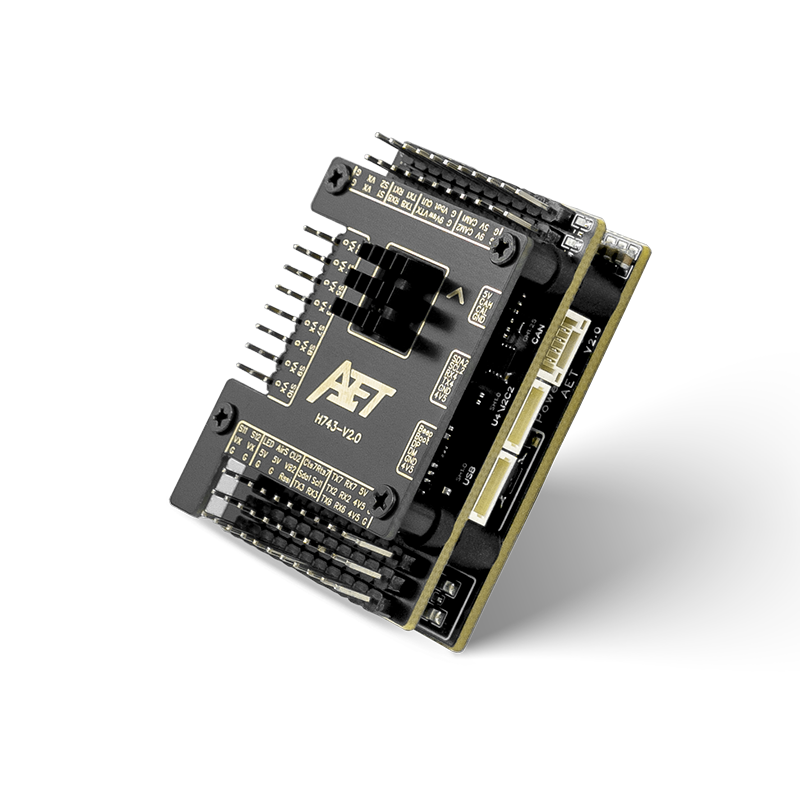
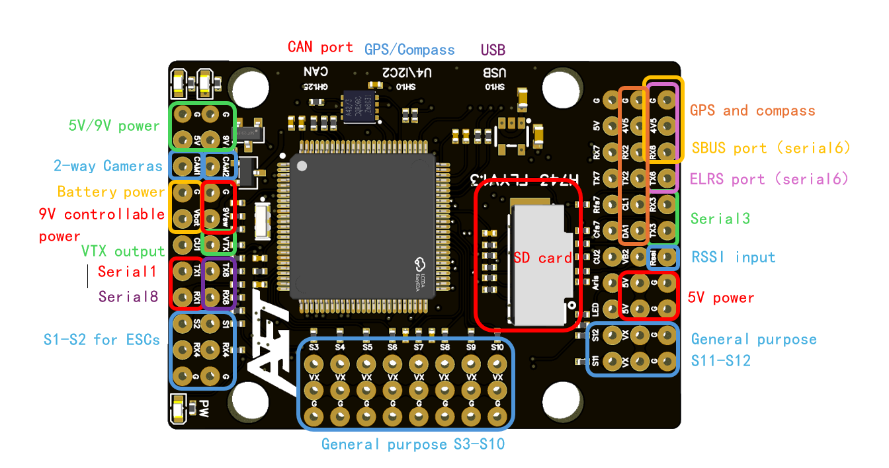
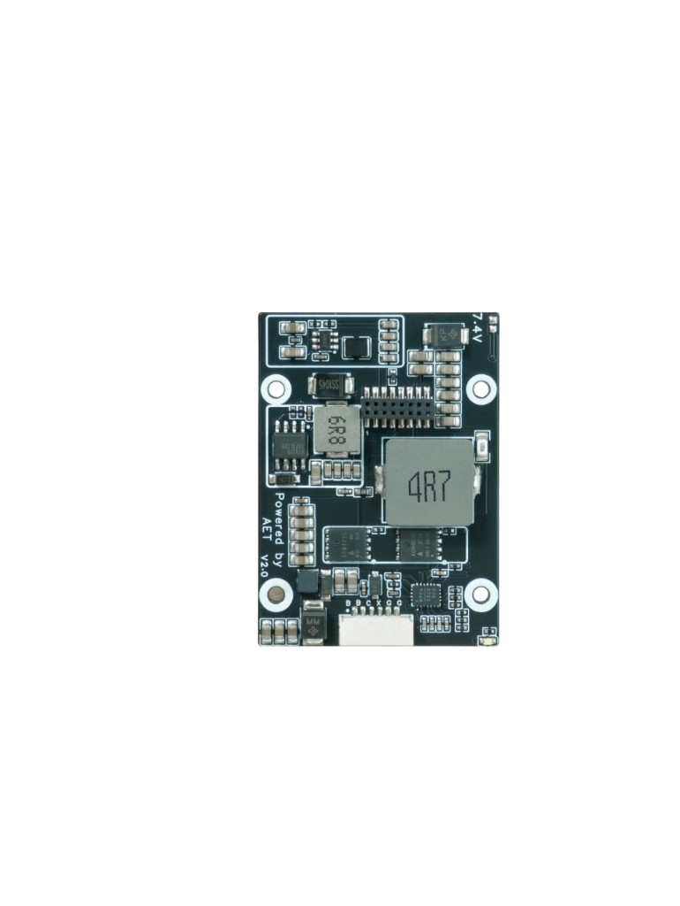
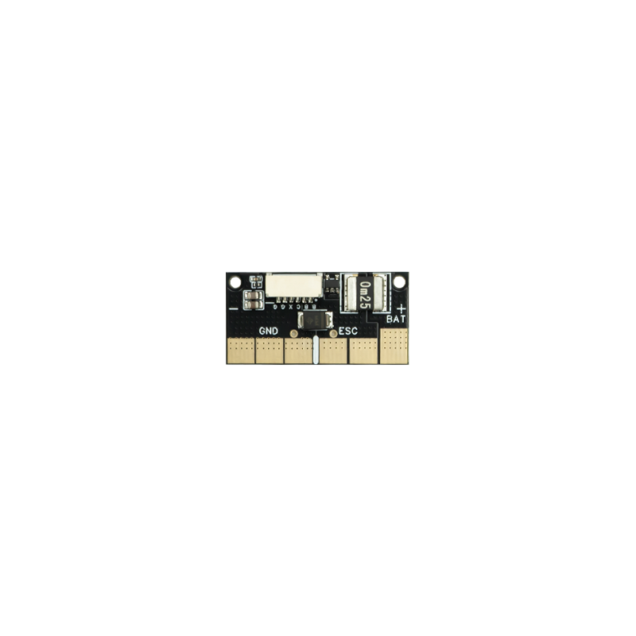
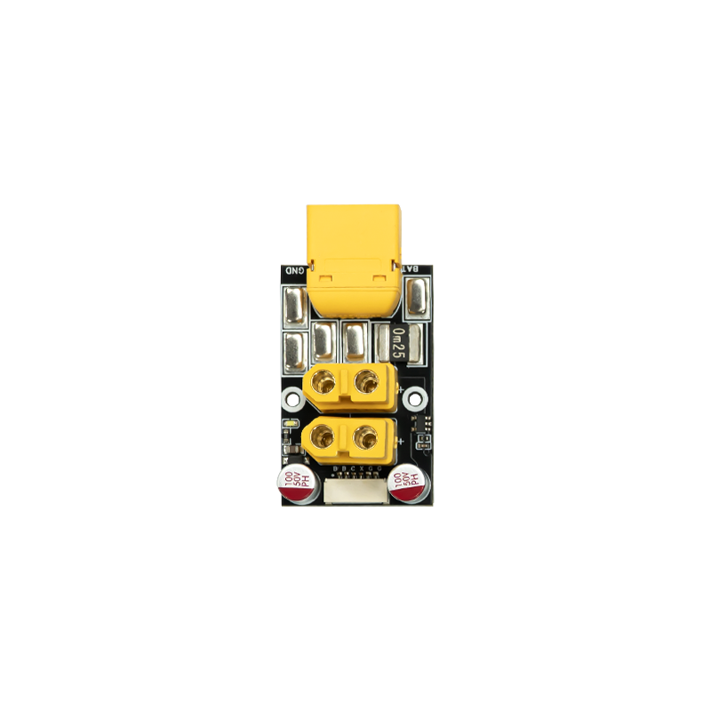
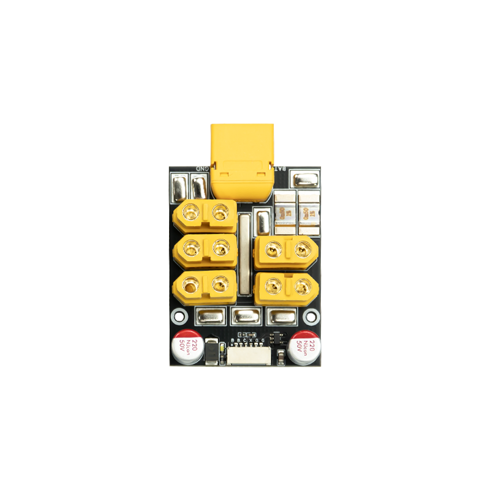

# AET-H743-Basic-V2 Flight Controller

The AET-H743-Basic-V2 is a flight controller designed and produced by AeroEggTech.

Compared with AET-H743-Basic (V1), V2 replaces the dual ICM-42688 IMUs with BMI088 + BMI270, and uses a new power-board design.

## Features

- STM32H743 (480MHz) microcontroller with 2MB flash
- Dual IMUs: BMI088 + BMI270
- AT7456E OSD
- 12 PWM / DShot outputs plus 1 dedicated WS2812 LED output
- 7 UARTs + one USB connector with two virtual CDC ports (OTG1/OTG2), UART7 with CTS/RTS
- 1 CAN bus
- Dedicated USB board connector (single physical port)
- SPL06 barometer
- MicroSD card slot for logging
- 2 I2C buses
- Analog RSSI and airspeed ADC inputs
- 2-way analog camera switch
- 5V 4A BEC
- 9V 2A BEC for VTX / camera (GPIO switched)
- VX servo-rail BEC (default 5V, adjustable to 7.4V, 10A)
- Modular solder-free power distribution board options
- Bluetooth module included by default; external BLE and WiFi modules also supported
- ELRS / CRSF and SBUS RC input supported

## Where to Buy

You can purchase the AET-H743-Basic-V2 from the [AeroEggTech Official Store](https://www.aeroeggtech.com/).

## Mechanical

- Dimensions: 49 x 36 x 17 mm
- Weight: 45g

## Pinout

## Power supply

The AET-H743-Basic-V2 supports 2-6S LiPo input (7-25.2V). Direct connection to a PDB up to 33.6V is supported when an external 50V capacitor is fitted as specified by the manufacturer.

| Power symbol | Power source | Max power (current) |
|--------------|--------------|---------------------|
| 5V | from 5V BEC | 20W (4A) |
| 9V | from 9V BEC | 18W (2A) |
| 9Vsw | from 9V BEC, controlled by MCU | 10W (1A) |
| 4V5 | from USB or 5V BEC, with a diode | 5W (1A) |
| VX | from servo-rail VX BEC (default 5V, adjustable to 7.4V) | 74W (10A) |
| BAT | directly from battery | (5A) |

## Power distribution boards

The flight controller supports modular plug-in power distribution boards (PDB) that provide battery input, ESC power outs, and an analog current sensor to the FC (6-pin harness). Three options are available:

| PDB option | Battery / ESC interface | Current-sensor rating (manufacturer) |
|------------|-------------------------|--------------------------------------|
| Default | Solder pads (`BAT` / `ESC`) | 100 A |
| 1-to-2 | XT60 battery in, 2× XT60 ESC outs | 100 A |
| 1-to-4 | XT60 battery in, multiple XT60 ESC outs | 120 A |

Do not exceed the rated continuous current of the PDB you install. Set `BATT_AMP_PERVLT` to match the installed board's current sensor (default firmware value is `40.0` for the standard board).

## UART Mapping

USART6 is the RC input and is DMA capable. USART3 and UART8 are configured without DMA so the motor timers (TIM3, TIM4, TIM5, TIM15) and the WS2812 timer (TIM1) keep their DMA streams.

ArduPilot GPS instances follow SERIAL order. Enabling GPS on an earlier port makes that port GPS1.

| SERIAL | MCU | Default protocol | Notes |
|--------|-----|------------------|-------|
| 0 | USB (OTG1) | MAVLink2 | Primary USB CDC on the single USB connector |
| 1 | USART1 | MAVLink2 | Telem / User |
| 2 | USART2 | GPS | GPS1 by default |
| 3 | USART3 | MAVLink2 | Telem; no DMA |
| 4 | UART4 | GPS | GPS2 by default. `RX4` / `TX4` are also on the I2C2 connector, and `RX4` is shared with the S1/S2 ESC pads: use it for either GPS2 or ESC telemetry, not both, as a GPS and an ESC on the same RX line will drive each other |
| 5 | USB (OTG2) | MAVLink2 | Second virtual USB CDC on the same USB connector |
| 6 | USART6 | RCIN | RC / SBUS / ELRS; DMA capable |
| 7 | UART7 | MAVLink2 | Telem with CTS/RTS; Bluetooth module fitted by default; 115200 baud |
| 8 | UART8 | None | User; no DMA |

## RC Input

RC input defaults to SERIAL6 (USART6), which supports all serial RC protocols except PPM.

- SBUS: connect to the SBUS pad (`RX6`).
- ELRS / CRSF and other bi-directional protocols: connect to the ELRS port (`TX6` / `RX6`).

No parameter changes are needed for either. On STM32H7 the SBUS inversion is handled inside the UART, so SBUS and ELRS share the same `RX6` pin without an external inverter.

RC can also be attached to any other UART by setting that port's `SERIALn_PROTOCOL` = 23 and changing `SERIAL6_PROTOCOL` away from 23.

See [RC systems](https://ardupilot.org/plane/docs/common-rc-systems.html) for more detail.

## OSD Support

The AET-H743-Basic-V2 supports onboard analog OSD using an AT7456E chip. Connect the analog VTX to the VTX pin. The VTX is powered from the switched 9V rail, see [VTX power control](#vtx-power-control).

## PWM Output

The AET-H743-Basic-V2 supports up to 12 PWM outputs for motors/servos, plus one dedicated WS2812 LED output.

All motor/servo channels (S1-S12) support DShot and bi-directional DShot.

Outputs are grouped and every output within a group must use the same output protocol:

1, 2 are Group 1;

3, 4, 5, 6 are Group 2;

7, 8, 9, 10 are Group 3;

11, 12 are Group 4;

13 (LED) is Group 5;

The LED output is dedicated to WS2812 (NeoPixel). `SERVO13_FUNCTION = 120` is set in `defaults.parm`. `DEFAULT_NTF_LED_TYPES` = 455 in `hwdef.dat` enables Built-in, Toshiba I2C, NCP5623 and NeoPixel notification (bits 0,1,2,6,7,8), which also covers RGB LEDs on many external GPS modules. Set `NTF_LED_LEN` to the number of LEDs on the strip (requires a reboot after changing).

## Battery Monitoring

The board has two voltage sensor inputs and two current sensor inputs. The first monitor is the power board harness (also on the `Vbat` / `CU1` pads) and is enabled by default:

- `BATT_MONITOR` = 4
- `BATT_VOLT_PIN` = 10
- `BATT_CURR_PIN` = 11
- `BATT_VOLT_MULT` = 11.0
- `BATT_AMP_PERVLT` = 40.0

The second monitor is on the `VB2` / `CU2` pads. Enable it with `BATT2_MONITOR` = 4 and set:

- `BATT2_VOLT_PIN` = 18
- `BATT2_CURR_PIN` = 7
- `BATT2_VOLT_MULT` = 11.0
- `BATT2_AMP_PERVLT` to match the external current sensor

The voltage sensors are intended for up to 6S LiPo packs.

## Compass

The AET-H743-Basic-V2 does not have a builtin compass, but you can attach an external compass using I2C on the U4/I2C2 connector (`SDA2` / `SCL2`) or on the GPS and compass header (`CL1` / `DA1`). The onboard SPL06 barometer shares I2C2 at address `0x76`, so an external device on that bus must use a different address. Autoprobing is enabled.

## Analog RSSI

An analog RSSI input is available on the `Rssi` pad. Set `RSSI_TYPE` = 1 to use it (`RSSI_ANA_PIN` = 8).

## Analog Airspeed

An analog airspeed input is available on the `Airs` pad. Set `ARSPD_TYPE` = 2 for an analog sensor (`ARSPD_PIN` = 4).

## Camera Switch

GPIO 82 controls the analog camera switch (CAM1/CAM2). Example:

- `RELAY2_FUNCTION` = 1
- `RELAY2_PIN` = 82
- `RCx_OPTION` = 34

## VTX power control

GPIO 81 (`PD10`) switches the 9V rail (9Vsw). The output is active-low: `PD10` low enables the rail, `PD10` high disables it.

`RELAY1_PIN_DEFAULT` = 81 is set in `hwdef.dat`, so RELAY1 drives the rail without any further pin configuration. `RELAY1_INVERTED` = 1 is set in `defaults.parm` so that "Relay1 ON" means the rail is powered. `RELAY1_DEFAULT` is 0, which leaves the VTX rail **off** after boot; set `RELAY1_DEFAULT` = 1 if the VTX should be powered as soon as the firmware starts.

Both the bootloader and early firmware startup drive `PD10` high, so the VTX rail stays **off** through boot (no brief power-on flash).

The rail can then be toggled from a transmitter switch (`RCx_OPTION` = 28, Relay1), a ground station, or a mission command.

## GPIOs

| Label | GPIO |
|-------|------|
| S1 | 50 |
| S2 | 51 |
| S3 | 52 |
| S4 | 53 |
| S5 | 54 |
| S6 | 55 |
| S7 | 56 |
| S8 | 57 |
| S9 | 58 |
| S10 | 59 |
| S11 | 60 |
| S12 | 61 |
| LED | 62 |
| Beeper | 32 |
| 9Vsw (PINIO1) | 81 |
| Camera switch (PINIO2) | 82 |

## I2C Buses

`I2C_ORDER` is I2C2 then I2C1:

- I2C2 (bus 0): onboard SPL06 barometer at address `0x76`. The same bus is on the U4/I2C2 connector (`SDA2` / `SCL2`), which also carries UART4 (`TX4` / `RX4`). Devices on this bus must not use address `0x76`.
- I2C1 (bus 1): `CL1` / `DA1` pads on the GPS and compass header (typically used with a GPS+compass module on GPS1 / `RX2`/`TX2`).

## CAN Bus

One CAN interface (CAN1) is available on the CAN connector. Set `CAN_P1_DRIVER` = 1 and reboot to enable.

## Storage

- MicroSD card slot for dataflash logs (`HAL_OS_FATFS_IO`)
- Parameter storage in CPU flash

## Firmware

Firmware for this board will be published under sub-folders labeled `AET-H743-Basic-V2` on [firmware.ardupilot.org](https://firmware.ardupilot.org) after upstream merge.

## Loading Firmware

The board comes pre-installed with an ArduPilot compatible bootloader, allowing the loading of *.apj firmware files with any ArduPilot compatible ground station.
