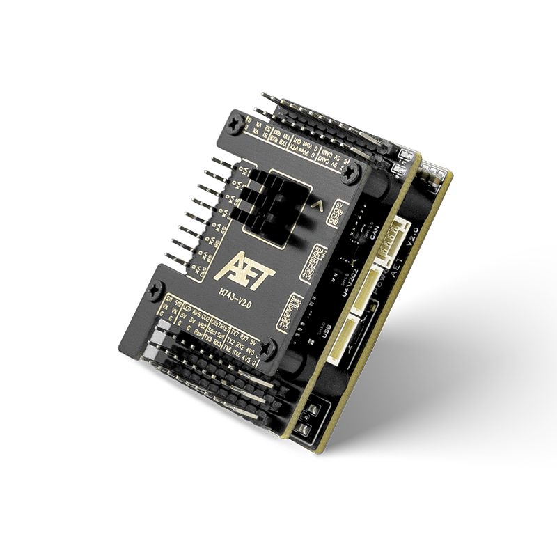
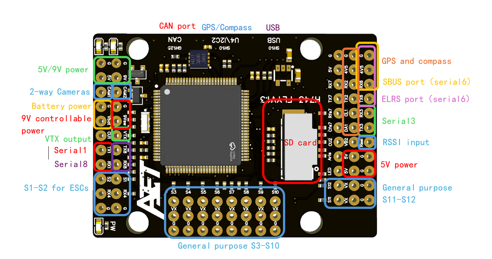
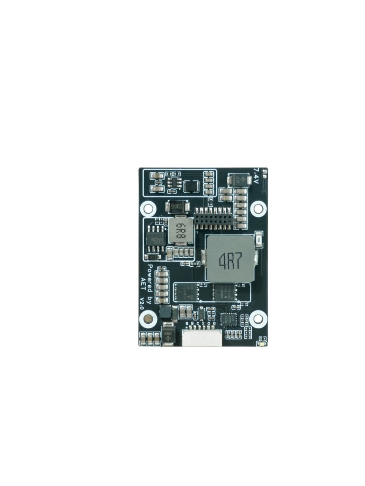
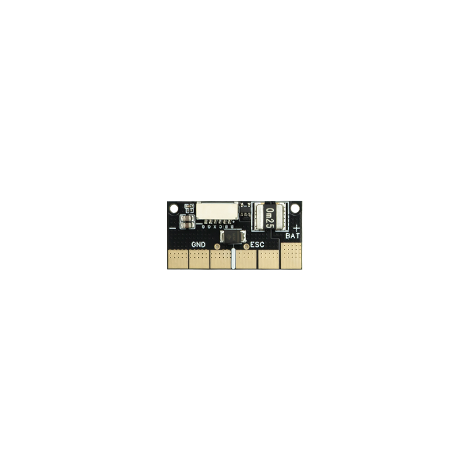
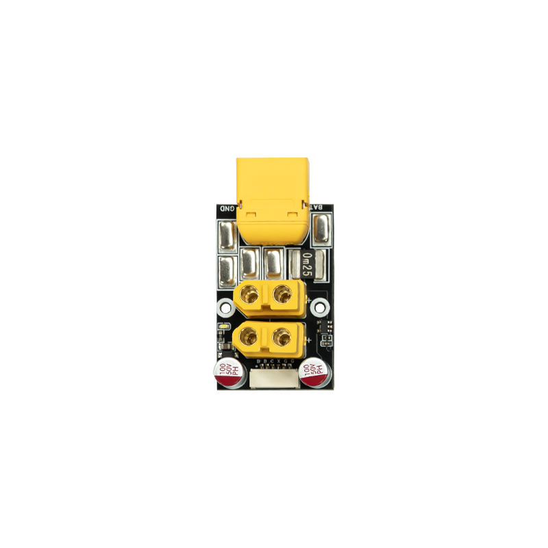
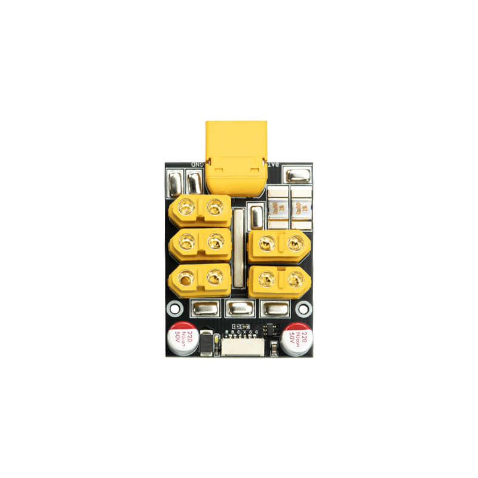

# AET-H743-Basic-V2 Flight Controller

The AET-H743-Basic-V2 is a flight controller designed and produced by AeroEggTech.

## Features

- STM32H743 (480MHz) microcontroller with 2MB flash
- Dual IMUs: BMI088 + BMI270
- AT7456E OSD
- 13 PWM / DShot outputs (one dedicated to WS2812 LED)
- 8 UARTs + dual USB (OTG1/OTG2), UART7 with CTS/RTS
- 1 CAN bus
- Dedicated USB board connector
- SPL06 barometer
- MicroSD card slot for logging
- 2 I2C buses
- Analog RSSI and airspeed ADC inputs
- 2-way analog camera switch
- 5V 4A BEC
- 9V 2A BEC for VTX / camera (GPIO switched)
- VX servo-rail BEC (default 5V, adjustable to 7.4V, 10A)
- Modular solder-free power distribution board options
- External Bluetooth / BLE and WiFi modules supported
- ELRS / CRSF and SBUS RC input supported

## Where to Buy

You can purchase the AET-H743-Basic-V2 from the [AeroEggTech Official Store](https://www.aeroeggtech.com/).

## Mechanical

- Dimensions: 49 x 36 x 17 mm
- Weight: 45g

## Pinout







## Power supply

The AET-H743-Basic-V2 supports 2-6S LiPo input (7-25.2V). Direct connection to a PDB up to 33.6V is supported when an external 50V capacitor is fitted as specified by the manufacturer.

| Power symbol | Power source | Max power (current) |
|--------------|--------------|---------------------|
| 5V | from 5V BEC | 20W (4A) |
| 9V | from 9V BEC | 18W (2A) |
| 9Vsw | from 9V BEC, controlled by MCU | 10W (1A) |
| 4V5 | from USB or 5V BEC, with a diode | 5W (1A) |
| VX | from servo-rail VX BEC (default 5V, adjustable to 7.4V) | 74W (10A) |
| BAT | directly from battery | (5A) |

## Power distribution boards

The flight controller supports modular plug-in power distribution boards (PDB) that provide battery input, ESC power outs, and an analog current sensor to the FC (6-pin harness). Three options are available:

| PDB option | Battery / ESC interface | Current-sensor rating (manufacturer) |
|------------|-------------------------|--------------------------------------|
| Default | Solder pads (`BAT` / `ESC`) | 100 A |
| 1-to-2 | XT60 battery in, 2× XT60 ESC outs | 100 A |
| 1-to-4 | XT60 battery in, multiple XT60 ESC outs | 120 A |

Do not exceed the rated continuous current of the PDB you install. Set `BATT_AMP_PERVLT` to match the installed board's current sensor (default firmware value is `40.0` for the standard board).







## UART Mapping

USART6 is configured without DMA so PWM13 (WS2812) can obtain timer DMA. Other listed UARTs are DMA capable.

ArduPilot GPS instances follow SERIAL order. Enabling GPS on an earlier port makes that port GPS1.

| SERIAL | MCU | Default protocol | Notes |
|--------|-----|------------------|-------|
| 0 | USB (OTG1) | MAVLink2 | USB |
| 1 | USART1 | MAVLink2 | Telem / User |
| 2 | USART2 | GPS | GPS1 by default |
| 3 | USART3 | MAVLink2 | Telem |
| 4 | UART4 | GPS | GPS2 by default; also on I2C2 connector (TX4/RX4) |
| 5 | USB (OTG2) | MAVLink2 | Second USB |
| 6 | USART6 | RCIN | RC / SBUS; no DMA |
| 7 | UART7 | MAVLink2 | Telem with CTS/RTS; common port for external BT module |
| 8 | UART8 | None | User |

## RC Input

RC input defaults to **SERIAL6 (USART6)** and supports all serial RC protocols except PPM. The SBUS pin is inverted and connected to RX6.

RC can be attached to any UART if that port protocol is set to `SERIALn_PROTOCOL = 23` and `SERIAL6_PROTOCOL` is changed away from `23`.

- SBUS: use the SBUS / RX6 connection with default RCIN on SERIAL6
- ELRS / CRSF: connect to a UART with TX+RX and set that port to RCIN (`SERIALn_PROTOCOL = 23`)

See [RC systems](https://ardupilot.org/plane/docs/common-rc-systems.html) for more detail.

## OSD Support

The AET-H743-Basic-V2 supports onboard analog OSD using an AT7456E chip. Connect the analog VTX to the VTX pin.

## PWM Output

The AET-H743-Basic-V2 supports up to 13 PWM outputs.

All channels support DShot.

Outputs are grouped and every output within a group must use the same output protocol:

1, 2 are Group 1;

3, 4, 5, 6 are Group 2;

7, 8, 9, 10 are Group 3;

11, 12 are Group 4;

13 (LED) is Group 5;

Output 13 is dedicated to WS2812 LED (NeoPixel). `SERVO13_FUNCTION = 120` and board NeoPixel notification are set in `defaults.parm`. Set `NTF_LED_LEN` to the number of LEDs on the strip.

## Battery Monitoring

The board has two voltage sensor inputs and current sense inputs (onboard plus external). The first monitor is enabled by default:

- `BATT_MONITOR` = 4
- `BATT_VOLT_PIN` = 10
- `BATT_CURR_PIN` = 11
- `BATT_VOLT_MULT` = 11.0
- `BATT_AMP_PERVLT` = 40.0
- `BATT2_VOLT_PIN` = 18
- `BATT2_CURR_PIN` = 7
- `BATT2_VOLT_MULT` = 11.0

Enable the second battery monitor with `BATT2_MONITOR` if needed, and set `BATT2_AMP_PERVLT` to match the external current sensor.

The voltage sensors are intended for up to 6S LiPo packs.

## Compass

The AET-H743-Basic-V2 has no built-in compass. Use an external I2C compass. Autoprobing is enabled.

## Analog inputs

- Analog RSSI: set `RSSI_TYPE` appropriately; `RSSI_ANA_PIN` defaults to 8
- Airspeed analog pin defaults to 4; set `ARSPD_TYPE` when an analog airspeed sensor is used

## Camera Switch

GPIO 82 controls the analog camera switch (CAM1/CAM2). Example:

- `RELAY2_FUNCTION` = 1
- `RELAY_PIN2` = 82
- `RCx_OPTION` = 34

## 9V switch

GPIO 81 controls the switched 9V rail (9Vsw). Example:

- `RELAY1_FUNCTION` = 1
- `RELAY_PIN` = 81
- `RCx_OPTION` = 28

## GPIOs

| Label | GPIO |
|-------|------|
| PWM1 | 50 |
| PWM2 | 51 |
| PWM3 | 52 |
| PWM4 | 53 |
| PWM5 | 54 |
| PWM6 | 55 |
| PWM7 | 56 |
| PWM8 | 57 |
| PWM9 | 58 |
| PWM10 | 59 |
| PWM11 | 60 |
| PWM12 | 61 |
| PWM13 / LED | 62 |
| Beeper | 32 |
| 9Vsw (PINIO1) | 81 |
| Camera switch (PINIO2) | 82 |

## I2C Buses

`I2C_ORDER` is I2C2 then I2C1:

- I2C2 (bus 0): onboard barometer
- I2C1 (bus 1): external connector (`SDA1` / `SCL1`) for compass / peripherals

The I2C2 connector also carries UART4 (`TX4` / `RX4`). Use one function set of devices carefully so nets are not double-driven.

## CAN Bus

One CAN interface (CAN1) is available on the CAN connector. Set `CAN_P1_DRIVER` = 1 and reboot to enable.

## Storage

- MicroSD card slot for dataflash logs (`HAL_OS_FATFS_IO`)
- Parameter storage in CPU flash

## Firmware

Firmware for this board will be published under sub-folders labeled `AET-H743-Basic-V2` on [firmware.ardupilot.org](https://firmware.ardupilot.org) after upstream merge.

Build locally with:

```sh
./waf configure --board AET-H743-Basic-V2
./waf copter
```

## Loading Firmware

The board ships with a bootloader. For a first load onto an empty MCU, enter DFU by holding the boot button while connecting USB, then load the `with_bl.hex` file with a DFU tool.

After the bootloader is present, update firmware with any ArduPilot GCS using the `*.apj` file. Mission Planner firmware update is not the same as DFU mode.
