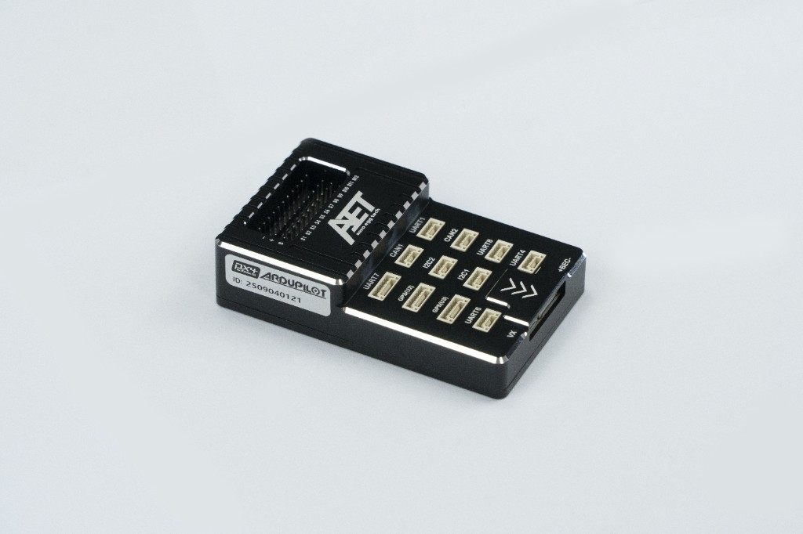
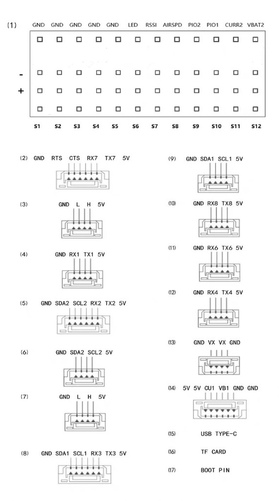
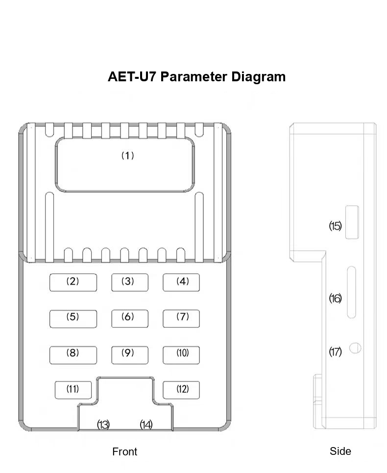
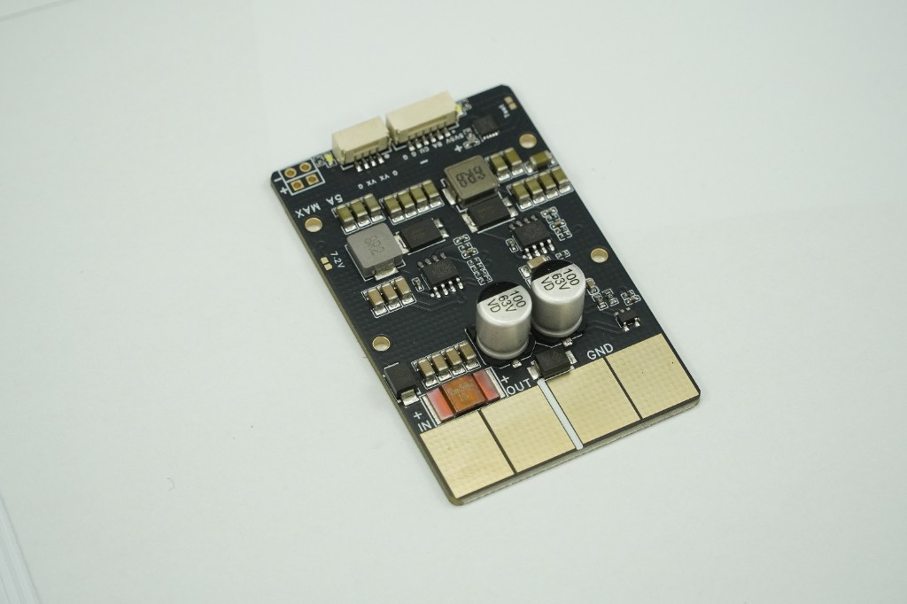

# AET-U7 Flight Controller

The AET-U7 is a flight controller designed and produced by AeroEggTech, based on the STM32H753 microcontroller.

## Features

- STM32H753 microcontroller (ArduPilot builds with the STM32H743xx target at 400MHz)
- Triple IMUs: ICM-45686 + dual ICM-42688 (SPI)
- Dual barometers: ICP-20100 and SPL06 (I2C)
- Onboard IST8310 compass
- 12 PWM / DShot outputs (plus PWM13 dedicated to WS2812 LED)
- 7 UARTs + USB (UART7 has RTS/CTS)
- 1 CAN bus
- USB-C
- MicroSD card slot (SDMMC)
- 2 I2C buses
- Dual analog power monitoring (PMU)
- Analog RSSI and airspeed inputs
- Dual status LEDs (blue/green) and WS2812 on PWM13
- 5V 5A BEC and VX servo BEC (5V or 7.2V, 5A)

## Where to Buy

You can purchase the AET-U7 from the [AeroEggTech Official Store](https://www.aeroeggtech.com/).

## Mechanical

- Dimensions: 85 x 52 x 21 mm

## Pinout

## Power supply

The AET-U7 PMU is designed for 12S (50.4V) input, with a transient maximum of 60V. The PMU current sensor is rated up to 120A.

Onboard BECs:

- 5V BEC, 5A
- VX servo rail BEC, selectable 5V or 7.2V, 5A

Please refer to the manufacturer's documentation for exact power distribution and VX voltage selection.

## UART Mapping

| SERIAL | MCU    | Default protocol | RX DMA | TX DMA | Connectors / notes |
|--------|--------|------------------|--------|--------|--------------------|
| 0      | USB    | MAVLink2         | N/A    | N/A    | USB-C |
| 1      | USART1 | MAVLink2         | Yes    | Yes    | UART1 connector |
| 2      | USART2 | MAVLink2         | No     | No     | GPS(U2) connector |
| 3      | USART3 | GPS              | Yes    | Yes    | GPS(U3) connector (default GPS1) |
| 4      | UART4  | GPS              | No     | No     | UART4 connector |
| 5      | USB2   | MAVLink2         | N/A    | N/A    | Second USB serial endpoint |
| 6      | USART6 | RC input         | Yes    | Yes    | UART6 connector |
| 7      | UART7  | MAVLink2         | Yes    | Yes    | UART7 connector with RTS/CTS |
| 8      | UART8  | None             | No     | No     | UART8 connector |

USART2, UART4 and UART8 have DMA disabled so the three IMU SPI buses can keep exclusive DMA while DShot/WS2812 timers still have DMA.

GPS1 defaults to **GPS(U3)** (SERIAL3, with DMA). GPS(U2) defaults to MAVLink2. If you also set `SERIAL2_PROTOCOL` = 5, GPS instances follow SERIAL order: GPS(U2) becomes GPS1 and GPS(U3) becomes GPS2 (set `GPS2_TYPE` = 1 and reboot). Only two GPS receivers are supported.

## RC Input

RC input defaults to **SERIAL6 (USART6)**. All common serial RC protocols are supported except PPM. There is no dedicated PPM / RCININT pin.

- SBUS / CRSF / ELRS and similar: connect to the UART6 connector (or any free UART with `SERIALn_PROTOCOL` = 23).
- FPort requires `SERIALn_OPTIONS` = `15`.
- CRSF/ELRS typically uses `SERIALn_OPTIONS` = `0`.
- SRXL2 requires `SERIALn_OPTIONS` = `4` and connects only the TX pin.

If RC is moved to another UART, set that port to protocol 23 and change `SERIAL6_PROTOCOL` away from 23.

See [RC systems](https://ardupilot.org/plane/docs/common-rc-systems.html) for more detail.

## PWM Output

The AET-U7 supports 12 PWM outputs for motors/servos. PWM13 is dedicated to WS2812 LED (NeoPixel).

All motor/servo channels support DShot, including bidirectional DShot (RPM telemetry). Enable with `SERVO_BLH_BDMASK` as needed.

Outputs are grouped and every output within a group must use the same output protocol:

1, 2 are Group 1;

3, 4, 5, 6 are Group 2;

7, 8, 9, 10 are Group 3;

11, 12 are Group 4;

13 (LED) is Group 5;

## Battery Monitoring

The board has two voltage sensor inputs and two current sensor inputs (battery 1 via the PMU connector, battery 2 via the VBAT2/CURR2 pads). Default parameters:

- `BATT_MONITOR` = 4 (Analog)
- `BATT_VOLT_PIN` = 10
- `BATT_CURR_PIN` = 11
- `BATT_VOLT_MULT` = 26.0
- `BATT_AMP_PERVLT` = 40.0
- `BATT2_VOLT_PIN` = 18
- `BATT2_CURR_PIN` = 7
- `BATT2_VOLT_MULT` = 26.0

The battery 1 current scale above matches the PMU. For battery 2 current, set `BATT2_AMP_PERVLT` to match your external sensor.

To use the VBAT2/CURR2 inputs, set `BATT2_MONITOR` = 4.

The voltage sensors support up to 12S, consistent with the PMU design.

## Compass

The AET-U7 has a built-in compass. Due to potential interference, the autopilot is usually used with an external I2C compass as part of a GPS/Compass combination.

## Analog RSSI

An analog RSSI input is available on the RSSI pad. Set `RSSI_TYPE` = 1 to use the RSSI pad (`RSSI_ANA_PIN` = 8).

## Analog Airspeed

An analog airspeed input is available on the AIRSPD pad. Set `ARSPD_TYPE` = 2 for an analog sensor on the AIRSPD pad (`ARSPD_PIN` = 4).

## WS2812 LED (NeoPixel)

PWM output 13 is dedicated to WS2812 LED control. Board and NeoPixel notification defaults are enabled in the firmware. To use it:

1. Connect the WS2812 data line to the LED / PWM13 output.
2. Set `NTF_LED_LEN` to the number of LEDs.
3. `SERVO13_FUNCTION` = 120 (NeoPixel) is set in `defaults.parm`.

## GPIOs

The motor/servo outputs and other pads are available as ArduPilot GPIOs (for relays, etc.).

| Label       | GPIO |
|-------------|------|
| S1          | 50   |
| S2          | 51   |
| S3          | 52   |
| S4          | 53   |
| S5          | 54   |
| S6          | 55   |
| S7          | 56   |
| S8          | 57   |
| S9          | 58   |
| S10         | 59   |
| S11         | 60   |
| S12         | 61   |
| LED / PWM13 | 62   |
| PIO1        | 81   |
| PIO2        | 82   |

## I2C Buses

Connector-to-bus mapping:

- **GPS(U2)** and **I2C2** connectors are on **I2C2** (ArduPilot bus 0; also used by the onboard barometers and IST8310, marked internal).
- **GPS(U3)** and **I2C1** connectors are on **I2C1** (ArduPilot bus 1; external).

For a GPS/compass module, prefer **GPS(U3)** / **I2C1** (default GPS1, external I2C bus). A compass on the GPS(U2)/I2C2 connector shares the internal bus with the onboard IST8310 and may not be autoprobed; an IST8310 at the same address will clash with the onboard compass.

## CAN Bus

One CAN interface (CAN1) is provided. The board has two physical connectors, **CAN1** and **CAN2**, both wired to CAN1 for daisy-chaining.

DroneCAN is not enabled by default. Set `CAN_P1_DRIVER` = 1 and reboot the board to use DroneCAN devices.

## Storage

A MicroSD card slot is provided for data logging (SDMMC). Flight logs are written under `/APM/` when the card is mounted.

## Firmware

Firmware for the AET-U7 can be found [here](https://firmware.ardupilot.org) in sub-folders labeled `AET-U7`.

## Loading Firmware

The board comes pre-installed with an ArduPilot compatible bootloader, allowing the loading of *.apj firmware files with any ArduPilot compatible ground station.
