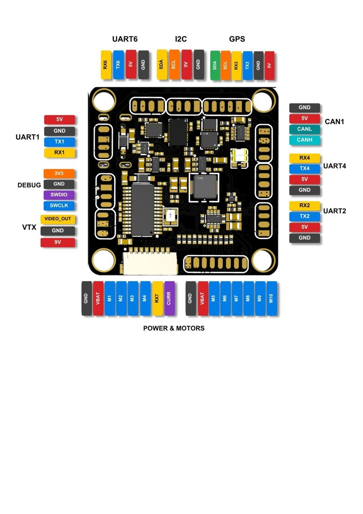

# AeroStem AeroH7 (AeroStemH743V1) Flight Controller

The AeroH7 (firmware target `AeroStemH743V1`, hardware rev 1.0) is a flight
controller designed and produced by
[AeroStem Technology](https://aerostemtechnology.com).

## Features

- STM32H743 microcontroller (480 MHz, 2 MB flash)
- BMI088 + BMI270 dual IMUs
- DPS310 barometer
- IST8310 magnetometer
- AT7456E analog OSD
- 2S-6S LiPo input (6.0-27.0 V)
- 9V 3A BEC; 5V 3A BEC
- MicroSD card slot
- 7 UARTs (6 full + 1 RX-only for ESC telemetry) plus USB-C
- 10 PWM outputs
- 1 CAN
- 1 I2C
- SWD debug pads
- Connector variants: JST-GH 1.25 mm or solder pads (same signals)

## Where to Buy

[AeroStem Technology](https://aerostemtechnology.com)

## Pinout

## UART Mapping

|Port | UART  | Protocol       | Notes                              |
|-----|-------|----------------|------------------------------------|
|0    | USB   | MAVLink2       |                                    |
|1    | UART1 | MAVLink2       |                                    |
|2    | UART2 | DisplayPort    | UART2 pads and DJI O3/O4 connector |
|3    | UART3 | GPS            | GPS connector                      |
|4    | UART4 | MAVLink2       |                                    |
|5    | UART6 | RCIN           |                                    |
|6    | UART7 | ESC Telemetry  | RX7 only, on ESC connector         |
|7    | UART8 | User           |                                    |

All UARTs have DMA.

UART2 is wired to both the UART2 pads (5V) and the DJI O3/O4 connector
(9V). They are the same UART - use only one at a time.

## RC Input

The default RC input is on UART6. The SBUS pin on the DJI O3 connector is
inverted and connected to RX6, so leave it unconnected when using RX6 directly.
Unidirectional protocols (SBUS, iBus, DSM, etc.) can be connected to RX6.
PPM is not supported.
CRSF/ELRS connects to both RX6 and TX6, with no further setup required.
RC can be moved to another UART (UART1, UART4 or UART8) by setting
`SERIALn_PROTOCOL=23` there and changing `SERIAL5_PROTOCOL` to something
other than 23. See [RC Systems](https://ardupilot.org/copter/docs/common-rc-systems.html)
for details.

## OSD Support

The board supports onboard analog OSD using OSD_TYPE 1 (MAX7456 driver).
The analog camera connects to the FPV CAMERA connector (9V, GND, VIDEO_IN);
like the VTX pads, its power pin is 9V. The analog OSD on this video path
runs at the same time as the DisplayPort OSD.

DisplayPort OSD is available at the same time on the HD VTX connector
(OSD_TYPE2 5). If `SERIAL2_PROTOCOL` is ever changed from MSP DisplayPort,
`OSD_TYPE2` must be set to 0, or a pre-arm failure will result.

## VTX Support

The SH1.0-6P connector supports a DJI O3 Air Unit / HD VTX. Protocol defaults
to DisplayPort. Pin 1 of this connector is 9V, so do not connect it to a
peripheral that needs 5V. The analog VTX pads also provide 9V.

## PWM Output

The AeroStem H743 V1 supports up to 10 PWM outputs. All channels support
DShot; channels 1-8 support bi-directional DShot.

PWM outputs are grouped and every group must use the same output protocol:

- 1, 2, 3, 4 are Group 1 (TIM1)
- 5, 6 are Group 2 (TIM3)
- 7, 8, 9, 10 are Group 3 (TIM4)

## GPIOs

The PWM outputs can be used as GPIOs (relays, buttons, RPM etc). To use
them, set the output's `SERVOx_FUNCTION` to -1.

|Output | GPIO |
|-------|------|
|M1     | 50   |
|M2     | 51   |
|M3     | 52   |
|M4     | 53   |
|M5     | 54   |
|M6     | 55   |
|M7     | 56   |
|M8     | 57   |
|M9     | 58   |
|M10    | 59   |

## Battery Monitoring

The board has an internal voltage sensor (up to 6S LiPo) and a current
sensor input on the ESC connector. Default battery parameters:

- BATT_MONITOR 4
- BATT_VOLT_PIN 10
- BATT_CURR_PIN 11
- BATT_VOLT_MULT 21.12
- BATT_AMP_PERVLT 40.2

`BATT_AMP_PERVLT` will need to be adjusted for whichever current sensor is
attached.

## CAN

DroneCAN is not enabled by default. To use DroneCAN devices, set
`CAN_P1_DRIVER` to 1 and reboot the board.

CAN1 connector pin order is GND, 5V, CANL, CANH (not the Pixhawk standard
order) - check pre-made DroneCAN cables before connecting.

## Compass

The board has a built-in IST8310 compass. Due to potential interference, the
autopilot is usually used with an external I2C compass as part of a GPS/Compass
combination, connected to the GPS connector or the I2C pads.

## Mechanical

- Mounting: 30.5 x 30.5 mm, M3 (4 mm holes)
- Dimensions: 36 x 36 x 8 mm
- Weight: 9 g

## Loading Firmware

Firmware for the AeroH7 is available from [ArduPilot Firmware Server](https://firmware.ardupilot.org) under the `AeroStemH743V1` target.

To load ArduPilot firmware, hold the BOOT button while connecting USB to the board.
Then use the STM32CubeProgrammer app to load the "***_with_bl.hex" file.
Subsequently, a GCS can update firmware using the *.apj files.
