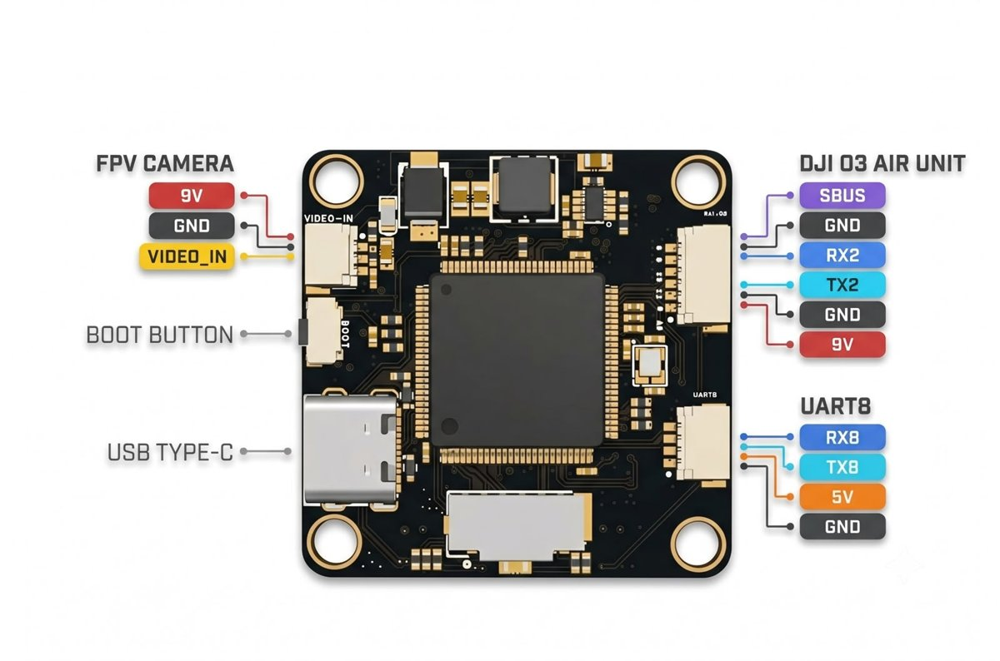

# AeroStem AeroH7 (AeroStemH743V1) Flight Controller

The AeroH7 (firmware target `AeroStemH743V1`, hardware rev 1.0) is a flight
controller designed and produced by
[AeroStem Technology](https://aerostemtechnology.com).

## Features

- STM32H743 microcontroller (480 MHz, 2 MB flash)
- BMI088 + BMI270 dual IMUs
- DPS310 barometer
- IST8310 magnetometer
- AT7456E analog OSD
- 2S-6S LiPo input (6.0-27.0 V)
- 9V 3A BEC; 5V 3A BEC
- MicroSD card slot
- 7 UARTs (6 full + 1 RX-only for ESC telemetry) plus USB-C
- 10 PWM outputs
- 1 CAN
- 1 I2C
- SWD debug pads
- Connector variants: JST-GH 1.25 mm or solder pads (same signals)

## Physical

## UART Mapping

- SERIAL0 -> USB
- SERIAL1 -> UART1 (MAVLink2, DMA-enabled)
- SERIAL2 -> UART2 (DisplayPort, DJI O3/O4 connector, DMA-enabled)
- SERIAL3 -> UART3 (GPS, DMA-enabled)
- SERIAL4 -> UART4 (MAVLink2, DMA-enabled)
- SERIAL5 -> UART6 (RCIN, DMA-enabled)
- SERIAL6 -> UART7 (RX only, ESC Telemetry, DMA-enabled)
- SERIAL7 -> UART8 (User, DMA-enabled)

UART2 is wired to both the TELEM2 connector (5V) and the DJI O3/O4
connector (9V). They are the same UART - use only one at a time.

## RC Input

The default RC input is configured on UART6. The SBUS pin (also present on
the DJI O3 connector) is inverted and connected to RX6. Non-SBUS, single-wire
serial receivers can be tied directly to RX6 if the SBUS pin is left
unconnected. RC can be moved to another UART (UART1, UART4 or UART8) by
setting `SERIALn_PROTOCOL=23` there and changing `SERIAL5_PROTOCOL` to
something other than 23.

## OSD Support

The board supports onboard analog OSD using OSD_TYPE 1 (MAX7456 driver).
DisplayPort OSD is available at the same time on the HD VTX connector
(OSD_TYPE2 5).

## VTX Support

The SH1.0-6P connector supports a DJI O3 Air Unit / HD VTX. Protocol defaults
to DisplayPort. Pin 1 of this connector is 9V, so do not connect it to a
peripheral that needs 5V. The analog VTX pads also provide 9V.

## PWM Output

The AeroStem H743 V1 supports up to 10 PWM outputs. All channels support
DShot; channels 1-8 support bi-directional DShot.

PWM outputs are grouped and every group must use the same output protocol:

- 1, 2, 3, 4 are Group 1 (TIM1)
- 5, 6 are Group 2 (TIM3)
- 7, 8, 9, 10 are Group 3 (TIM4)

## Battery Monitoring

The board has an internal voltage sensor (up to 6S LiPo) and a current
sensor input on the ESC connector. Default battery parameters:

- BATT_MONITOR 4
- BATT_VOLT_PIN 10
- BATT_CURR_PIN 11
- BATT_VOLT_MULT 21.2
- BATT_AMP_PERVLT 40.2

## CAN

CAN1 connector pin order is GND, 5V, CANL, CANH (not the Pixhawk standard
order) - check pre-made DroneCAN cables before connecting.

## Compass

The board has a built-in IST8310 compass. An external compass can be
connected to the I2C pads or the SDA/SCL pins of the GPS connector.

## Mechanical

- Mounting: 30.5 x 30.5 mm, M3 (4 mm holes)
- Dimensions: 36 x 36 x 8 mm
- Weight: 9 g

## Loading Firmware

Initial firmware load can be done with DFU by plugging in USB with the BOOT
button pressed. Then load the `*_with_bl.hex` firmware using your favourite
DFU loading tool (e.g. STM32CubeProgrammer).

Once the initial firmware is loaded, update the firmware with any ArduPilot
ground station using the `*.apj` files.
