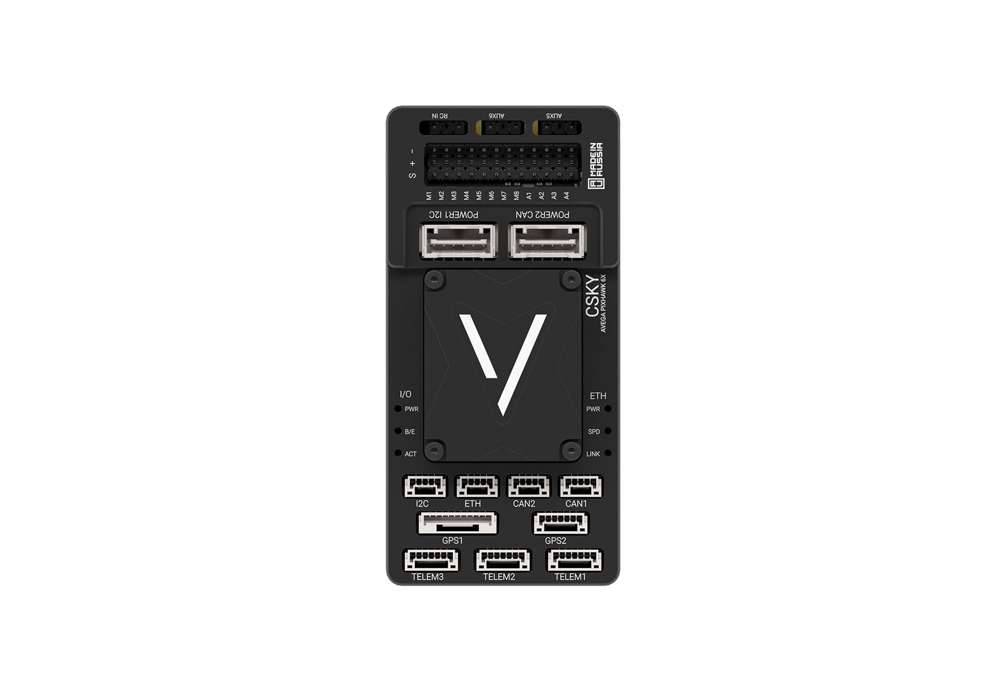
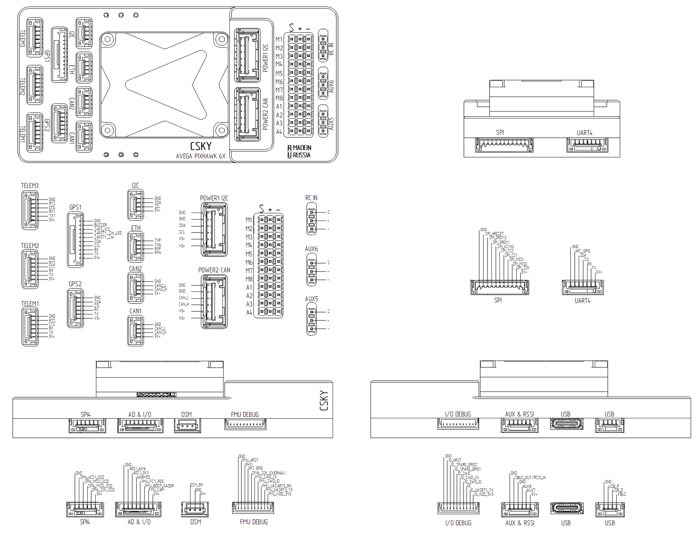

# CSKY_AVEGA6X

The CSKY_AVEGA6X autopilot is manufactured by [CSKY](https://csky.space).

## Where to Buy

[Manufacturer Store](https://csky.space/avega6X)

## Specifications

- Processor
  - STM32H743 FMU: 32-bit Arm® Cortex®-M7, 480 MHz, 2 MB flash, 1 MB RAM
  - STM32F103 IOMCU: 32-bit Arm® Cortex®-M3
- Sensors
  - BMM150 magnetometer
  - BMP388 barometer
  - ICP201xx barometers ×2
  - IMU board Rev1: ICM45686, BMI088, ICM42670
  - IMU board Rev2: 2× ICM45686
  - IMU heater
- Storage
  - microSD card
  - FRAM (32 KB parameter storage)
- Interfaces
  - USB-C and JST-GH USB connectors (same port)
  - 7 UARTs + IOMCU UART, 3 with RTS/CTS flow control
  - 2× CAN (CAN1, CAN2)
  - 4× I2C (1 internal; 3 external)
  - 4× SPI (internal). Note: The exposed SPI connectors on the FMU module and baseboard are not supported by the firmware.
  - Ethernet 100 Mbps, LAN8742A PHY
  - 8× FMU PWM outputs
  - 8× IOMCU PWM outputs (M1-M8)
  - 1× RC input (single-wire), 1× DSM (Spektrum satellite)
  - FMU Debug and I/O Debug ports (SWD)
  - Safety switch, buzzer, RGB status LED
- Power
  - Servo power input: 0–36 V
  - USB voltage: 4.75–5.25 V
  - Total current limit for remaining ports: 1.5 A
  - Telem1 port current limit: 1.5 A
- Dimensions
  - Standard Baseboard: 47.5 × 97.5 × 17.1 mm
  - FMU: 38.8 × 31.8 × 22.4 mm
  - Weight: Standard Baseboard 65 g; FMU 30 g
  - Operating temperature: −40 to +85 °C

## Pinout

## UART Mapping

| Serial  | UART  | Default Protocol | Notes |
|---------|-------|------------------|-------|
| SERIAL0 | OTG1  | MAVLink2         | USB   |
| SERIAL1 | UART7 | MAVLink2         | TELEM1 (Flow control) |
| SERIAL2 | UART5 | MAVLink2         | TELEM2 (Flow control) |
| SERIAL3 | USART1| GPS              | GPS1  |
| SERIAL4 | UART8 | GPS              | GPS2  |
| SERIAL5 | USART2| None             | TELEM3 (Flow control). Note: Silkscreen labels are RX1/TX1. |
| SERIAL6 | UART4 | None             | User  |
| SERIAL7 | USART3| None             | Debug UART |
| SERIAL8 | OTG2  | MAVLink2         | Second USB serial channel (virtual) |

All UARTs have DMA in both directions. USART6 is dedicated to the IOMCU and is not exposed as a user serial port.

## I2C Buses

The board provides I2C connections on several connectors. To avoid address clashes and correctly set compass/airspeed bus parameters, the buses are distributed as follows:

- **GPS1**: I2C1
- **GPS2**: I2C2 (shared with the two ICP201xx barometers at 0x63/0x64)
- **I2C connector**: I2C3
- **UART4 connector**: I2C3
- **POWER1**: I2C1
- **Internal (BMP388 barometer, compass)**: I2C4

## PWM Output

The board features both FMU and IOMCU PWM outputs.

- **IOMCU Outputs (M1–M8)**:
  - M1–M2 (Timer Group 1)
  - M3–M4 (Timer Group 2)
  - M5–M8 (Timer Group 3)
  - DShot on M1–M8 requires `BRD_IO_DSHOT` = 1, followed by a reboot, which loads the DShot firmware onto the IOMCU. Bi-directional DShot is available on M1–M4.
- **FMU Outputs**:
  - A1–A4 (SERVO9–12): Bi-Directional DShot supported. (Servo rail)
  - AUX5–AUX6 (SERVO13–14): Bi-Directional DShot supported. (AUX5/AUX6 connectors)
  - AUX7–AUX8 (SERVO15–16): PWM only, no DShot. (AUX & RSSI connector)

Channels within the same timer group must use the same output rate. If any channel in a group uses DShot, all channels in that group must use DShot.

## RC Input

The board has a single-wire RC input (`RC IN`) supporting PPM, S.Bus, and other single-wire protocols. A dedicated DSM connector is also provided for Spektrum satellite receivers.

For serial protocols such as CRSF, ELRS, or SRXL2, use a spare UART (e.g., SERIAL6) and set `SERIALx_PROTOCOL` to `23` (RCIN). See the ArduPilot [RC systems](https://ardupilot.org/copter/docs/common-rc-systems.html) documentation for protocol-specific options.

## RSSI / Analog Inputs

The AUX & RSSI connector provides an analog RSSI input (`RSSI_IN`). Set `RSSI_ANA_PIN` = 103 to use it.

The AD & I/O connector provides two additional analog inputs:

- `ADC1_3V3` (pin 13)
- `ADC1_6V6` (pin 12)

## CAN

The board has two CAN ports. POWER2 CAN is connected to **CAN1**.

To use them, set the following parameters:

- `CAN_P1_DRIVER` = 1 (for CAN1)
- `CAN_P2_DRIVER` = 1 (for CAN2)

## Ethernet

To enable the Ethernet port, set the parameter `NET_ENABLE` = 1.

## GPIOs

The following GPIOs are available for user configuration via the `relay` and `button` parameters:

| Pin | GPIO | Location |
|-----|------|----------|
| A1–A4 | 50–53 | Servo rail |
| AUX5–AUX6 | 54–55 | AUX5/AUX6 connectors |
| AUX7–AUX8 | 56–57 | AUX & RSSI connector |
| FMU_CAP1 | 58 | AD & I/O connector |
| NFC_GPIO | 60 | UART4 connector |

## Battery Monitoring

The board can monitor batteries via the POWER1 or POWER2 ports. By default, battery monitoring is disabled (`BATT_MONITOR` = 0).

**Important:** The flight controller can be powered by only one source at a time — either POWER1, POWER2, or USB. Simultaneous power from multiple sources is not supported and may damage the board.

To enable battery monitoring, set `BATT_MONITOR` based on the port you are using:

- **POWER1 (I2C1)**: Supports the INA226 battery monitor. Set `BATT_MONITOR` = 21.
- **POWER2 (CAN1)**: Supports DroneCAN battery monitors. Set `BATT_MONITOR` = 8.
- **AD&IO Analog**: Supports an analog voltage/current sensor. Set `BATT_MONITOR` = 4. The pins are:
  - `BATT_VOLT_PIN` = 13 (`ADC1_3V3`)
  - `BATT_CURR_PIN` = 12 (`ADC1_6V6`)
  - `BATT_VOLT_MULT` = 18.18
  - `BATT_AMP_PERVLT` = 262
  - *Note: `BATT_VOLT_MULT` and `BATT_AMP_PERVLT` must be adjusted to match the specific sensor connected.*

## Compass

The CSKY_AVEGA6X has a built-in compass. Due to potential interference, the autopilot is usually used with an external I2C compass as part of a GPS/Compass combination.

## Debug Ports

The board features two separate SWD debug ports:

- **FMU Debug**: For the main STM32H743 processor.
- **I/O Debug**: For the STM32F103 IOMCU processor.

These ports can be used to flash firmware or debug the respective processors using standard SWD tools (e.g., ST-Link).

## Loading Firmware

The board comes pre-installed with an ArduPilot-compatible bootloader. The standard way to load firmware is via Mission Planner or QGroundControl, which can flash the `.apj` file. Firmware is available from the [ArduPilot firmware server](https://firmware.ardupilot.org) under the `CSKY_AVEGA6X` folder.

### SD Card Flashing

The bootloader can automatically flash a file from an SD card:

1. Insert an SD card containing a file named exactly `ardupilot.abin` in the root directory.
2. Power on the board.
3. The bootloader will automatically flash the firmware.

### Recovery (DFU)

If the bootloader is corrupted, you can recover the board using DFU. To enter DFU mode, hold the `FMU_BOOTLOADER` pin (located on the AD & I/O connector) HIGH while powering on the board. Then flash the `_with_bl.hex` file using STM32CubeProgrammer.
