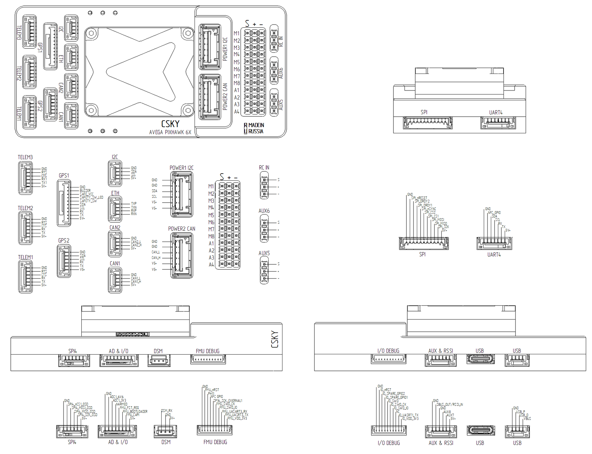

# CSKY_AVEGA6X

The CSKY_AVEGA6X autopilot is manufactured by [CSKY](https://csky.space).

## Where to Buy

[Manufacturer Store](https://csky.space/avega6X)

## Specifications

- Processor
  - STM32H743 FMU: 32-bit Arm® Cortex®-M7, 480 MHz, 2 MB flash, 1 MB RAM
  - STM32F103 IOMCU: 32-bit Arm® Cortex®-M3
- Sensors
  - BMM150 magnetometer
  - BMP388 barometer
  - ICP201xx barometers ×2
  - IMU board Rev1: ICM45686, BMI088, ICM42670
  - IMU board Rev2: 2× ICM45686
- Storage
  - microSD card
  - FRAM (32 KB parameter storage)
- Interfaces
  - 2× USB (OTG1, OTG2)
  - 7 UARTs + IOMCU UART, 3 with RTS/CTS flow control
  - 2× CAN (CAN1, CAN2)
  - 4× I2C (1 internal; 3 external)
  - 5× SPI (1 external; 4 internal)
  - Ethernet 100 Mbps, LAN8742A PHY
  - 8× FMU PWM outputs (SERVO9-16)
  - 8× IOMCU PWM outputs (M1-M8)
  - 1× RC input (single-wire)
  - FMU Debug and I/O Debug ports (SWD)
  - Safety switch, buzzer, RGB status LED
- Power
  - Servo power input: 0–36 V
  - USB voltage: 4.75–5.25 V
  - Total current limit for remaining ports: 1.5 A
  - Telem1 port current limit: 1.5 A
- Dimensions
  - Standard Baseboard: 47.5 × 97.5 × 17.1 mm
  - FMU: 38.8 × 31.8 × 22.4 mm
  - Weight: Standard Baseboard 65 g; FMU 30 g
  - Operating temperature: −40 to +85 °C

## Pinout

## UART Mapping

| Serial  | UART  | Default Protocol | Notes |
|---------|-------|------------------|-------|
| SERIAL0 | OTG1  | MAVLink2         | USB   |
| SERIAL1 | UART7 | MAVLink2         | TELEM1 (Flow control) |
| SERIAL2 | UART5 | MAVLink2         | TELEM2 (Flow control) |
| SERIAL3 | USART1| GPS              | GPS1  |
| SERIAL4 | UART8 | GPS              | GPS2  |
| SERIAL5 | USART2| None             | TELEM3 (Flow control) |
| SERIAL6 | UART4 | None             | User  |
| SERIAL7 | USART3| None             | Debug UART |
| SERIAL8 | OTG2  | MAVLink2         | Second USB port (serial channel) |

*Note: USART6 is dedicated to the IOMCU and is not exposed as a user serial port.*

## PWM Output

The board features both FMU and IOMCU PWM outputs.

- **IOMCU Outputs (M1–M8)**: Standard DShot supported on all. Bi-Directional DShot is supported on M1–M4 when `BRD_IO_DSHOT` = 1.
- **FMU Outputs (SERVO9–16)**:
  - A1–A4: Bi-Directional DShot supported.
  - AUX5–AUX6: Bi-Directional DShot supported.
  - AUX7–AUX8: Mapped to PWM 7–8 (TIM12). They lack DMA and therefore **do not support DShot**.

Channels within the same timer group must use the same output rate. If any channel in a group uses DShot, all channels in that group must use DShot.

## RC Input

The board has a single-wire RC input (`RC IN`) supporting PPM, S.Bus, and other single-wire protocols.

For serial protocols such as CRSF, ELRS, or SRXL2, use a spare UART (e.g., SERIAL6) and set `SERIALx_PROTOCOL` to `23` (RCIN). See the ArduPilot [RC systems](https://ardupilot.org/copter/docs/common-rc-systems.html) documentation for protocol-specific options.

## CAN

The board has two CAN ports. To use them, set the following parameters:

- `CAN_P1_DRIVER` = 1 (for CAN1)
- `CAN_P2_DRIVER` = 1 (for CAN2)

## GPIOs

The following GPIOs are available for user configuration via the `relay` and `button` parameters:

| Pin | GPIO |
|-----|------|
| PWM 1–8 | 50–57 |
| FMU_CAP1 | 58 |
| NFC_GPIO | 60 |

## Battery Monitoring

The board can monitor batteries via the POWER1 or POWER2 ports. By default, battery monitoring is disabled (`BATT_MONITOR` = 0).

**Important:** The flight controller can be powered by only one source at a time — either POWER1, POWER2, or USB. Simultaneous power from multiple sources is not supported and may damage the board.

To enable battery monitoring, set `BATT_MONITOR` based on the port you are using:

- **POWER1 (I2C)**: Supports the INA226 battery monitor. Set `BATT_MONITOR` = 21.
- **POWER2 (CAN)**: Supports DroneCAN battery monitors. Set `BATT_MONITOR` = 8.
- **AD&IO Analog**: Supports an analog voltage/current sensor. Set `BATT_MONITOR` = 4. The required pins are configured as follows:
  - `BATT_VOLT_PIN` = 13
  - `BATT_CURR_PIN` = 12
  - `BATT_VOLT_MULT` = 18.18
  - `BATT_AMP_PERVLT` = 262

## Compass

The board has a built-in BMM150 magnetometer. An external compass can be connected via any exposed I2C port.

## Debug Ports

The board features two separate SWD debug ports:

- **FMU Debug**: For the main STM32H743 processor.
- **I/O Debug**: For the STM32F103 IOMCU processor.

These ports can be used to flash firmware or debug the respective processors using standard SWD tools (e.g., ST-Link).

## Loading Firmware

Firmware for the CSKY_AVEGA6X can be found on the [ArduPilot firmware server](https://firmware.ardupilot.org).

You can load firmware in two ways:

1. **Normal Flashing (via USB/DFU)**: Use Mission Planner or QGroundControl to flash the `.apj` file. Alternatively, you can flash the `with_bl.hex` file using DFU mode.
2. **SD Card Flashing**: The bootloader can automatically flash a file from an SD card.
   - **Note:** The file **must** be named exactly `ardupilot.abin` and placed in the root directory of the SD card. Other names (like `.apj` or downloaded `.abin` names) will be ignored.
