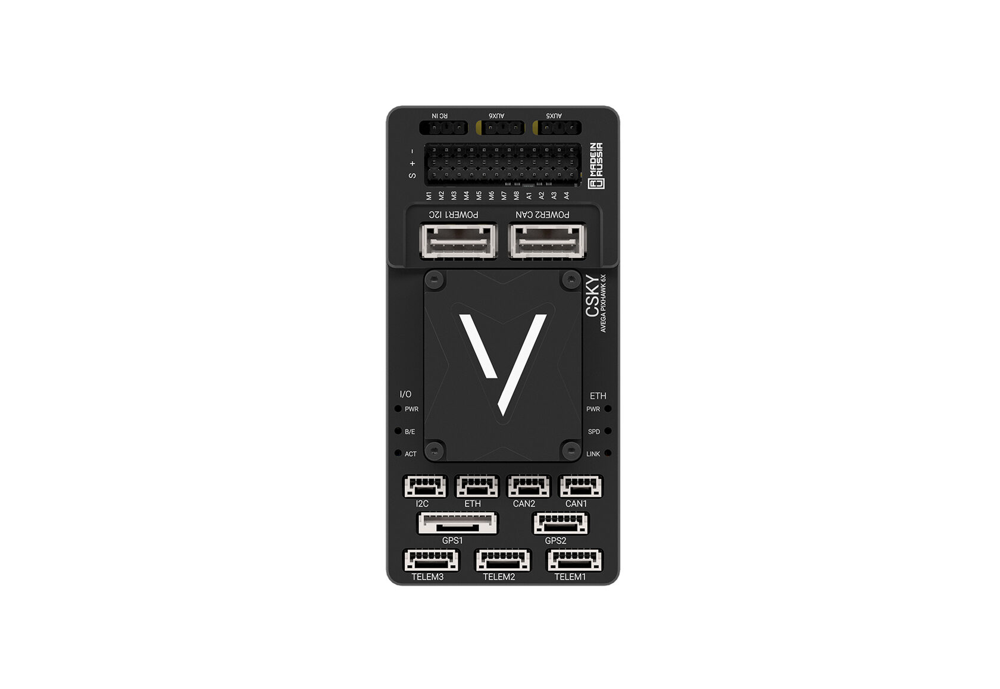

# CSKY_AVEGA6X

The CSKY_AVEGA6X autopilot is manufactured by [CSKY](https://csky.space).

## Where to Buy

[Manufacturer Store](https://csky.space/avega6X)

## Specifications

- Processor
  - STM32H743 FMU: 32-bit Arm® Cortex®-M7, 480 MHz, 2 MB flash, 1 MB RAM
  - STM32F103 IOMCU: 32-bit Arm® Cortex®-M3
- Sensors
  - BMM150 magnetometer (I2C, with heater compensation)
  - BMP388 barometer (I2C)
  - ICP201xx barometers ×2 (I2C)
  - IMU board: 2× ICM45686 (SPI2, SPI3)
  - IMU heater with `HAL_HEATER_MAG_OFFSET_BMM150` compensation
- Storage
  - microSD card (SDMMC2)
  - FRAM (RAMTRON, SPI5) — 32 KB parameter storage
- Interfaces
  - 2× USB (OTG1, OTG2)
  - 7 UARTs + IOMCU UART (USART6), 3 with RTS/CTS flow control
  - 2× CAN (CAN1, CAN2)
  - 4× I2C (I2C4 internal; I2C1, I2C2, I2C3 external)
  - 5× SPI (SPI4 external; SPI1/2/3/5 internal)
  - Ethernet 100 Mbps, LAN8742A PHY (RMII)
  - 8× PWM outputs (FMU timers), DShot and Bi-Directional DShot capable
  - 1× RC input (single-wire, TIM8_CH1)
  - Safety switch, buzzer, RGB status LED
- Power
  - Servo power input: 0–36 V
  - USB voltage: 4.75–5.25 V
  - Total current limit for remaining ports: 1.5 A
  - Telem1 port current limit: 1.5 A
- Dimensions
  - Standard Baseboard: 47.5 × 97.5 × 17.1 mm
  - FMU: 38.8 × 31.8 × 22.4 mm
  - Weight: Standard Baseboard 65 g; FMU 30 g
  - Operating temperature: −40 to +85 °C

## Pinout

Similar to Pixhawk6X

## UART Mapping

The UARTs are marked `Rn` and `Tn` on the board silkscreen. The `Rn` pin is the receive pin for UART `n`; the `Tn` pin is the transmit pin for UART `n`.

| Serial  | UART  |  Default Protocol | TX DMA | RX DMA |          Notes          |
|---------|-------|-------------------|--------|--------|-------------------------|
| SERIAL0 | OTG1  |     MAVLink2      |   ✘    |    ✘   |           USB           |
| SERIAL1 | UART7 |     MAVLink2      |   ✔    |    ✔   | Flow control (RTS/CTS)  |
| SERIAL2 | UART5 |     MAVLink2      |   ✔    |    ✔   | Flow control (RTS/CTS)  |
| SERIAL3 | USART1|       GPS         |   ✔    |    ✔   |           GPS1          |
| SERIAL4 | UART8 |       GPS         |   ✔    |    ✔   |           GPS2          |
| SERIAL5 | USART2|      Serial       |   ✔    |    ✔   | Flow control (RTS/CTS)  |
| SERIAL6 | UART4 |      Serial       |   ✔    |    ✔   |           User          |
| SERIAL7 | USART3|      Serial       |   ✔    |    ✔   |        Debug UART       |
| SERIAL8 | OTG2  |     MAVLink2      |   ✘    |    ✘   |     Second USB port     |

USART6 is dedicated to the IOMCU (`IOMCU_UART USART6`) and is not exposed as a user serial port.

DMA capability is enabled for all UARTs listed above by default, as no `NODMA` flag is specified for them in `hwdef.dat`. The USB ports do not use DMA.

## PWM Output

The board has 8 PWM outputs, all on FMU timers:

- PWM 1–4: TIM5 (Bi-Directional DShot on PWM 1 and 3)
- PWM 5–6: TIM4 (Bi-Directional DShot on both)
- PWM 7–8: TIM12 (no DMA — DShot timing may be affected)

Channels within the same timer group must use the same output rate. If any channel in a group uses DShot, all channels in that group must use DShot. IOMCU firmware includes `HAL_WITH_IO_MCU_BIDIR_DSHOT 1`.

## RC Input

The board has a single-wire RC input on `TIM8_CH1` (`PI5`), supporting PPM, S.Bus, and other single-wire protocols.

For serial protocols such as CRSF, ELRS, or SRXL2, use a spare UART (e.g. SERIAL6/UART4) and set `SERIALx_PROTOCOL` to `23` (RCIN). See the ArduPilot [RC systems](https://ardupilot.org/copter/docs/common-rc-systems.html) documentation for protocol-specific options.

## GPIOs

GPIO assignments defined in the hwdef:

| Pin           | GPIO  |
|---------------|-------|
|    PWM 1–8    | 50–57 |
|    FMU_CAP1   |  58   |
|    NFC_GPIO   |  60   |
| SPEKTRUM_PWR  |  73   |
|     ALARM     |  77   |
|   HEATER_EN   |  80   |
|    LED_RED    |  90   |
|   LED_GREEN   |  91   |
|   LED_BLUE    |  92   |
|   SP3_DRDY2   |  93   |

User-configurable GPIOs are available via the `relay` and `button` parameters.

## RSSI / Airspeed / Analog Pins

The board exposes 4 analog inputs (`SCALED1_V3V3` … `SCALED4_V3V3`) plus `VDD_5V_SENS`, in addition to the battery voltage/current sense pins. Dedicated analog RSSI and airspeed pins are not defined in the hwdef; if used, configure `RSSI_ANA_PIN` / `ARSPD_PIN` to one of the available ADC channels.

## Battery Monitoring

The board has an analog voltage/current sensor and optional INA226 support on I2C1.

Default parameters:

- `BATT_MONITOR` = 4
- `BATT_VOLT_PIN` = 13
- `BATT_CURR_PIN` = 12
- `BATT_VOLT_MULT` = 18.18
- `BATT_AMP_PERVLT` = 262

`HAL_BATTMON_INA2XX_BUS 1` is defined; to use an INA226 instead of the analog sensor, set `BATT_MONITOR` = 21.

## Compass

The board has a built-in BMM150 magnetometer at I2C address 0x10 on the internal I2C bus. Heater-induced field offset is compensated via `HAL_HEATER_MAG_OFFSET_BMM150`. An external compass can be connected via any exposed I2C port.

## Firmware

Firmware for the CSKY_AVEGA6X is built as the `CSKY_AVEGA6X` target in ArduPilot
