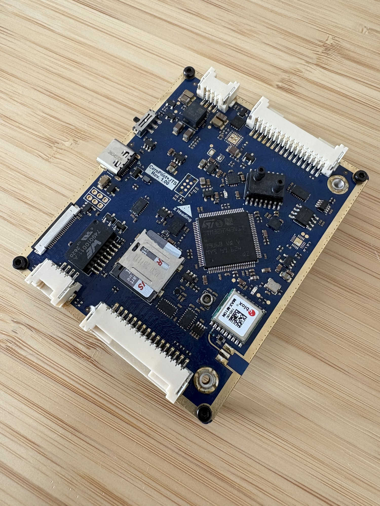
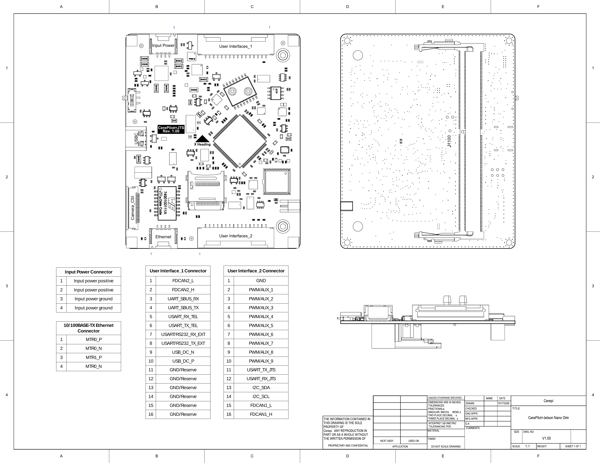

# CerePilot V1.00 Flight Controller

The CerePilot V1.00 by Cerepi puts an STM32H743 flight management unit and an
NVIDIA Jetson Orin Nano carrier on a single 80 x 65 mm board, so the autopilot
and the companion computer share one assembly and one power input.

## Where to Buy

Available from Cerepi: <https://www.cerepi.com>

## Features

- STM32H743VIT6, 480 MHz Cortex-M7, 2 MB flash
- BMI088 and ISM330DLC IMUs
- BMM350 magnetometer
- BMP585 barometer
- SM9541 differential pressure sensor, -100 to +100 cmH2O
- u-blox MAX-M10N GNSS on board, MMCX antenna connector
- 32 KB FM25V02A FRAM for parameter storage
- microSD card slot for logging
- 9 PWM outputs
- 2 CAN FD ports, each with a fitted 120 Ohm termination
- 5 serial ports, including an RS-232 port and a link to the on-board Jetson
- 1 external I2C port
- USB
- Connector for an NVIDIA Jetson Orin Nano module on the bottom side

## Physical

| Parameter | Value |
|-----------|-------|
| PCB size | 80.00 x 65.00 mm |
| Mounting holes | 75.30 x 60.30 mm pattern, 2 mm diameter |
| Weight | 55 g |
| Input voltage | 6.5 V to 26 V (2S to 6S LiPo) |

The input is protected against reverse polarity, over and under voltage, over
current, short circuit and surges, and is soft started.

## Pinout

The two 16-pin user connectors are JST SM16B-ZESS-TB; the mating part is JST
ZER-16V-S. Input power and Ethernet are JST SM04B-ZESS-TB, mating ZER-04V-S.

### User Interface_1 - telemetry, RC, RS-232, CAN2, USB

| Pin | Signal | Notes |
|-----|--------|-------|
| 1  | CAN2_L | 120 Ohm termination fitted on board |
| 2  | CAN2_H | |
| 3  | SBUS RX | RC input, SERIAL5 |
| 4  | SBUS TX | SERIAL5 |
| 5  | TELEM1 RX | SERIAL1 |
| 6  | TELEM1 TX | SERIAL1 |
| 7  | RS-232 RX | SERIAL4, RS-232 levels |
| 8  | RS-232 TX | SERIAL4, RS-232 levels |
| 9  | USB D- | FMU USB |
| 10 | USB D+ | FMU USB |
| 11-16 | GND / reserved | |

### User Interface_2 - PWM outputs, CAN1, external I2C, companion UART

| Pin | Signal | Notes |
|-----|--------|-------|
| 1  | GND | |
| 2-10 | SERVO1 to SERVO9 | |
| 11 | SERIAL2 TX | shared with the on-board Jetson, see below |
| 12 | SERIAL2 RX | shared with the on-board Jetson, see below |
| 13 | I2C SDA | external I2C |
| 14 | I2C SCL | external I2C |
| 15 | CAN1_L | 120 Ohm termination fitted on board |
| 16 | CAN1_H | |

All signals are 3.3 V logic except the RS-232 pair on User Interface_1.

## UART Mapping

| Serial | Port | Default protocol | Connector |
|--------|------|------------------|-----------|
| SERIAL0 | USB | MAVLink2 | User Interface_1 |
| SERIAL1 | UART7 | MAVLink2 (TELEM1) | User Interface_1 |
| SERIAL2 | UART8 | MAVLink2 | on-board Jetson |
| SERIAL3 | UART4 | GPS | on-board MAX-M10N |
| SERIAL4 | USART1 | MAVLink2 | User Interface_1, RS-232 levels |
| SERIAL5 | USART2 | RCIN | User Interface_1 |

No port has RTS/CTS flow control pins. All ports have DMA except SERIAL4,
which is a low rate console port and is polled so that the DMA streams can
go to the PWM timers instead.

## Companion Computer

The on-board Jetson Orin Nano is wired to the FMU on **SERIAL2** (UART8),
reaching the Jetson's UART1. It defaults to MAVLink2 at 57600 baud, and the
serial link itself needs no jumpers or external wiring. Raise `SERIAL2_BAUD`
on both ends if the companion link needs more throughput.

This same signal pair is also brought out on User Interface_2 pins 11 and 12,
so the link has three endpoints: the FMU, the Jetson, and the connector. Leave
those two pins unconnected when using the on-board Jetson. Driving them from
an external device puts two transmitters on one line.

### Jetson Power

The FMU drives the module's power enable and reset lines through inverting
buffers, so a high output holds the module off. The bootloader and the
firmware both leave them high, which means the Jetson stays powered down
until something releases them.

| Line | GPIO | Direction | State at boot |
|------|------|-----------|---------------|
| POWER_EN | 72 | output | high, module powered down |
| SYS_RESET | 71 | output | high, module held in reset |
| SHUTDOWN_REQ | 70 | input | read only |

The module needs POWER_EN released first and SYS_RESET released at least
80 ms later, so driving both low together does not start it. ArduPilot has no
driver for this sequence, so release the lines from a Lua script:

    gpio:write(72, 0)        -- release POWER_EN
    return function()
      gpio:write(71, 0)      -- release SYS_RESET
    end, 150

The board also carries a Jetson Off/ON slide switch.

## RC Input

RC input is on **SERIAL5** (USART2), which defaults to `SERIAL5_PROTOCOL = 23`
(RCIN). The RC pad is User Interface_1 pin 3, which is USART2 RX, so a
receiver's serial output wires straight to it: SBUS, CRSF, FPort and IBUS are
all auto-detected.

Returning telemetry to the receiver needs half-duplex, which drives the line
on the USART2 TX pin, pin 4 of the same connector. Wire a half-duplex receiver
to pin 4 and set `SERIAL5_OPTIONS = 4` (HalfDuplex), or add SwapTXRX for
`SERIAL5_OPTIONS = 12` to keep the receiver on pin 3.

## PWM Output

Nine PWM outputs, SERVO1 to SERVO9. Outputs sharing a timer must use the same
output rate and protocol:

| Outputs | Timer |
|---------|-------|
| 1, 2 | TIM3 |
| 3, 4 | TIM1 |
| 5    | TIM2 |
| 6, 7 | TIM4 |
| 8, 9 | TIM15 |

Every timer has its own DMA stream, so all nine support regular PWM, OneShot
and DShot. The outputs are buffered by level translators, which bidirectional
DShot telemetry does not pass through, so bidirectional DShot is not
available on this board.

## GPIOs

Any PWM output not assigned to a motor or servo can be used as a GPIO by
setting its `SERVOn_FUNCTION` to -1. The pin numbers are:

| Output | Pin | | Output | Pin |
|--------|-----|-|--------|-----|
| SERVO1 | 50 | | SERVO6 | 55 |
| SERVO2 | 51 | | SERVO7 | 56 |
| SERVO3 | 52 | | SERVO8 | 57 |
| SERVO4 | 53 | | SERVO9 | 58 |
| SERVO5 | 54 | | | |

## OSD Support

The board has no on-board OSD. MSP DisplayPort and other serial OSD
protocols are supported on any spare serial port.

## Battery Monitoring

The board has no internal voltage or current sensing and expects an I2C smart
power module on the external I2C port. The defaults are set for an INA2xx
module:

- `BATT_MONITOR = 21`

Reboot after changing `BATT_MONITOR`, then set the module's parameters as
required.

## Analog Inputs

The analog inputs measure the supply rails, each through a 10K/10K divider.
The 5 V input on pin 5 is the board voltage, which ArduPilot logs and reports
in `POWER_STATUS`, so a sagging supply shows up there. The 3.3 V and 1.8 V
rails are plain analog channels with no default consumer; read them from Lua
or assign them to a parameter which takes an analog pin.

| ArduPilot pin | Rail |
|---------------|------|
| 5  | 5 V input |
| 4  | 3.3 V main |
| 9  | 3.3 V sensor |
| 10 | 3.3 V BMI088 |
| 11 | 1.8 V sensor |

## Compass

The BMM350 magnetometer is fitted on an internal I2C bus and enabled by
default. External compasses are supported on the external I2C port.

## Airspeed

An SM9541-100C-D differential pressure sensor is fitted on an internal I2C bus
and is enabled by default:

- `ARSPD_TYPE = 21`
- `ARSPD_BUS = 1`

The sensor spans -100 to +100 cmH2O (about +/- 9.8 kPa) and reports its own
temperature. Connect the pitot and static lines to the two ports; with the
differential part either port may be the higher pressure.

## Storage

Parameters are stored in FRAM. Logs are written to the microSD card, which
must be inserted before power-up to be detected.

## CAN

Two CAN ports, CAN1 on User Interface_2 and CAN2 on User Interface_1. Both
have a 120 Ohm termination resistor fitted on the board, so the CerePilot
counts as one end of the bus.

Both ports are enabled by default and share one driver
(`CAN_P1_DRIVER = 1`, `CAN_P2_DRIVER = 1`), so `CAN_D1_PROTOCOL` sets the
protocol for both and `CAN_D2_PROTOCOL` has no effect. Set
`CAN_P2_DRIVER = 2` if CAN2 needs a protocol of its own.

## LEDs

Two status LEDs, green and blue, driven by the standard ArduPilot notify
patterns. The green LED also indicates bootloader activity.

## Loading Firmware

The board ships with the ArduPilot bootloader installed, so firmware is loaded
with `*.apj` files through a ground station or with:

    ./waf configure --board CerePilotV100
    ./waf copter --upload

To install or recover the bootloader itself, load `CerePilotV100_bl.hex` with
STM32CubeProgrammer over SWD (connect-under-reset, `-c port=SWD mode=UR`), or
use DFU.

