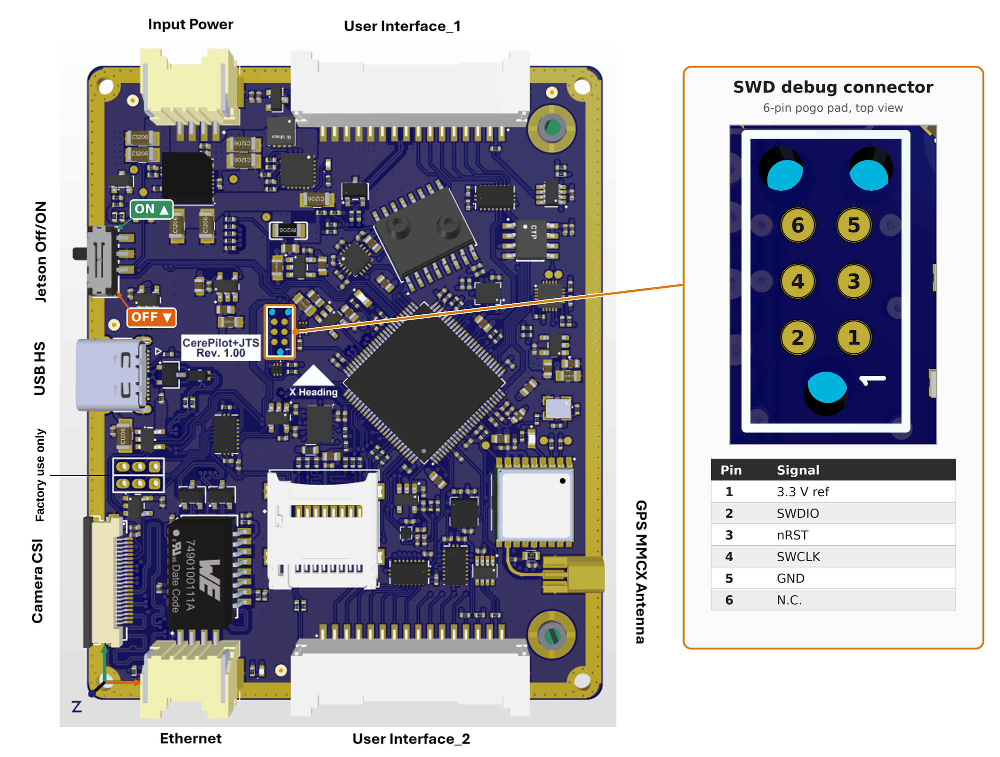

# CerePilot V1.00 Flight Controller

The CerePilot V1.00 by Cerepi puts an STM32H743 flight management unit and an
NVIDIA Jetson Orin Nano carrier on a single 80 x 65 mm board, so the autopilot
and the companion computer share one assembly and one power input.

## Where to Buy

Available from Cerepi: <https://www.cerepi.com>

## Features

- STM32H743VIT6, 480 MHz Cortex-M7, 2 MB flash
- BMI088 and ISM330DLC IMUs
- BMM350 magnetometer
- BMP585 barometer
- SM9541 differential pressure sensor, -100 to +100 cmH2O
- u-blox MAX-M10N GNSS on board, MMCX antenna connector
- 32 KB FM25V02A FRAM for parameter storage
- microSD card slot for logging
- 9 PWM outputs
- 2 CAN FD ports, each with a fitted 120 Ohm termination
- 5 serial ports, including an RS-232 port and a link to the on-board Jetson
- 1 external I2C port
- USB
- Connector for an NVIDIA Jetson Orin Nano module on the bottom side

## Physical

| Parameter | Value |
|-----------|-------|
| PCB size | 80.00 x 65.00 mm |
| Mounting holes | 75.30 x 60.30 mm pattern, 2 mm diameter |
| Weight | 35 g, without the Jetson module |
| Input voltage | 6.5 V to 26 V (2S to 6S LiPo) |

The input is protected against reverse polarity, over and under voltage, over
current, short circuit and surges, and is soft started.

## Pinout

This view names every connector and port, and shows where the SWD debug pads,
the Jetson Off/ON switch and the GNSS antenna connector sit on the board:

The 2x3 through-hole pad group beside the USB-C connector is for factory use
only.

The two 16-pin user connectors are JST SM16B-ZESS-TB; the mating part is JST
ZER-16V-S. Input power and Ethernet are JST SM04B-ZESS-TB, mating ZER-04V-S.

Neither User Interface connector supplies power. Receivers, servos, external
I2C devices and CAN peripherals all need their own supply. The GND/Reserve
pins on User Interface_1 and pin 1 of User Interface_2 are ground only.

Three of the board's connectors belong to the on-board Jetson rather than the
FMU:

| Connector | Goes to | Function |
|-----------|---------|----------|
| Input Power | board | 6.5 V to 26 V supply for the whole board |
| User Interface_1 | FMU | telemetry, RC, RS-232, CAN2, USB |
| User Interface_2 | FMU | PWM outputs, CAN1, external I2C, companion UART |
| Ethernet | Jetson | 10/100BASE-TX |
| Camera_CSI | Jetson | 22-pin CSI camera connector |
| USB-C | Jetson | USB 2.0 high speed host port |

The USB-C connector is the Jetson's, not the FMU's, and the two are not in
parallel. The FMU's own USB is on User Interface_1, pins 9 and 10.

### User Interface_1 - telemetry, RC, RS-232, CAN2, USB

| Pin | Signal | Notes |
|-----|--------|-------|
| 1  | FDCAN2_L | CAN2, 120 Ohm termination fitted on board |
| 2  | FDCAN2_H | CAN2 |
| 3  | UART_SBUS_RX | SERIAL5, RC input |
| 4  | UART_SBUS_TX | SERIAL5 |
| 5  | USART_RX_TEL | SERIAL1, TELEM1 RX |
| 6  | USART_TX_TEL | SERIAL1, TELEM1 TX |
| 7  | USART/RS232_RX_EXT | SERIAL4, RS-232 levels |
| 8  | USART/RS232_TX_EXT | SERIAL4, RS-232 levels |
| 9  | USB_DC_N | FMU USB D- |
| 10 | USB_DC_P | FMU USB D+ |
| 11-16 | GND/Reserve | |

### User Interface_2 - PWM outputs, CAN1, external I2C, companion UART

| Pin | Signal | Notes |
|-----|--------|-------|
| 1  | GND | |
| 2  | PWM/AUX_1 | SERVO1 |
| 3  | PWM/AUX_2 | SERVO2 |
| 4  | PWM/AUX_3 | SERVO3 |
| 5  | PWM/AUX_4 | SERVO4 |
| 6  | PWM/AUX_5 | SERVO5 |
| 7  | PWM/AUX_6 | SERVO6 |
| 8  | PWM/AUX_7 | SERVO7 |
| 9  | PWM/AUX_8 | SERVO8 |
| 10 | PWM/AUX_9 | SERVO9 |
| 11 | USART_TX_JTS | SERIAL2 TX, shared with the on-board Jetson, see below |
| 12 | USART_RX_JTS | SERIAL2 RX, shared with the on-board Jetson, see below |
| 13 | I2C_SDA | external I2C |
| 14 | I2C_SCL | external I2C |
| 15 | FDCAN1_L | CAN1, 120 Ohm termination fitted on board |
| 16 | FDCAN1_H | CAN1 |

All signals are 3.3 V logic except the RS-232 pair on User Interface_1.

### Ethernet - Jetson only

| Pin | Signal |
|-----|--------|
| 1  | MTR0_P |
| 2  | MTR0_N |
| 3  | MTR1_P |
| 4  | MTR1_N |

This port is wired to the on-board Jetson. The STM32H743 has no Ethernet
interface on this board, so ArduPilot neither uses nor configures it. The pins
are the transformer side of the on-board magnetics, and the connector shield
is tied to ground.

## UART Mapping

| Serial | Port | Default protocol | Connector |
|--------|------|------------------|-----------|
| SERIAL0 | USB | MAVLink2 | User Interface_1 |
| SERIAL1 | UART7 | MAVLink2 (TELEM1) | User Interface_1 |
| SERIAL2 | UART8 | MAVLink2 | on-board Jetson |
| SERIAL3 | UART4 | GPS | on-board MAX-M10N |
| SERIAL4 | USART1 | MAVLink2 | User Interface_1, RS-232 levels |
| SERIAL5 | USART2 | RCIN | User Interface_1 |

No port has RTS/CTS flow control pins. All ports have DMA except SERIAL4,
which is a low rate console port and is polled so that the DMA streams can
go to the PWM timers instead.

## Companion Computer

The on-board Jetson Orin Nano is wired to the FMU on **SERIAL2** (UART8),
reaching the Jetson's UART1. It defaults to MAVLink2 at 57600 baud, and the
serial link itself needs no jumpers or external wiring. Raise `SERIAL2_BAUD`
on both ends if the companion link needs more throughput.

This same signal pair is also brought out on User Interface_2 pins 11 and 12,
so the link has three endpoints: the FMU, the Jetson, and the connector. Leave
those two pins unconnected when using the on-board Jetson. Driving them from
an external device puts two transmitters on one line.

### Jetson Power

The FMU drives the module's power enable and reset lines through open-drain
MOSFET inverters, so a high output holds the module off, and so does a pin
left floating. The bootloader and the firmware both leave them high, which
means the Jetson stays powered down until something releases them.

| Line | GPIO | Direction | State at boot |
|------|------|-----------|---------------|
| POWER_EN | 72 | output | high, module powered down |
| SYS_RESET | 71 | output | high, module held in reset |
| SHUTDOWN_REQ | 70 | input | read only |

The module needs POWER_EN released first and SYS_RESET released at least
64 ms later, so driving both low together does not start it. ArduPilot has no
driver for this sequence, so release the lines from a Lua script:

    gpio:write(72, 0)        -- release POWER_EN
    return function()
      gpio:write(71, 0)      -- release SYS_RESET
    end, 150

Scripting is off by default, so set `SCR_ENABLE` to 1, put the script in
`APM/scripts` on the microSD card and reboot.

The board also carries a Jetson Off/ON slide switch, wired across POWER_EN and
ground. OFF holds POWER_EN low, so the module stays powered down whatever
GPIO 72 does. ON leaves POWER_EN to the FMU, so the script above is still what
starts the module.

## RC Input

RC input is configured on SERIAL5 (USART2), which defaults to
`SERIAL5_PROTOCOL = 23` (RCIN). Unidirectional receiver protocols (SBUS, iBUS,
DSM and similar) connect to UART_SBUS_RX, User Interface_1 pin 3. PPM is not
supported.

For CRSF/ELRS, which is full duplex, connect the receiver's TX to
UART_SBUS_RX (pin 3) and its RX to UART_SBUS_TX (pin 4), and leave
`SERIAL5_OPTIONS` at 0.

Half-duplex protocols that share one wire, such as SRXL2 and FPort, have not
been tested on this board.

See [RC systems](https://ardupilot.org/plane/docs/common-rc-systems.html) for
details.

## PWM Output

Nine PWM outputs, PWM/AUX_1 to PWM/AUX_9. Outputs sharing a timer must use the
same output rate and protocol:

| Outputs | Timer |
|---------|-------|
| PWM/AUX_1, PWM/AUX_2 | TIM3 |
| PWM/AUX_3, PWM/AUX_4 | TIM1 |
| PWM/AUX_5 | TIM2 |
| PWM/AUX_6, PWM/AUX_7 | TIM4 |
| PWM/AUX_8, PWM/AUX_9 | TIM15 |

Every timer has its own DMA stream, so all nine support regular PWM, OneShot
and DShot. All nine outputs also support bidirectional DShot. The outputs pass
through TXS0108E buffers before reaching the connector; bidirectional DShot has
not been tested on this board.

## GPIOs

Any PWM output not assigned to a motor or servo can be used as a GPIO by
setting its `SERVOn_FUNCTION` to -1. The pin numbers are:

| Output | Pin | | Output | Pin |
|--------|-----|-|--------|-----|
| PWM/AUX_1 | 50 | | PWM/AUX_6 | 55 |
| PWM/AUX_2 | 51 | | PWM/AUX_7 | 56 |
| PWM/AUX_3 | 52 | | PWM/AUX_8 | 57 |
| PWM/AUX_4 | 53 | | PWM/AUX_9 | 58 |
| PWM/AUX_5 | 54 | | | |

## OSD Support

The board has no on-board OSD. MSP DisplayPort and other serial OSD
protocols are supported on any spare serial port.

## Battery Monitoring

The board has no internal voltage or current sensing and expects an I2C smart
power module on the external I2C port. The defaults are set for an INA2xx
module:

- `BATT_MONITOR = 21`

Reboot after changing `BATT_MONITOR`, then set the module's parameters as
required.

## Analog Inputs

The analog inputs measure the supply rails, each through a 10K/10K divider.
The 5 V input on pin 5 is the board voltage, which ArduPilot logs and reports
in `POWER_STATUS`, so a sagging supply shows up there. The 3.3 V and 1.8 V
rails are plain analog channels with no default consumer; read them from Lua
or assign them to a parameter which takes an analog pin.

| ArduPilot pin | Rail |
|---------------|------|
| 5  | 5 V input |
| 4  | 3.3 V main |
| 9  | 3.3 V sensor |
| 10 | 3.3 V BMI088 |
| 11 | 1.8 V sensor |

## Compass

The CerePilot V1.00 has a built-in compass (BMM350). Due to potential
interference, the autopilot is usually used with an external I2C compass as
part of a GPS/Compass combination, connected to the I2C_SDA/I2C_SCL pins on
User Interface_2.

## Airspeed

An SM9541-100C-D differential pressure sensor is fitted on an internal I2C bus
and is enabled by default:

- `ARSPD_TYPE = 21`
- `ARSPD_BUS = 1`

The sensor spans -100 to +100 cmH2O (about +/- 9.8 kPa) and reports its own
temperature. Connect the pitot and static lines to the two ports; with the
differential part either port may be the higher pressure.

## Storage

Parameters are stored in FRAM. Logs are written to the microSD card, which
must be inserted before power-up to be detected.

## CAN

Two CAN ports, CAN1 on User Interface_2 and CAN2 on User Interface_1. Both
have a 120 Ohm termination resistor fitted on the board, so the CerePilot
counts as one end of the bus.

Both ports are enabled by default and share one driver
(`CAN_P1_DRIVER = 1`, `CAN_P2_DRIVER = 1`), so `CAN_D1_PROTOCOL` sets the
protocol for both and `CAN_D2_PROTOCOL` has no effect. Set
`CAN_P2_DRIVER = 2` if CAN2 needs a protocol of its own.

## LEDs

Two status LEDs, green and blue, driven by the standard ArduPilot notify
patterns. The green LED also indicates bootloader activity.

## Loading Firmware

Firmware for the CerePilot V1.00 is available from [ArduPilot Firmware
Server](https://firmware.ardupilot.org) under the `CerePilotV100` target.

The board comes pre-installed with an ArduPilot compatible bootloader, allowing
the loading of *.apj firmware files with any ArduPilot compatible ground
station.

To install or recover the bootloader itself, load `CerePilotV100_bl.hex` with
STM32CubeProgrammer over SWD (connect-under-reset, `-c port=SWD mode=UR`). SWD
is a six-pin pogo pad beside the board revision label; the connector image in
the Pinout section shows its position and signals.

