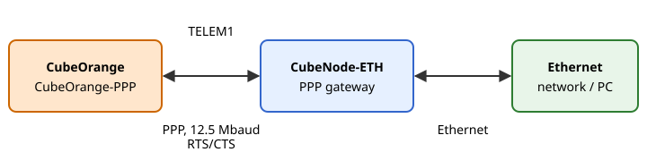

# CubeOrange-PPP

CubeOrange-PPP is firmware for the CubePilot CubeOrange which networks
the vehicle over PPP on TELEM1, through a PPP gateway such as a
CubeNode-ETH. See [CubeOrange](../CubeOrange/README.md) for the
hardware.



## Differences from CubeOrange

- PPP networking is built in, and SERIAL1 (TELEM1) defaults to PPP at
  12.5 Mbaud with hardware flow control (RTS/CTS), which are the
  CubeNode-ETH's defaults as a PPP gateway. NET_ENABLE defaults to 1.
- The bootloader serves a firmware update web page over the same PPP
  link, using the address the gateway assigns. TELEM1 is not a
  bootloader serial port; USB, TELEM2 and SERIAL5 still are.

## Firmware updates over the network

With the net_webserver.lua applet installed, its front page has a
"Firmware Update" link which reboots the vehicle into the bootloader,
whose page (on port 80) accepts a firmware .bin file.

Tools/scripts/uploader.py can do the same:

```sh
Tools/scripts/uploader.py --ip VEHICLE_IP arducopter.apj
```

Add `--mavlink tcp:VEHICLE_IP:PORT` to reboot the vehicle into the
bootloader over MAVLink instead of through the web page.
