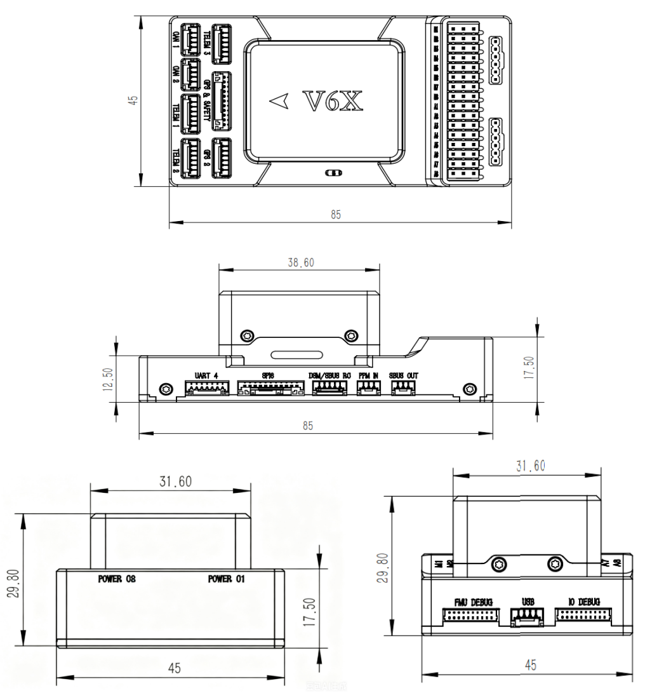
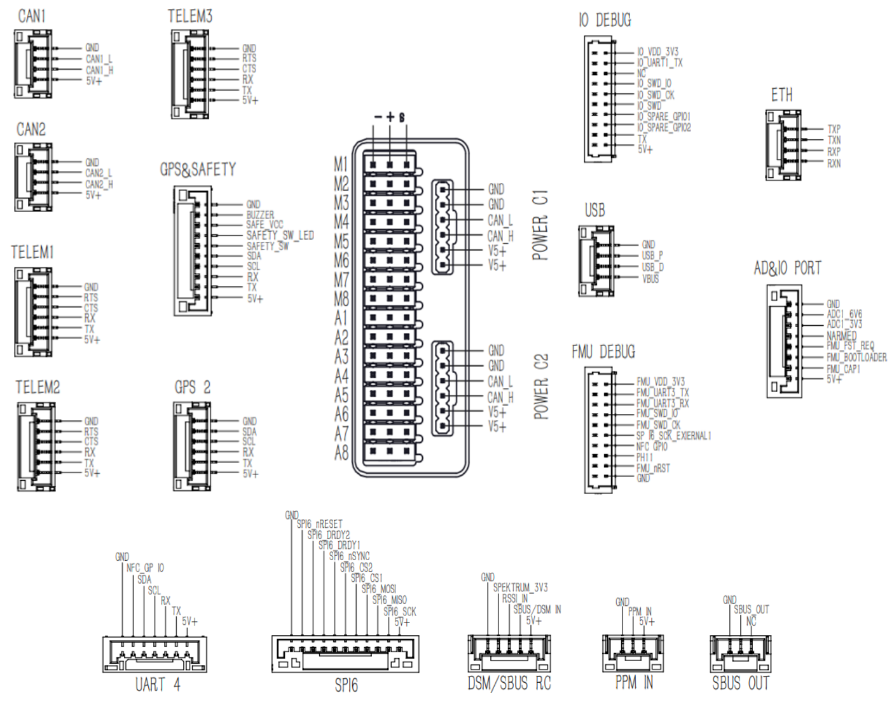

# CyberX-Cube Flight Controller

The CyberX-Cube is manufactured by [CyberCraft International Limited](http://int.woocoo.vip/).

The CyberX-Cube is a separate-flight-core autopilot with an STM32H743 FMU and an STM32F103 IO co-processor.

## Specifications

- **Processor**
  - STM32H743IIK6 32-bit main processor (400MHz, 2MB Flash, 1MB RAM)
  - STM32F103 IO co-processor (72MHz, 128KB Flash, 20KB SRAM)
- **Sensors**
  - IMU1: IIM-42652
  - IMU2: ICM-42688-P
  - IMU3: ICM-42688-P (vibration isolated)
  - Triple synced IMUs, constant-temperature IMU heating (~1W)
  - Baro1: BMP581, Baro2: ICP-20100
  - Magnetometer: IST8310 (internal)
- **Interfaces**
  - microSD card slot
  - USB-C
  - 16 PWM outputs (8 IO + 8 FMU)
  - 7 UARTs (TELEM1/TELEM2/TELEM3 with flow control) plus dedicated RC input
  - Dual CAN
  - 100Mbps Ethernet
  - Two power-monitor inputs
  - Analog/RSSI/ADC inputs
- **Power**
  - Power Voltage: 4.5V - 5.5V
  - USB Input: 4.75V - 5.25V
- **Dimensions**
  - size: 85mm x 45mm x 29.8mm
  - weight: 95.4g

## Where to Buy

[CyberCraft International Limited](http://int.woocoo.vip/)

## Pinout

## UART Mapping

The UARTs are marked RX and TX in the above pinouts. The RX pin is the receive pin for the UART. The TX pin is the transmit pin.

|  Name   | Label/Protocol      |  UART  |     DMA     |
| :-----: | :-----------------: | :----: | :---------: |
| SERIAL0 | USB, MAVLink2       |  OTG1  |             |
| SERIAL1 | TELEM1, MAVLink2    | UART7  | DMA Enabled |
| SERIAL2 | TELEM2, MAVLink2    | UART5  | DMA Enabled |
| SERIAL3 | GPS&SAFETY, GPS     | USART1 | DMA Enabled |
| SERIAL4 | GPS 2, GPS          | UART8  | DMA Enabled |
| SERIAL5 | TELEM3, MAVLink2    | USART2 | DMA Enabled |
| SERIAL6 | UART 4, None        | UART4  | DMA Enabled |
| SERIAL7 | FMU DEBUG, None     | USART3 | DMA Enabled |
| SERIAL8 | USB, MAVLink2       |  OTG2  |             |

The TELEM1/TELEM2/TELEM3 ports have RTS/CTS flow-control pins; the other UARTs do not.

## RC Input

RC input is configured on the port marked DSM/SBUS RC (via the IO co-processor) and PPM IN, and supports all unidirectional RC protocols.

For bi-directional or half-duplex protocols, such as CRSF/ELRS, a full UART should be used with its `SERIALx_PROTOCOL` set to 23. See [RC systems](https://ardupilot.org/copter/docs/common-rc-systems.html) for details for each protocol.

## SBUS OUT

The SBUS OUT port is attached to the IO co-processor and can be used to output all servo channels via SBUS. It is enabled by setting the BRD_SBUS_OUT parameter.

## PWM Output

The CyberX-Cube supports up to 16 PWM outputs. The first 8 outputs (labelled M1 to M8) are controlled by the dedicated STM32F103 IO controller. These support all PWM protocols, and DShot (Bi-directional DShot on M1-M4 only, M5-M8 get plain DShot) can be enabled by setting BRD_IO_DSHOT to 1, which loads the DShot firmware on the IO co-processor.

The remaining 8 outputs (labelled A1 to A8) are the "auxiliary" outputs directly attached to the STM32H743 FMU. A1 to A6 support all PWM protocols and Bi-Directional DShot. A7 and A8 only support PWM.

The 8 IO PWM outputs are in 3 groups:

- M1 and M2 in group1
- M3 and M4 in group2
- M5, M6, M7 and M8 in group3

The 8 FMU PWM outputs are in 3 groups:

- A1, A2, A3 and A4 in group1
- A5 and A6 in group2
- A7 and A8 in group3

Channels within the same group need to use the same output rate. If any channel in a group uses DShot then all channels in the group need to use DShot.

## GPIOs

All PWM outputs can be used as GPIOs (relays, camera, RPM, etc.). To use them you need to set the output's SERVOx_FUNCTION to -1. The GPIO numbering for the PIN variables in ArduPilot is:

- A1  50
- A2  51
- A3  52
- A4  53
- A5  54
- A6  55
- A7  56
- A8  57
- FMU_CAP1 58
- NFC_GPIO 60
- M1 101
- M2 102
- M3 103
- M4 104
- M5 105
- M6 106
- M7 107
- M8 108

## CAN

The CyberX-Cube has two independent CAN buses, enabled by default. See the CAN1 and CAN2 connectors.

## SPI6

The CyberX-Cube has a dedicated SPI6 port for connecting to external devices. The SPI6 port is available on the 11-pin connector marked SPI6 in the pinout diagram above.

SPI6 is not enabled in the standard firmware, so the SPI6 connector can only be used with a custom build.

## Ethernet

The board provides a 100Mbps Ethernet port (ETH connector). See [Networking](https://ardupilot.org/copter/docs/common-network.html) for setup.

## Battery Monitoring

The board has two DroneCAN power ports (POWER C1 and POWER C2). The first is enabled by default:

- BATT_MONITOR = 8

To use a second power module on POWER C2, set BATT2_MONITOR = 8.

## Compass

The CyberX-Cube has a built-in IST8310 compass. Due to potential interference, the autopilot is usually used with an external I2C compass as part of a GPS/compass combination.

## RSSI/Analog Inputs

The CyberX-Cube has the following analog inputs:

- Analog pin 12 -> 6.6V sense
- Analog pin 13 -> 3.3V sense
- Analog pin 103 -> RSSI voltage monitoring

To use analog RSSI on the DSM/SBUS RC connector, set `RSSI_ANA_PIN` = 103 and `RSSI_TYPE` = 1.

The 6.6V and 3.3V sense inputs (analog pins 12 and 13) are on the AD&IO PORT connector.

## Safety Switch

The safety switch is disabled by default.

## Firmware

Firmware for the CyberX-Cube can be found [here](https://firmware.ardupilot.org/) in sub-folders labeled "CyberX-Cube".

## Loading Firmware

The board comes pre-installed with an ArduPilot compatible bootloader, allowing the loading of `*.apj` firmware files with any ArduPilot compatible ground station.
