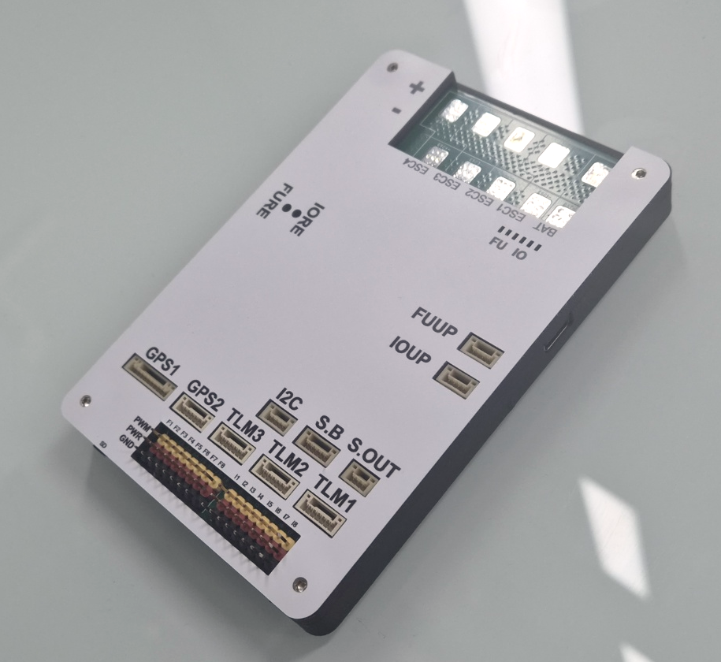
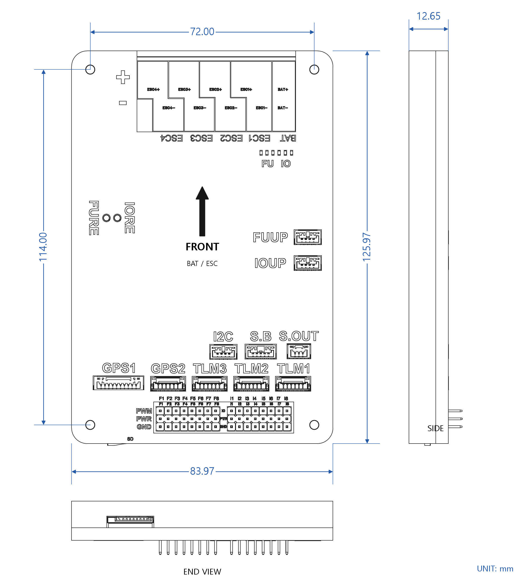
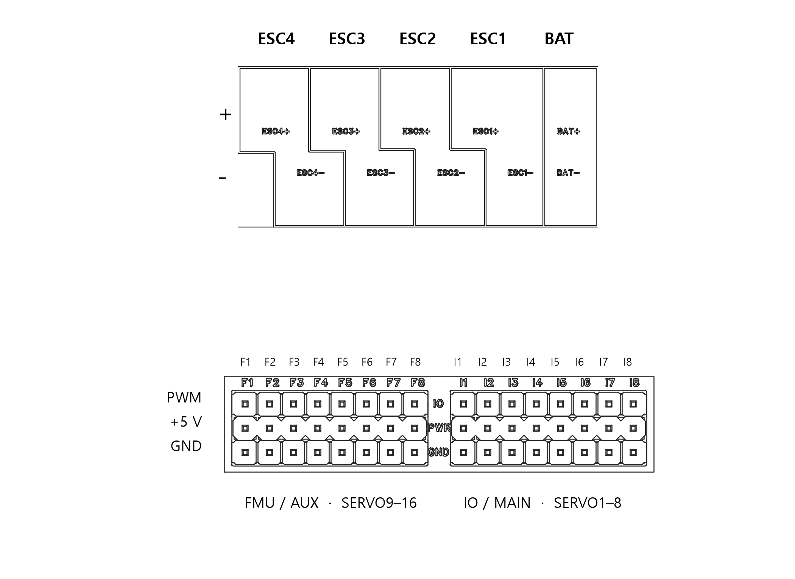
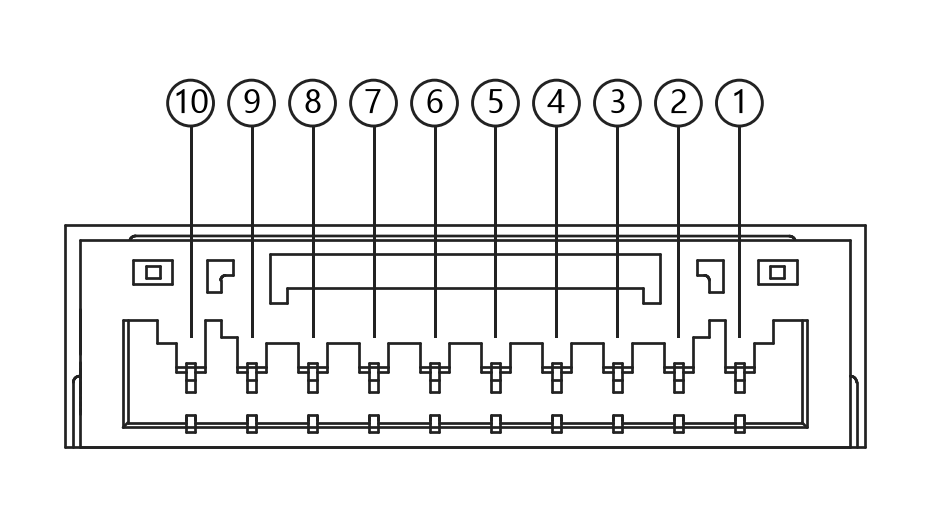
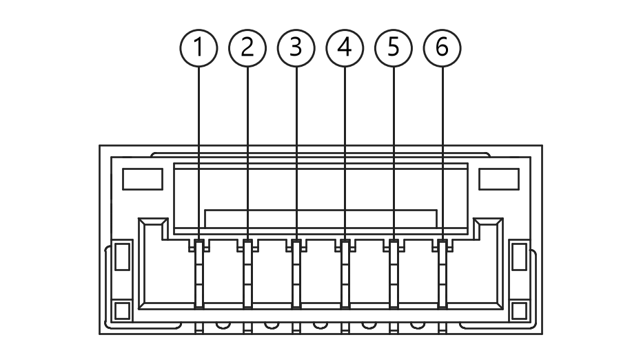
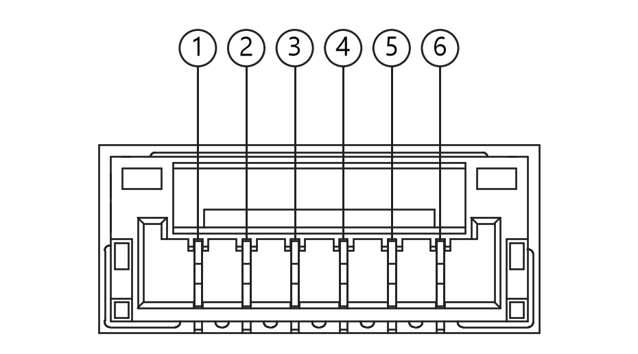
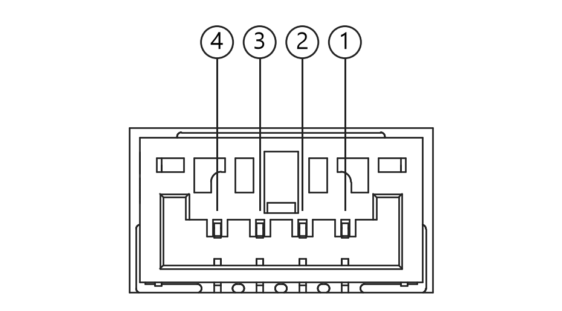
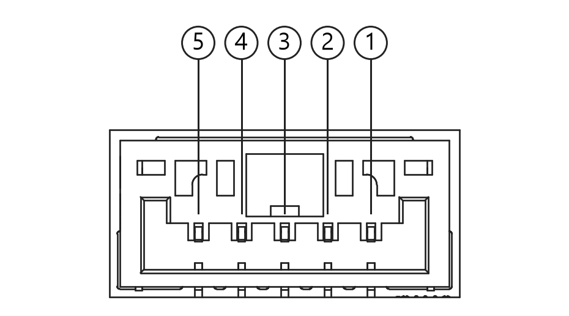
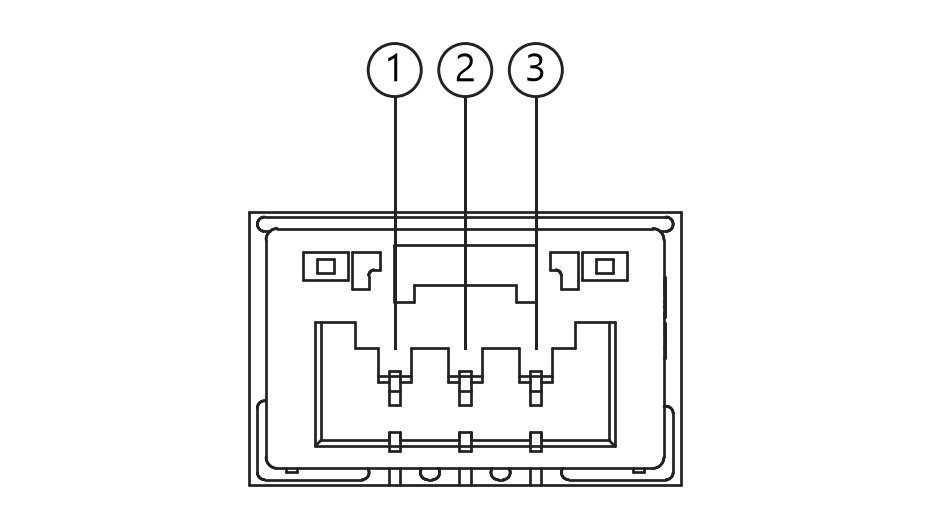
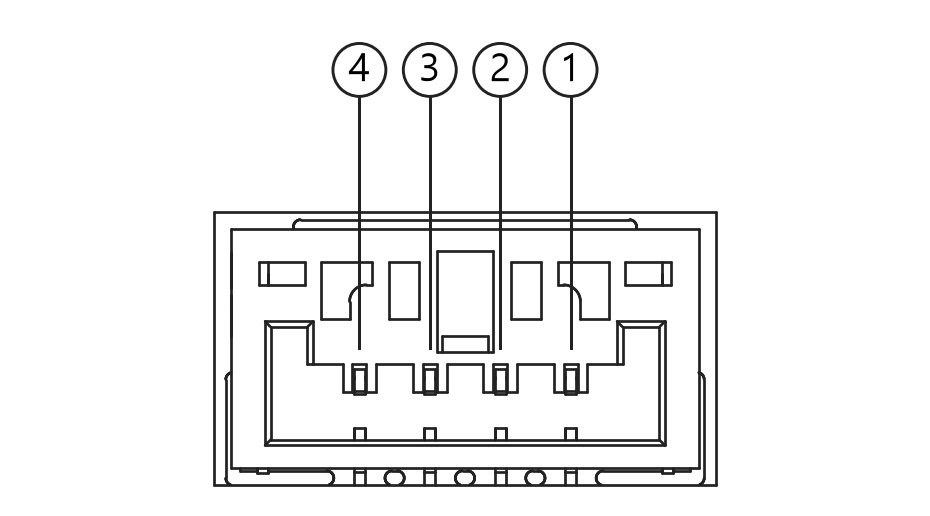

# DCD FC

## Introduction

DCD FC is a flight controller with integrated power distribution from [Corp.DCLASS](https://www.d-class.co.kr). It provides battery input and power pads for four external ESCs.

## Features and specifications

- STM32H743IIT6 main MCU and STM32F103C8T6 IO MCU.
- BMI088 and ICM-42688-P IMUs; MS5611 barometer; IST8310 compass.
- FRAM parameter storage and microSD logging.
- 16 PWM outputs, two GPS ports, three telemetry ports, I2C, SBUS and USB.
- 3–6S LiPo input, maximum 25.2 V.
- Enclosure approximately 126 × 84 × 13 mm; weight 103 g with enclosure.
- Front points toward the BAT/ESC pads. Secure the FC to the aircraft with double-sided tape. The 72 × 114 mm hole pattern is for enclosure assembly.
- No external CAN port or PPM input.

## Where to buy

Purchase enquiries and technical support: [Corp.DCLASS](https://www.d-class.co.kr).

## Pinout

Top view, with Front at the top. Circled numbers are pin numbers. The cable mating-face view is mirrored. TX/RX are named from the FC perspective.

Battery positive and ESC positive pads distribute the same battery voltage; negative pads are GND. F1–F8 are FMU outputs (SERVO9–16), and I1–I8 are IO outputs (SERVO1–8). PWM PWR supplies shared 5 V; do not parallel another BEC.

### Reset buttons and LEDs

FURE resets the FMU; IORE resets the IO processor.

| Label | Indication |
| --- | --- |
| FU | FMU 3.3 V power indicator, arming/pre-arm/calibration status LED, and GPS status LED |
| IO | IO 3.3 V power indicator, ring LED held on by the stock IO firmware, and FMU communication-loss/failsafe indicator |

### GPS1

| Pin | Signal |
| --- | --- |
| 1 | GND |
| 2 | BUZZER |
| 3 | +3.3 V |
| 4 | SAFETY LED |
| 5 | SAFETY SW |
| 6 | SDA |
| 7 | SCL |
| 8 | RX |
| 9 | TX |
| 10 | +5 V |

### GPS2

| Pin | Signal |
| --- | --- |
| 1 | +5 V |
| 2 | TX |
| 3 | RX |
| 4 | SCL |
| 5 | SDA |
| 6 | GND |

### TLM1

| Pin | Signal |
| --- | --- |
| 1 | +5 V |
| 2 | TX |
| 3 | RX |
| 4 | CTS |
| 5 | RTS |
| 6 | GND |

### TLM2

| Pin | Signal |
| --- | --- |
| 1 | +5 V |
| 2 | TX |
| 3 | RX |
| 4 | CTS |
| 5 | RTS |
| 6 | GND |

### TLM3

| Pin | Signal |
| --- | --- |
| 1 | +5 V |
| 2 | TX |
| 3 | RX |
| 4 | SCL |
| 5 | SDA |
| 6 | GND |

### I2C

| Pin | Signal |
| --- | --- |
| 1 | GND |
| 2 | SDA |
| 3 | SCL |
| 4 | +5 V |

### S.B

| Pin | Signal |
| --- | --- |
| 1 | GND |
| 2 | NC |
| 3 | RSSI |
| 4 | SBUS IN |
| 5 | +5 V |

### S.OUT

| Pin | Signal |
| --- | --- |
| 1 | NC |
| 2 | SIGNAL OUT |
| 3 | GND |

### FUUP

| Pin | Signal |
| --- | --- |
| 1 | 3.3 V REF |
| 2 | SWCLK |
| 3 | SWDIO |
| 4 | GND |

### IOUP

| Pin | Signal |
| --- | --- |
| 1 | 3.3 V REF |
| 2 | SWCLK |
| 3 | SWDIO |
| 4 | GND |

S.OUT is the IOMCU SBUS output, enabled by setting `BRD_SBUS_OUT`. It has no power output. Analog RSSI is unavailable while SBUS output is enabled; the two functions cannot be used together. FUUP and IOUP are SWD service ports; their 3.3 V pins are debugger references. Leave NC pins unconnected.

### Port power

| Supply | Voltage | Shared current condition |
| --- | --- | --- |
| GPS1/2, TLM1/2/3, I2C, S.B | 5 V | Up to 1.5 A total including internal FC consumption |
| F1–F8 and I1–I8 PWR | 5 V | Up to 1.5 A total across both banks, separate from FC/peripherals |
| GPS1 pin 3 | 3.3 V | 1 A supply rating shared with microSD |

Allow for internal consumption and thermal limits. USB is also limited by the host and cable.

## UART mapping

| Serial port | Peripheral | Default protocol | Connection |
| --- | --- | --- | --- |
| SERIAL0 | OTG1 | USB MAVLink | USB |
| SERIAL1 | UART7 | MAVLink2 | TLM1, CTS/RTS |
| SERIAL2 | UART5 | MAVLink2 | TLM2, CTS/RTS |
| SERIAL3 | USART1 | GPS | GPS1 |
| SERIAL4 | UART8 | GPS | GPS2 |
| SERIAL5 | USART2 | None | TLM3 |
| SERIAL6 | USART3 | None | Not pinned out |
| SERIAL7 | OTG2 | MAVLink2 | Second virtual port on the same USB connector |

All UARTs have DMA on both RX and TX. USART6 connects the FMU to the IO processor and is not an external serial port.

## PWM outputs

| ArduPilot outputs | Board outputs | Timer group |
| --- | --- | --- |
| 1-2 | I1-I2 | IO TIM2 |
| 3-4 | I3-I4 | IO TIM4 |
| 5-8 | I5-I8 | IO TIM3 |
| 9-12 | F1-F4 | FMU TIM1 |
| 13-14 | F5-F6 | FMU TIM4 |
| 15-16 | F7-F8 | FMU TIM5 |

All 16 outputs support PWM and DShot. I1-I4 support Bi-Directional DShot when `BRD_IO_DSHOT=1`, which selects the DShot IO firmware.

Channels within the same group need to use the same output rate. If any channel in a group uses DShot then all channels in the group need to use DShot.

## RC input

Connect SBUS to S.B pin 4. PPM is not supported. To use CRSF/ELRS or other bi-directional RC protocols, connect the receiver to a full UART such as TLM3 (SERIAL5) and set `SERIAL5_PROTOCOL=23`. See [RC systems](https://ardupilot.org/plane/docs/common-rc-systems.html) for details.

## GPIOs

The output pins can be configured as GPIOs. They are signal pins, not power outputs.

| Board outputs | GPIO numbers |
| --- | --- |
| F1-F8 | 50-57 |
| I1-I8 | 101-108 |

## RSSI and analog inputs

S.B pin 3 carries the IOMCU analog RSSI input. Set `RSSI_TYPE=1` and `RSSI_ANA_PIN=103`. Analog RSSI cannot be used while SBUS output is enabled. Onboard voltage/current sensing uses analog pins 8/4. These ADC connections are not battery input pads. There is no dedicated external analog airspeed input; external I2C peripherals can use the I2C port.

## Battery monitoring

| Parameter | Setting |
| --- | ---: |
| BATT_MONITOR | 3 (voltage only) |
| BATT_VOLT_PIN | 8 |
| BATT_CURR_PIN | 4 |
| BATT_VOLT_MULT | 8.987575 |
| BATT_AMP_PERVLT | 0.25 |

Voltage-only monitoring is the default. For optional current monitoring, set `BATT_MONITOR=4` and reboot. The onboard current sensor measures only the FC supply branch, not ESC current. Use an external sensor for total battery current measurement. `BATT_VOLT_MULT` and `BATT_AMP_PERVLT` may need adjustment against a reference meter.

## Compass

The DCD FC has a built-in IST8310 compass. Due to potential interference, the autopilot is usually used with an external I2C compass as part of a GPS/Compass combination.

## Firmware

The firmware target is `DCD-FC`. After this board support is merged and builds are published, firmware will be available from the [ArduPilot firmware server](https://firmware.ardupilot.org).

## Loading firmware

The board comes pre-installed with an ArduPilot compatible bootloader, allowing the loading of *.apj firmware files with any ArduPilot compatible ground station.

## Other links

- [Manufacturer and support](https://www.d-class.co.kr)
