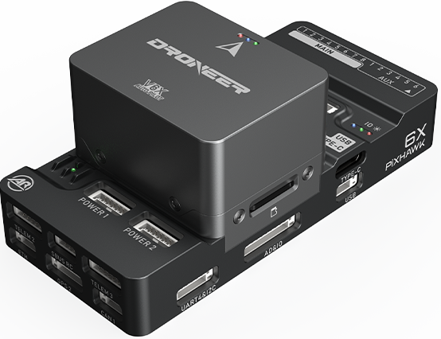
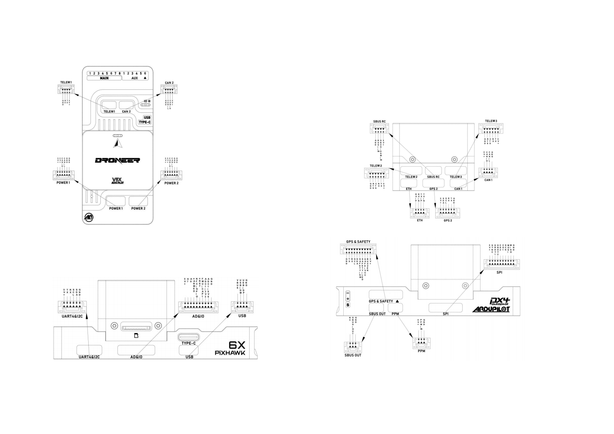

# DroneerX6 Flight Controller

The DroneerX6 is a series of flight controllers manufactured by Droneer, which is based on the open-source FMU v6X architecture and Pixhawk Autopilot Bus open source specifications.

## Features

- Separate flight control core design.
- MCU

   STM32H753IIK6 32-bit processor running at 480MHz
   2MB Flash
   1MB RAM

- IO MCU

   STM32F103

- Sensors
  - IMU:

       Internal Vibration Isolation for IMUs
       IMU constant temperature heating(2W heating power).
       With Triple Synced IMUs, BalancedGyro technology, low noise and more shock-resistant:

    - **X6**:

       IMU1-ICM45686(With vibration isolation)
       IMU2-ICM45686(With vibration isolation)
       IMU3-ICM45686(No vibration isolation)

  - Baro:

       Two barometers:  2 x ICP20100

  - Magnetometer:

       Builtin RM3100 magnetometer

## Pinout

## UART Mapping

The board connectors are labelled by function, with `TX` and `RX` identifying the transmit and receive pins. The DMA allocations are shown below.

| Name | Connector label | Hardware interface | Default protocol | TX DMA | RX DMA |
| --- | --- | --- | --- | --- | --- |
| SERIAL0 | USB | OTG1 (VCP) | MAVLink2 | N/A | N/A |
| SERIAL1 | TELEM1 | UART7 | MAVLink2 | Yes | Yes |
| SERIAL2 | TELEM2 | UART5 | MAVLink2 | Yes | Yes |
| SERIAL3 | GPS & SAFETY | USART1 | GPS | Yes | No |
| SERIAL4 | GPS 2 | UART8 | GPS | Yes | No |
| SERIAL5 | TELEM3 | USART2 | MAVLink2 | Yes | Yes |
| SERIAL6 | UART4&I2C | UART4 | None | Yes | Yes |
| SERIAL7 | Not user-accessible | USART3 | None | Yes | No |
| SERIAL8 | OTG2 | USB | MAVLink2 | N/A | N/A |

TELEM2 and TELEM3 have RTS/CTS hardware flow control; the other UART connectors do not. SERIAL7 (USART3) is not pinned out to a user connector.

## RC Input

The `SBUS RC` input supports ArduPilot's unidirectional receiver protocols. An FPort receiver connected only to this input can provide RC control but not its bidirectional telemetry. CRSF/ELRS, FPort telemetry and SRXL2 require a suitable UART connection.

For example, use SERIAL6 (UART4) as follows:

- Set `SERIAL6_PROTOCOL` to `23` (RCIN).
- For FPort, set `SERIAL6_OPTIONS` to `15` and connect the receiver signal wire to the **UART4 RX** pin (not TX).
- Alternatively, for FPort using `SERIAL6_OPTIONS=7`, connect the receiver signal wire to the **UART4 TX** pin (not RX).
- For CRSF/ELRS, set `SERIAL6_OPTIONS` to `0`, connect receiver TX to UART4 RX and receiver RX to UART4 TX, and share ground. UART4 retains RX DMA, as preferred for reliable CRSF/ELRS operation.
- For SRXL2, set `SERIAL6_OPTIONS` to `4` (half-duplex) and connect the signal wire to the **UART4 TX** pin.

The `PPM` connector is an FMU timer-based RC input (`TIM8_CH1`), rather than a UART. See the [ArduPilot RC systems documentation](https://ardupilot.org/copter/docs/common-rc-systems.html) for supported receiver types and configuration.

The `SBUS OUT` connector outputs an SBUS-format serial control signal to compatible external devices; it is not an RC receiver input.

## PWM Output

The DroneerX6 provides 16 PWM outputs. `MAIN1`–`MAIN8` are controlled by the STM32F103 I/O MCU; `AUX1`–`AUX6` and `A7`/`A8` are controlled directly by the STM32H753 FMU.

`MAIN1` corresponds to `SERVO1`, `MAIN8` to `SERVO8`, `AUX1` to `SERVO9`, `AUX6` to `SERVO14`, `A7` to `SERVO15`, and `A8` to `SERVO16`.

The eight MAIN outputs form **three groups**:

- Group 1: `MAIN1`–`MAIN2`.
- Group 2: `MAIN3`–`MAIN4`.
- Group 3: `MAIN5`–`MAIN8`.

The eight FMU outputs form **three groups**:

- Group 1: `AUX1`–`AUX4` (`TIM5`).
- Group 2: `AUX5`–`AUX6` (`TIM4`).
- Group 3: `A7`–`A8` (`TIM12`; PWM only, no DMA).

All 16 outputs support standard PWM. Standard DShot is supported on `MAIN1`–`MAIN8` (using the I/O MCU DShot firmware) and `AUX1`–`AUX6`. `A7` and `A8` support PWM only, not DShot.

For **bidirectional DShot** on the I/O MCU, `MAIN1`–`MAIN4` are supported when `BRD_IO_DSHOT` = 1. I/O MCU bidirectional DShot is enabled in the firmware using `HAL_WITH_IO_MCU_BIDIR_DSHOT=1`.

Channels in the same output group must use compatible output rates and protocols. Where DShot is used, the other outputs in that group must also be configured for DShot.

## GPIOs

PWM outputs can also be configured as GPIOs (for example, relays or camera triggers). Set the corresponding `SERVOx_FUNCTION` to `-1` before using it as a GPIO. GPIO numbers for ArduPilot `PIN` parameters are:

| Connector pin | GPIO number | ArduPilot output |
| --- | ---: | --- |
| MAIN1 | 101 | SERVO1 |
| MAIN2 | 102 | SERVO2 |
| MAIN3 | 103 | SERVO3 |
| MAIN4 | 104 | SERVO4 |
| MAIN5 | 105 | SERVO5 |
| MAIN6 | 106 | SERVO6 |
| MAIN7 | 107 | SERVO7 |
| MAIN8 | 108 | SERVO8 |
| AUX1 | 50 | SERVO9 |
| AUX2 | 51 | SERVO10 |
| AUX3 | 52 | SERVO11 |
| AUX4 | 53 | SERVO12 |
| AUX5 | 54 | SERVO13 |
| AUX6 | 55 | SERVO14 |
| A7 | 56 | SERVO15 (`TIM12_CH1`) |
| A8 | 57 | SERVO16 (`TIM12_CH2`) |
| FMU_CAP1 | 58 | FMU capture input |
| NFC_GPIO | 60 | NFC GPIO |

`A7` and `A8` are on the `AD&IO` connector, separate from the MAIN and AUX output headers.

The **SPI connector is not enabled in firmware**.

## Additional Connectors

- **ETH**: Ethernet interface. Set `NET_ENABLE=1` to enable Ethernet networking in firmware.
- **FMU DEBUG**: FMU USART3 (`SERIAL7`) TX/RX signals, if the hardware exposes them. The current published pinout does not identify an accessible connector for this port.
- **SBUS OUT**: SBUS-format serial output for compatible external devices (not an RC input).

## CAN

The DroneerX6 provides **CAN1** and **CAN2**, including CAN connections on its power-module connectors. Both interfaces are configured for DroneCAN by default in `defaults.parm` via `CAN_P1_DRIVER=1` and `CAN_P2_DRIVER=1`.

## Battery Monitoring

The X6 flight controller has two six-pin power connectors that support DroneCAN power modules. `BATT_MONITOR` defaults to 8 (DroneCAN).

## Compass

The X6 flight controller has a built-in RM3100 compass. Due to potential interference, the autopilot is usually used with an external I2C compass as part of a GPS/Compass combination.

## Analog Inputs

The X6 flight controller has 2 analog inputs.

- Analog Pin12 -> ADC 6.6V Sense
- Analog Pin13 -> ADC 3.3V Sense
- RSSI analog input pin = 103

## 5V PWM Voltage

The X6 flight controller supports switching between 3.3V and 5V PWM levels. Switch PWM output pulse level by configuring parameter `BRD_PWM_VOLT_SEL`. 0 for 3.3V (default) and 1 for 5V output.

## Mechanical data

- Weight
  - Flight Controller Module: 89g
- Dimensions: 84.6mm x 39.6mm x 32.77mm

## Loading Firmware

The board comes pre-installed with an ArduPilot compatible bootloader,
allowing `.apj` firmware files to be loaded using an ArduPilot-compatible ground station.
Firmware for these boards can be found [here](https://firmware.ardupilot.org) in subfolders labelled "DroneerX6".

## Where to Buy

[Droneer](https://www.droneer.com)
