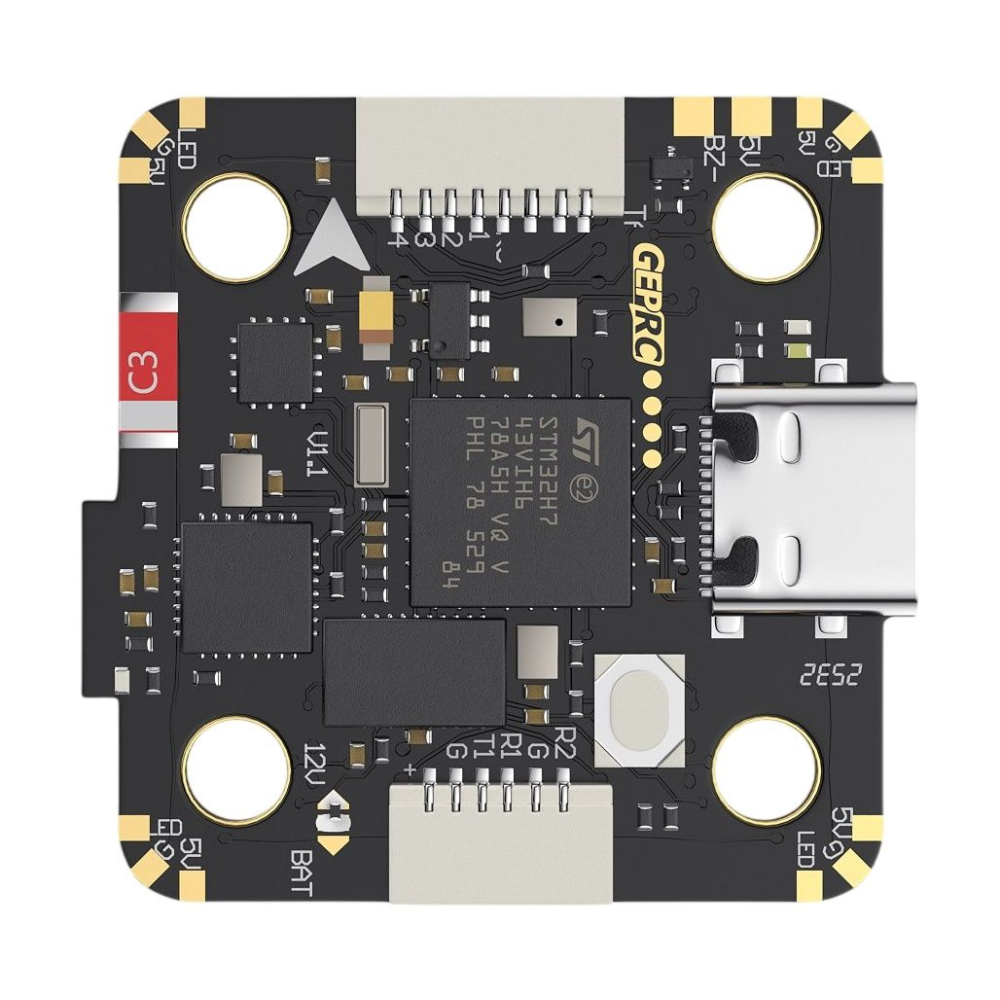
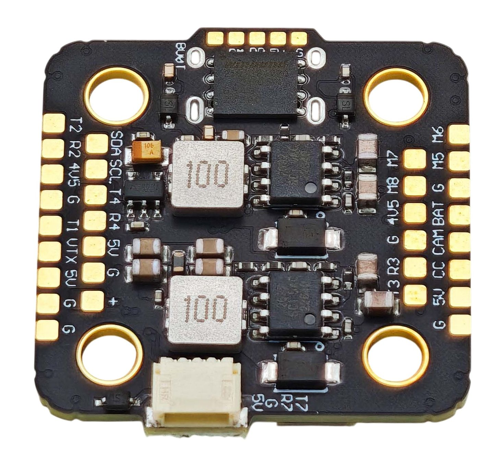

# GEPRC TAKER H743 MINI Flight Controller

The TAKER H743 MINI is a flight controller produced by [GEPRC](https://geprc.com/).

## Where to Buy

[GEPRC](https://geprc.com/product/geprc-taker-h743-mini-flight-controller/)

## Specifications

- Processor

  - STM32H743 32-bit processor, 480MHz
  - 2MB Flash
  - 1MB RAM
  - AT7456E OSD

- Sensors

  - ICM42688-P IMU
  - DPS310 barometer

- Interfaces

  - USB-C
  - 7 UARTs, one connected to the onboard Bluetooth module
  - 9 PWM outputs (output 9 defaulted for NeoPixel LED)
  - ESC connector (SH1.0-8P) with current sense and telemetry input
  - HD VTX connector (SH1.0-6P)
  - GPS/UART7 connector (SH1.0-4P)
  - I2C for external compass
  - Analog video in/out
  - 16MB onboard flash for logging

- Power

  - 3S - 8S LiPo input
  - 5V, 3A BEC
  - 12V, 2.5A BEC for video, GPIO controlled
  - 4.5V output for receiver, also powered from USB

- Dimensions

  - Size: 31.5 x 30.5 mm, 20 x 20 mm mounting
  - Weight: 6.1g

## Pinout

## UART Mapping

The UARTs are marked Rn and Tn in the above pinouts. The Rn pin is the
receive pin for UARTn. The Tn pin is the transmit pin for UARTn.

|Port    |Pads              |UART   |Protocol      |TX DMA |RX DMA |
|--------|------------------|-------|--------------|-------|-------|
|SERIAL0 |USB               |USB    |MAVLink2      |✘      |✘      |
|SERIAL1 |T1, R1            |USART1 |DisplayPort   |✔      |✔      |
|SERIAL2 |T2, R2            |USART2 |RCIN          |✔      |✔      |
|SERIAL3 |T3, R3            |USART3 |None          |✔      |✔      |
|SERIAL4 |T4, R4            |UART4  |GPS           |✔      |✔      |
|SERIAL5 |R5 (ESC connector)|UART5  |ESC Telemetry |✘      |✔      |
|SERIAL7 |T7, R7            |UART7  |None          |✘      |✘      |
|SERIAL8 |internal          |UART8  |None          |✘      |✘      |

- T1 and R1 are on both the HD VTX connector and the T1 pad next to the
  analog VTX pads. Only one VTX can be used: set `SERIAL1_PROTOCOL` to
  match the connected VTX (DisplayPort for an HD VTX, or SmartAudio/Tramp
  for analog VTX control).
- R2 is on the HD VTX connector and receives SBUS from an HD VTX.
- T4, R4, SDA, SCL, 5V and G are on the GPS SH1.0-4P connector and pads.
- T7, R7, 5V and G are on the SH1.0 connector on the bottom edge.
- UART8 is connected to the onboard Bluetooth module, which is intended
  for Betaflight MSP configuration apps.

## RC Input

RC input is configured by default on SERIAL2 (USART2). R2 is on the HD
VTX connector, for HD VTXs that pass on an SBUS receiver signal.

A separate serial receiver can be connected to T3/R3 (SERIAL3), powered
from the 4V5 pad. Set `SERIAL3_PROTOCOL` to 23 and `SERIAL2_PROTOCOL` to
something other than 23.

- FPort would require `SERIALn_OPTIONS` be set to 15.
- CRSF/ELRS would require `SERIALn_OPTIONS` be set to 0.
- SRXL2 would require `SERIALn_OPTIONS` be set to 4, and connects only
  the TX pin.

Any UART can be used for RC system connections in ArduPilot, and is
compatible with all protocols except PPM. See
[RC systems](https://ardupilot.org/copter/docs/common-rc-systems.html)
for details.

## OSD Support

The TAKER H743 MINI supports analog OSD using its onboard AT7456E. The
camera video input is the CAM pad and the video output is the VTX pad.

DisplayPort OSD for HD VTXs on SERIAL1 runs alongside the analog OSD by
default (`OSD_TYPE2` 5). If `SERIAL1_PROTOCOL` is ever changed from MSP
DisplayPort, `OSD_TYPE2` must be set to 0, or a pre-arm failure will
result.

## HD VTX Support

The SH1.0-6P connector supports a DJI Air Unit / HD VTX connection.
SERIAL1 defaults to DisplayPort. Pin 1 of the connector is 12V (from the
12V BEC, or VBAT when the 12V/BAT solder pads are bridged to BAT), so
be careful not to connect it to a peripheral requiring 5V.

## VTX power control

GPIO 71 controls the 12V BEC output to the + pad and the HD VTX
connector. Setting this GPIO low removes power from them. By default,
RELAY2 controls this pin and sets it high at boot.

## LIGHT OFF control

GPIO 70 is the Betaflight "LIGHT OFF" PINIO output. By default, RELAY1
controls this pin and sets it high at boot, as Betaflight does.

## PWM Output

The TAKER H743 MINI supports up to 9 PWM/DShot outputs. M1 to M4 are on
the ESC connector, M5 to M8 are pads. Output 9 is on the four LED pads,
which are chained together, and defaults to serial LED.

The PWM is in 3 groups:

- PWM 1-4 in group1
- PWM 5-8 in group2
- PWM 9 in group3

Channels within the same group need to use the same output rate. If any
channel in a group uses DShot then all channels in the group need to use
DShot. Outputs 1-8 support bi-directional DShot.

## GPIOs

|Pin    |GPIO Number |
|-------|------------|
|M1     |50          |
|M2     |51          |
|M3     |52          |
|M4     |53          |
|M5     |54          |
|M6     |55          |
|M7     |56          |
|M8     |57          |
|LED    |58          |
|PINIO1 |70          |
|PINIO2 |71          |

## Buzzer

Connect a buzzer between the 5V and BZ- pads, with the positive terminal
on 5V.

## Battery Monitoring

The board has an internal voltage sensor, and the ESC connector has a
current sensor input (CUR) and battery voltage (BAT). The voltage sensor
can handle up to 8S LiPo batteries.

The default battery parameters are:

- `BATT_MONITOR` 4
- `BATT_VOLT_PIN` 11
- `BATT_CURR_PIN` 10
- `BATT_VOLT_MULT` 11.0
- `BATT_AMP_PERVLT` 100

## Compass

The TAKER H743 MINI does not have a built-in compass. An external compass
can be attached using the SDA and SCL pads.

## Firmware

Firmware for this board can be found
[here](https://firmware.ardupilot.org) in sub-folders labeled
"GEPRC_TAKER_H743MINI".

## Loading Firmware

The board does not ship with an ArduPilot compatible bootloader. To load
ArduPilot firmware, hold the boot button or BOOT pad low while powering
up the board. Then use the STM32CubeProgrammer app to load the
"\*_with_bl.hex" file. Subsequently, a GCS can update firmware using the
\*.apj files.
