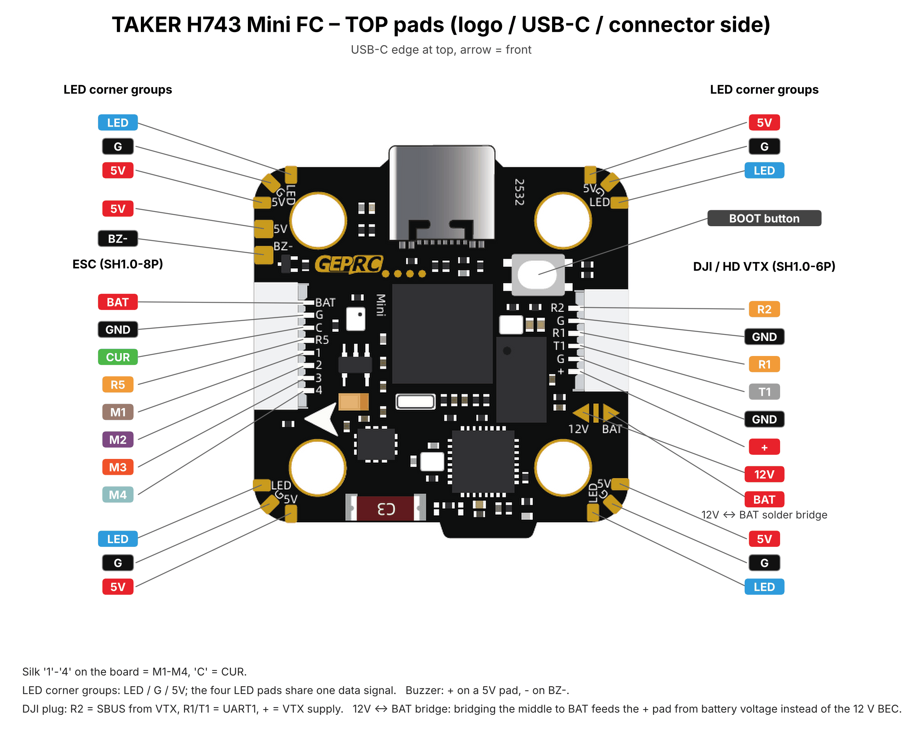
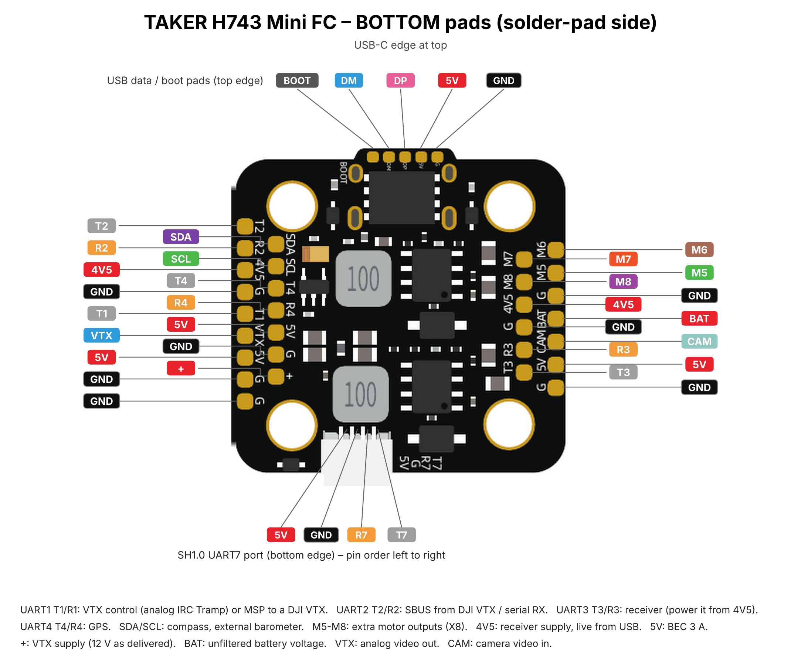

# GEPRC TAKER H743 Mini Flight Controller

The TAKER H743 Mini is a 20x20 mm flight controller produced by [GEPRC](https://geprc.com/), featuring an STM32H743 processor, an ICM42688-P IMU, 16MB of onboard flash for logs and scripts and a built-in Bluetooth module.

## Where to Buy

[GEPRC TAKER H743 Mini flight controller](https://geprc.com/product/geprc-taker-h743-mini-flight-controller/), also sold as part of the [TAKER H743 Mini 60A stack](https://geprc.com/product/geprc-taker-h743-mini-32bit-60a-stack/).

## Specifications

- Processor
  - STM32H743 32-bit processor running at 480 MHz
  - 2MB flash
  - 16MB onboard flash with a LittleFS filesystem for logs and Lua scripts
- Sensors
  - ICM42688-P IMU, or an LSM6DSK320X in its place
  - SPL06-001 barometer
  - Battery voltage sensor, and current sensor input on the ESC connector
- Power
  - 3S-8S LiPo input
  - 5V 3A BEC for the flight controller, receiver, camera and LEDs
  - 12V 3A BEC for the video transmitter, switchable
  - 4V5 receiver supply, live when powered from USB only
- Interfaces
  - 7 UARTs, one of them connected to the onboard Bluetooth module
  - 8 motor outputs and one serial LED output
  - I2C pads for an external compass
  - AT7456E analog OSD
  - SH1.0-6P HD VTX connector
  - SH1.0-8P ESC connector
  - SH1.0-4P UART7 connector
  - USB Type-C
- Mechanical
  - 31.5 x 30.5 mm, 20x20 mm M3 mounting holes
  - 6.1 g

## Pinout

The ESC connector pins are BAT, G, CUR, R5 and M1 to M4. The five pads along the top edge of the bottom side are BOOT, USB D- (DM), USB D+ (DP), 5V and G. The BAT pad beside CAM carries the battery voltage.

## UART Mapping

The UARTs are marked Rn and Tn in the above pinouts. The Rn pin is the receive pin for UARTn. The Tn pin is the transmit pin for UARTn.

| Port | Pads | UART | Default protocol |
|---|---|---|---|
| SERIAL0 | USB | USB | MAVLink2 |
| SERIAL1 | T1/R1, also on the HD VTX connector | USART1 | DisplayPort |
| SERIAL2 | T2/R2, R2 also on the HD VTX connector | USART2 | RC Input |
| SERIAL3 | T3/R3 | USART3 | None |
| SERIAL4 | T4/R4 | UART4 | GPS |
| SERIAL5 | R5 on the ESC connector (receive only) | UART5 | ESC Telemetry |
| SERIAL7 | T7/R7 on the SH1.0-4P connector | UART7 | None |
| SERIAL8 | onboard Bluetooth module | UART8 | None |

All UARTs except UART7 and UART8 are DMA-enabled. The SH1.0-4P connector carries 5V, GND, R7 and T7 for a GPS, receiver or telemetry radio. A GPS on it needs [SERIAL7_PROTOCOL](https://ardupilot.org/copter/docs/parameters.html#serial7-protocol) set to 5.

## RC Input

RC input is configured by default on SERIAL2. R2 is also on the HD VTX connector, so a DJI air unit's SBUS output works without extra wiring.

To use a separate receiver instead, connect it to T3/R3 and power it from the 4V5 pad, which stays live on USB power so the receiver can be bound on the bench. Then set [SERIAL3_PROTOCOL](https://ardupilot.org/copter/docs/parameters.html#serial3-protocol) to 23 and [SERIAL2_PROTOCOL](https://ardupilot.org/copter/docs/parameters.html#serial2-protocol) to something other than 23, since only one serial port can be used for RC input.

- CRSF/ELRS needs both T3 and R3 connected, with SERIAL3_OPTIONS 0.
- FPort connects to R3 only, with SERIAL3_OPTIONS 15.
- SRXL2 needs SERIAL3_OPTIONS 4 and connects only the T3 pin.

## OSD Support

The TAKER H743 Mini supports analog OSD using OSD_TYPE 1 (AT7456E driver), and simultaneously DisplayPort on SERIAL1 using OSD_TYPE2 5, which is set by default.

If [SERIAL1_PROTOCOL](https://ardupilot.org/copter/docs/parameters.html#serial1-protocol) is ever changed from DisplayPort, set [OSD_TYPE2](https://ardupilot.org/copter/docs/parameters.html#osd-type2) to 0, or a pre-arm failure will result.

## HD VTX Support

The SH1.0-6P connector supports a DJI air unit or other HD VTX. Its pins are 12V, GND, T1, R1, GND and R2 (SBUS). The power pin carries the switchable 12V BEC as delivered, or the battery voltage if the middle pad of the 12V/BAT solder jumper is bridged to BAT. Make sure the VTX can take that voltage.

## Analog VTX and Camera

An analog VTX connects to the + (power), G, VTX (video) and T1 (control) pads. T1 is the same UART as the HD VTX connector, so set SERIAL1_PROTOCOL to match the VTX that is connected: 37 for SmartAudio or 44 for Tramp. Set OSD_TYPE2 to 0 at the same time.

The camera connects to the 5V, G and CAM pads. The CC pad between CAM and 5V, which the bottom diagram does not show, is not supported.

## VTX Power Control

GPIO 71 controls the 12V BEC that powers the + pad and the HD VTX connector. RELAY2 is assigned to it and is on by default. To switch VTX power from the transmitter, set an RC channel's RCx_OPTION to 34 (Relay2 On/Off).

## GPIOs

GPIO 70 switches the onboard Bluetooth module, which is on while the pin is high. RELAY1 is assigned to it and is on by default. Set an RC channel's RCx_OPTION to 28 (Relay On/Off) to switch Bluetooth from the transmitter.

M1 to M8 are GPIOs 50 to 57 and the LED output is GPIO 58, for use as relays or other GPIO functions when they are not used as PWM outputs.

## PWM Output

The TAKER H743 Mini supports up to 9 PWM or DShot outputs. M1 to M4 are on the ESC connector and M5 to M8 are solder pads. Output 9 drives the LED pad at each of the four corners with the same signal, and is set up for serial LEDs by default (SERVO9_FUNCTION 120). Every strip shows the same pattern, so set NTF_LED_LEN to the number of LEDs on one strip.

The PWM is in 3 groups:

- PWM 1-4 in group1
- PWM 5-8 in group2
- PWM 9 in group3

Channels within the same group need to use the same output rate. If any channel in a group uses DShot then all channels in the group need to use DShot. Channels 1-8 support bi-directional DShot.

The motors are expected in Betaflight order, so FRAME_TYPE defaults to 12 (BetaFlightX).

## Battery Monitoring

The board has a built-in voltage sensor, and reads the current sensor of the ESC through the CUR pin of the ESC connector. The voltage sensor can handle up to 8S LiPo batteries.

The default battery parameters are:

- [BATT_MONITOR](https://ardupilot.org/copter/docs/parameters.html#batt-monitor) = 4
- [BATT_VOLT_PIN](https://ardupilot.org/copter/docs/parameters.html#batt-volt-pin-ap-battmonitor-analog) = 11
- [BATT_CURR_PIN](https://ardupilot.org/copter/docs/parameters.html#batt-curr-pin-ap-battmonitor-analog) = 10
- [BATT_VOLT_MULT](https://ardupilot.org/copter/docs/parameters.html#batt-volt-mult-ap-battmonitor-analog) = 11.0
- [BATT_AMP_PERVLT](https://ardupilot.org/copter/docs/parameters.html#batt-amp-pervlt-ap-battmonitor-analog) = 100

BATT_AMP_PERVLT depends on the ESC, so check it against a reference meter.

## Compass

The TAKER H743 Mini does not have a builtin compass, but you can attach an external compass using I2C on the SDA and SCL pads.

## Buzzer

Connect a buzzer to the 5V and BZ- pads, with its positive lead on 5V.

## Bluetooth

The onboard Bluetooth module is connected to UART8 (SERIAL8) and is not used by default. GEPRC runs it at 115200 baud, so set [SERIAL8_BAUD](https://ardupilot.org/copter/docs/parameters.html#serial8-baud) to 115 when enabling it.

## Logging and Scripts

The 16MB onboard flash holds a LittleFS filesystem. Logs are written to it as files and can be downloaded with MAVFTP or the ground station's log download, and Lua scripts can be uploaded to the APM/scripts directory.

## Firmware

Firmware for this board is available from the [ArduPilot Firmware Server](https://firmware.ardupilot.org) under the `GEPRC_TAKER_H743MINI` target.

## Loading Firmware

The board ships with Betaflight and no ArduPilot-compatible bootloader. To load ArduPilot firmware, hold down the BOOT button, on the top side beside the HD VTX connector, while plugging in USB, to start the board in DFU mode. Then use the STM32CubeProgrammer app to load the "\*_with_bl.hex" file. Subsequently, a GCS can update the firmware using the \*.apj files.
