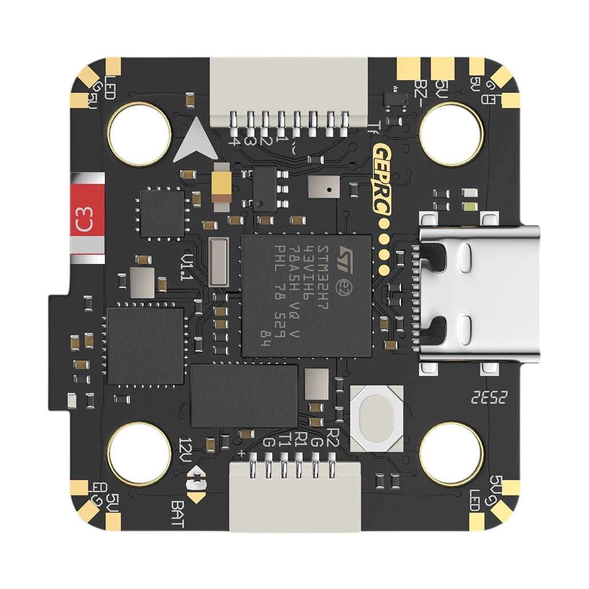
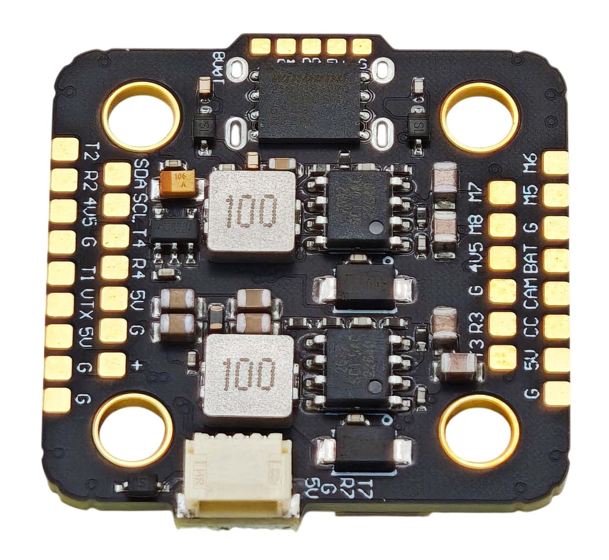

# GEPRC TAKER H743MINI

ArduPilot hardware definition for the GEPRC TAKER H743MINI flight controller.
The TAKER H743 MINI is a flight controller produced by [GEPRC](https://geprc.com/).

## Features

- STM32H743 microcontroller
- ICM42688-P IMU
- SPL06-001 barometer
- microSD based 16MB flash logging
- AT7456E OSD
- 7 UARTs
- 8 PWM outputs

## Pinout




## Hardware overview

- MCU -> STM32H743
- IMU -> ICM42688P over SPI2
- IMU orientation -> `ROTATION_ROLL_180`
- Barometer -> onboard device on I2C1
- OSD -> MAX7456-compatible device over SPI4
- Blackbox storage -> W25Q128FV 16 MB SPI flash over SPI3
- USB -> USB OTG FS
- Motor outputs -> 8 PWM outputs
- Battery sensing -> analog voltage and current inputs

## Serial port mapping

The assignments below follow the Betaflight target pin map. Connector
functions should be checked against the board silkscreen and vendor
documentation.

- UART1 -> PA9 TX, PA10 RX -> MSP DisplayPort / VTX
- UART2 -> PD5 TX, PD6 RX -> RC receiver (configure protocol as appropriate)
- UART3 -> PD8 TX, PD9 RX -> general-purpose serial
- UART4 -> PA0 TX, PA1 RX -> GPS
- UART5 -> PB5 RX only -> ESC telemetry input
- UART7 -> PE8 TX, PE7 RX -> general-purpose serial
- UART8 -> PE1 TX, PE0 RX -> onboard Bluetooth / MSP-capable serial

USART6 is intentionally omitted from `SERIAL_ORDER` because no UART6 pin
mapping is defined for this target.

## I2C

- I2C1 -> PB8 SCL, PB9 SDA -> onboard barometer
- I2C2 -> PB10 SCL, PB11 SDA -> external compass/accessories

## SPI devices

- SPI2 -> PB13 SCK, PC2 MISO, PC3 MOSI -> ICM42688P IMU; CS PB12; data-ready PB2
- SPI3 -> PC10 SCK, PC11 MISO, PC12 MOSI -> W25Q128FV flash; CS PA15
- SPI4 -> PE2 SCK, PE5 MISO, PE6 MOSI -> MAX7456-compatible OSD; CS PE4

## PWM outputs

Motor output order follows the Betaflight target's `MOTOR1_PIN` through
`MOTOR8_PIN` mapping:

- Motor 1 -> PC6 / TIM8_CH1
- Motor 2 -> PC7 / TIM8_CH2
- Motor 3 -> PC8 / TIM8_CH3
- Motor 4 -> PC9 / TIM8_CH4
- Motor 5 -> PE9 / TIM1_CH1
- Motor 6 -> PE11 / TIM1_CH2
- Motor 7 -> PE13 / TIM1_CH3
- Motor 8 -> PE14 / TIM1_CH4

## Other GPIO and analog inputs

- Addressable LED output -> PD12
- Status LED -> PB7
- Buzzer -> PD2 (active-low assumption; verify on hardware)
- PINIO1 -> PC5
- PINIO2 -> PD3
- Battery voltage sense -> PC1
- Battery current sense -> PC0

Battery monitor scale values are provisional and must be calibrated
against a trusted meter/current measurement.

## Build

From the ArduPilot repository root, configure and build the desired
vehicle target using the standard ChibiOS build workflow. For example,
for Copter:

``` bash
./waf configure --board GEPRC_TAKER_H743MINI
./waf copter
```

The board directory should be located at:

``` text
libraries/AP_HAL_ChibiOS/hwdef/GEPRC_TAKER_H743MINI/
```

## Items to verify

- Confirm the oscillator frequency and clock configuration against the
  board schematic or a known-good vendor configuration.
- Identify the exact onboard barometer model and I2C address; the
  Betaflight target enables BMP280, DPS310 and MS5611 driver families,
  but that alone does not identify the fitted part.
- Verify IMU orientation on a level surface and by tilting the board
  in each axis. Current tested setting: `ROTATION_ROLL_180`.
- Calibrate battery voltage/current scaling.
- Confirm buzzer polarity, PINIO behavior, LED output, OSD, flash
  logging, and all serial connector functions.
- Allocate and verify a unique ArduPilot board ID before distributing
  firmware.
- Check flash reservation and storage layout against the
  bootloader/application build configuration.

## Reference

- Betaflight Support Explorer target:
  [https://support.betaflight.com/targets/GEPRC_TAKER_H743MINI](https://github.com/betaflight/config/blob/4961818ca9b6c463b4371e2e95f3e44da60b41a0/configs/GEPR/GEPRC_TAKER_H743MINI/config.h)
- ArduPilot hardware-definition directory:
  `libraries/AP_HAL_ChibiOS/hwdef/`
