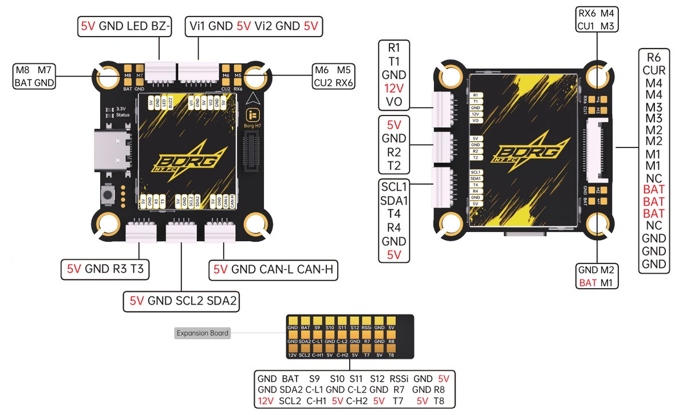

# iFlight Borg H7 Flight Controller

The Borg H7 is a flight controller produced by [iFlight](https://shop.iflight.com/Borg-H7-Flight-Controller-Pro3832).

## Features

- MCU - STM32H743VIH6 32-bit processor running at 480 MHz, 2MB flash
- IMU - Dual ICM42688-P
- Barometer - SPA06-003
- OSD - AT7456E
- 32MB onboard flash for logging
- 7x UARTs
- 2x I2C
- 2x CAN
- 13x PWM outputs (12 motor outputs, 1 LED strip)
- Battery input voltage: 4S-12S
- BEC 5V 2.5A
- BEC 12V 2A for video, GPIO controlled, on the HD VTX connector
- Dual switchable camera inputs
- 30.5 x 30.5mm mounting holes (4mm), 37.5 x 37.5mm, 17g

## Pinout

The board uses SH1.0 connectors, with an FPC connector for the 4-in-1 ESC:

- HD VTX connector: R1, T1, GND, 12V, VO (analog video out)
- RX connector: 5V, GND, R2, T2
- GPS connector: SCL1, SDA1, T4, R4, GND, 5V
- UART3 connector: 5V, GND, R3, T3
- I2C connector: 5V, GND, SCL2, SDA2
- CAN connector: 5V, GND, CAN-L, CAN-H
- LED/buzzer connector: 5V, GND, LED, BZ-
- Camera connector: Vi1, GND, 5V, Vi2, GND, 5V
- ESC FPC connector: M1-M4, R6 (ESC telemetry), CUR (current), BAT, GND

Two sets of corner pads take a pair of 4-in-1 ESCs: M1-M4 with CU1 and RX6, and M5-M8 with CU2 and RX6, each with BAT and GND.

The expansion board carries S9-S12, RSSI, R7/T7, R8/T8, SCL2/SDA2, both CAN buses (C-H1/C-L1 and C-H2/C-L2), BAT, 12V, 5V and GND.

## UART Mapping

The UARTs are marked Rn and Tn in the above pinout. The Rn pin is the receive pin for UARTn. The Tn pin is the transmit pin for UARTn.

- SERIAL0 -> USB
- SERIAL1 -> UART1 (DisplayPort, HD VTX connector, DMA-enabled)
- SERIAL2 -> UART2 (RC Input, RX connector, DMA-enabled)
- SERIAL3 -> UART3 (UART3 connector, DMA-enabled)
- SERIAL4 -> UART4 (GPS, GPS connector, DMA-enabled)
- SERIAL6 -> UART6 (ESC Telemetry, RX6 on the ESC connector and pads)
- SERIAL7 -> UART7 (expansion board)
- SERIAL8 -> UART8 (expansion board)

## RC Input

RC input is configured by default on UART2 (the RX connector). It supports all serial RC protocols except PPM. For full duplex protocols such as CRSF/ELRS use both R2 and T2.

## OSD Support

The Borg H7 supports analog OSD using OSD_TYPE 1 (AT7456E driver). DisplayPort for an HD VTX is set up by default on SERIAL1; to use it alongside the analog OSD set OSD_TYPE2 to 5.

## PWM Output

The Borg H7 supports up to 13 PWM outputs. M1-M4 are on the ESC connector and its corner pads, M5-M8 on the second set of corner pads, and outputs 9-12 on the S9-S12 expansion board pads. Output 13 is the LED pad on the LED/buzzer connector, set to serial LED by default.

The PWM outputs are in five groups:

- PWM 1-2 in group1
- PWM 3-6 in group2
- PWM 7-10 in group3
- PWM 11-12 in group4
- PWM 13 in group5

Channels within the same group need to use the same output rate. If any channel in a group uses DShot then all channels in the group need to use DShot. Outputs 1-8 support bi-directional DShot. Outputs 9-10 support DShot, and outputs 11-12 support PWM only.

## Battery Monitoring

The board has a built-in voltage sensor and a current sensor input from the ESC (CUR on the ESC connector, CU1 on the pads). The correct battery setting parameters are set by default:

- BATT_MONITOR 4
- BATT_VOLT_PIN 10
- BATT_CURR_PIN 11
- BATT_VOLT_MULT 11.0
- BATT_AMP_PERVLT 50

The CU2 pad takes the current sensor of a second 4-in-1 ESC on M5-M8. To monitor it as a current-only battery:

- BATT2_MONITOR 31
- BATT2_CURR_PIN 7
- BATT2_AMP_PERVLT 50

## Analog RSSI

Analog RSSI uses RSSI_PIN 8, on the RSSI pad of the expansion board.

## CAN

The board has two CAN buses, both on the expansion board pads, and a CAN connector. CAN1 has a silent pin on GPIO 70, held low (active) by default.

## Compass

The Borg H7 does not have a built-in compass, but you can attach an external compass to either I2C bus.

## VTX Power Control

GPIO 81 switches the 12V supply on the HD VTX connector and is high (on) at boot. RELAY2 is assigned to this pin by default; set RELAY2_FUNCTION to 1 to control it from the GCS or a transmitter channel. RELAY2_DEFAULT is 1, so the VTX stays powered at boot.

## Camera Control

GPIO 82 switches the video output between the two camera inputs: high, the default, selects Vi1 and low selects Vi2. RELAY3 is assigned to this pin by default; set RELAY3_FUNCTION to 1 to control it. RELAY3_DEFAULT is 1, so Vi1 stays selected at boot.

## Loading Firmware

Initial firmware load can be done with DFU by plugging in USB with the bootloader button pressed. Then you should load the "with_bl.hex" firmware, using your favourite DFU loading tool.

Once the initial firmware is loaded you can update the firmware using any ArduPilot ground station software. Updates should be done with the *.apj firmware files.
