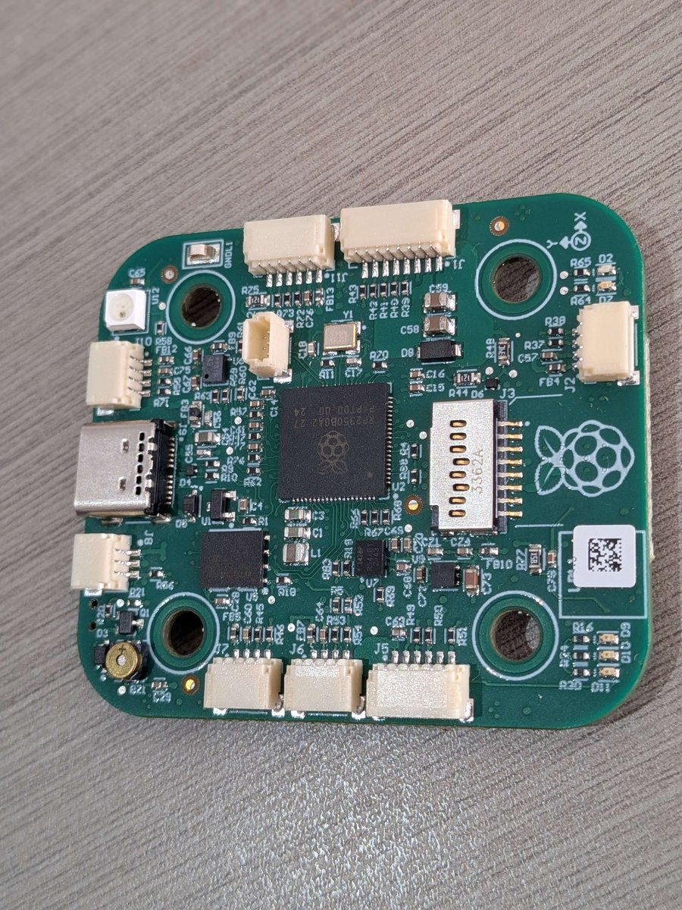
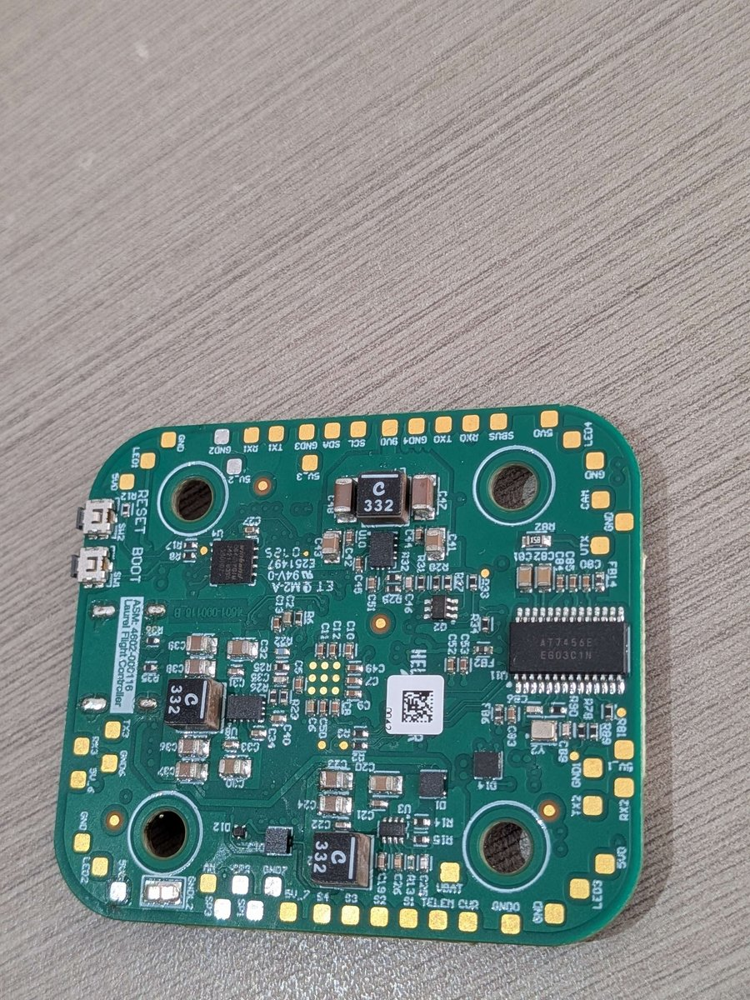

# Laurel Flight Controller

Laurel is a Raspberry Pi RP2350B flight controller used as a development
board for the ArduPilot RP2350 port. It is not built by the ArduPilot
firmware server; build it from source (see Loading Firmware).




Pin and connector details are in [HARDWARE.md](HARDWARE.md). Notes for
developers working on the port are in
`libraries/AP_HAL_ChibiOS/rp2350/DEVELOPMENT.md`.

## Features

- MCU - RP2350B dual-core Cortex-M33 running at 225 MHz, 520 KB SRAM
- QSPI flash for firmware and parameters
- ICM-42688-P IMU
- DPS310 barometer
- microSD card slot (SPI)
- 2 UARTs and 2 PIO UARTs, plus USB
- 4 PWM outputs with DShot and bidirectional DShot
- Battery voltage and current inputs, analog RSSI input
- Switched 5 V and 9 V rails
- Buzzer and two status LEDs
- SWD debug header

## UART Mapping

- SERIAL0 -> USB (MAVLink2)
- SERIAL1 -> UART0 (DisplayPort), J5 digital VTX connector
- SERIAL2 -> UART1 (GPS), J7
- SERIAL3 -> PIO UART0 (none by default, see RC Input), J2 receiver
  connector
- SERIAL4 -> PIO UART1 (MAVLink2), J10

## RC Input

RC input defaults to PPM on the J2 receiver connector, FC RX pin (GPIO21).
For a CRSF/ELRS receiver on J2, set `SERIAL3_PROTOCOL` = 23.

## OSD Support

Laurel supports DisplayPort on SERIAL1 (J5) with OSD_TYPE 5. The analog OSD
footprint shares SPI1 with the microSD card and is not used.

## PWM Output

Laurel supports 4 PWM or DShot outputs, with bidirectional DShot, on the J1
ESC connector. They are in two groups:

- PWM 1-2 in group1
- PWM 3-4 in group2

Channels within the same group need to use the same output rate. If any
channel in a group uses DShot then all channels in the group need to use
DShot.

## Battery Monitoring

The battery voltage is measured on the board, and the current-sense input
is on J1 pin 3. The default battery parameters are:

- `BATT_MONITOR` = 4
- `BATT_VOLT_PIN` = 0
- `BATT_CURR_PIN` = 1
- `BATT_VOLT_MULT` = 10.52
- `BATT_AMP_PERVLT` = 1.0

The current scale is a placeholder and needs calibrating for the ESC in
use.

## Analog RSSI input

Analog RSSI uses `RSSI_PIN` 2.

## Compass

Laurel does not have a builtin compass. The I2C bus is on J6.

## VTX power control

The 9 V output on J5 pin 1 is switched by GPIO15 and is off by default. No
relay is assigned to it in this target.

## Logging

Logs are written to the microSD card.

## Loading Firmware

Build the firmware with:

```bash
./waf configure --board Laurel
./waf copter
```

To install the bootloader the first time, hold `BOOT` while plugging in
USB, or hold `BOOT` and press `RESET`, to start the RP2350 ROM bootloader,
then either copy
`Tools/bootloaders/Laurel_bl.uf2` to the drive that appears, or, with
`picotool` on the path, run:

```bash
./waf configure --board Laurel --bootloader
./waf bootloader --upload
```

Once the bootloader is installed, load the `*.apj` firmware with any
ArduPilot ground station.
