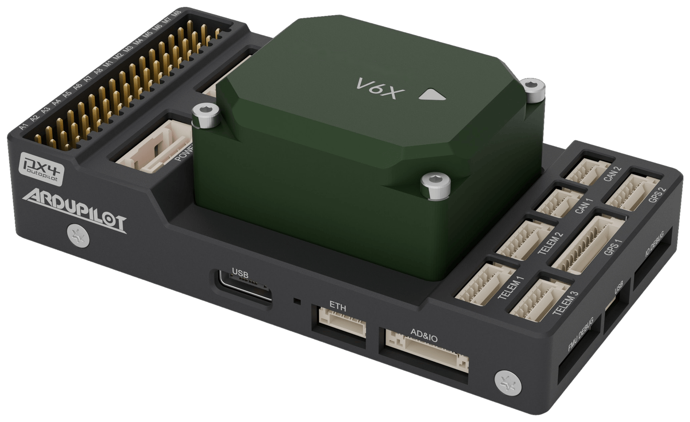
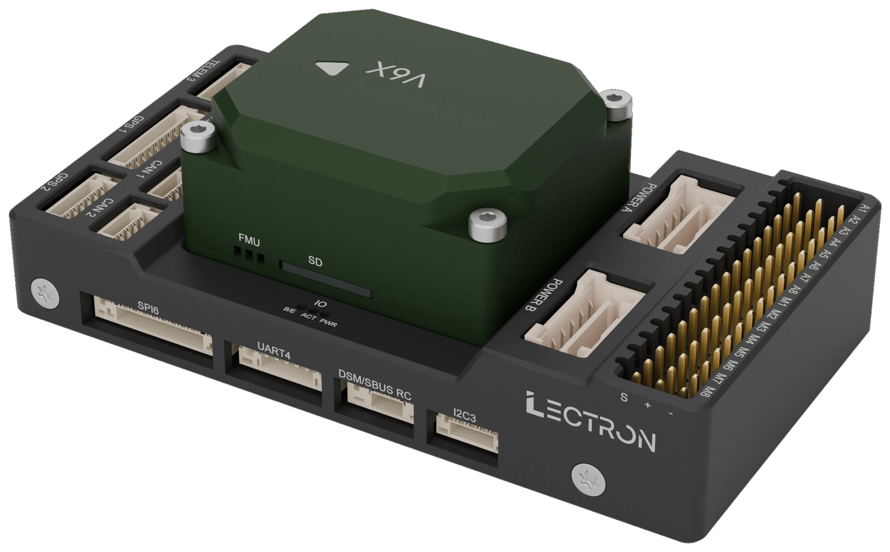
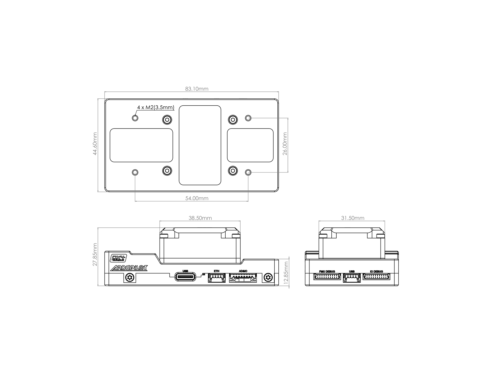
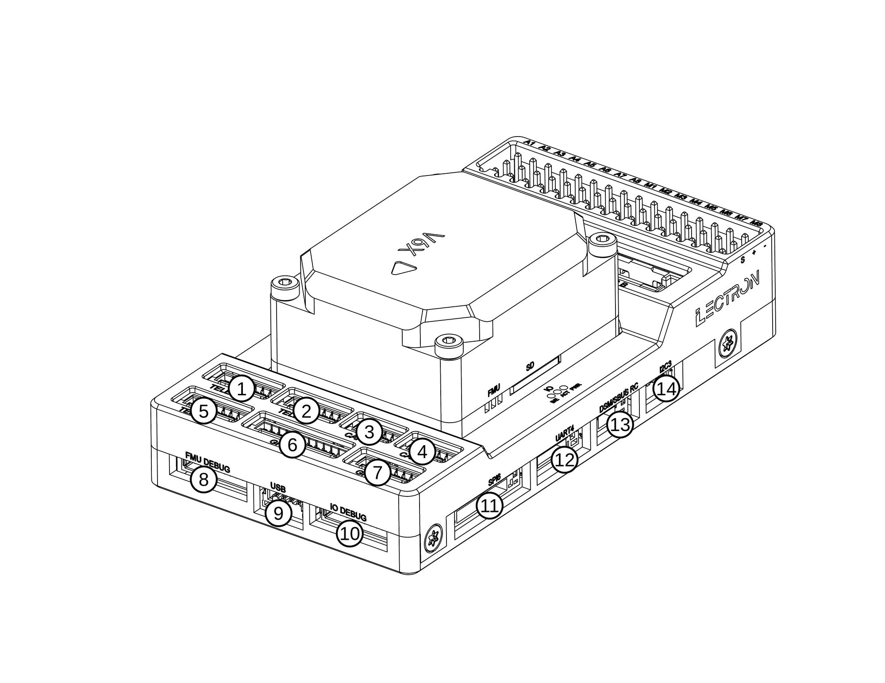
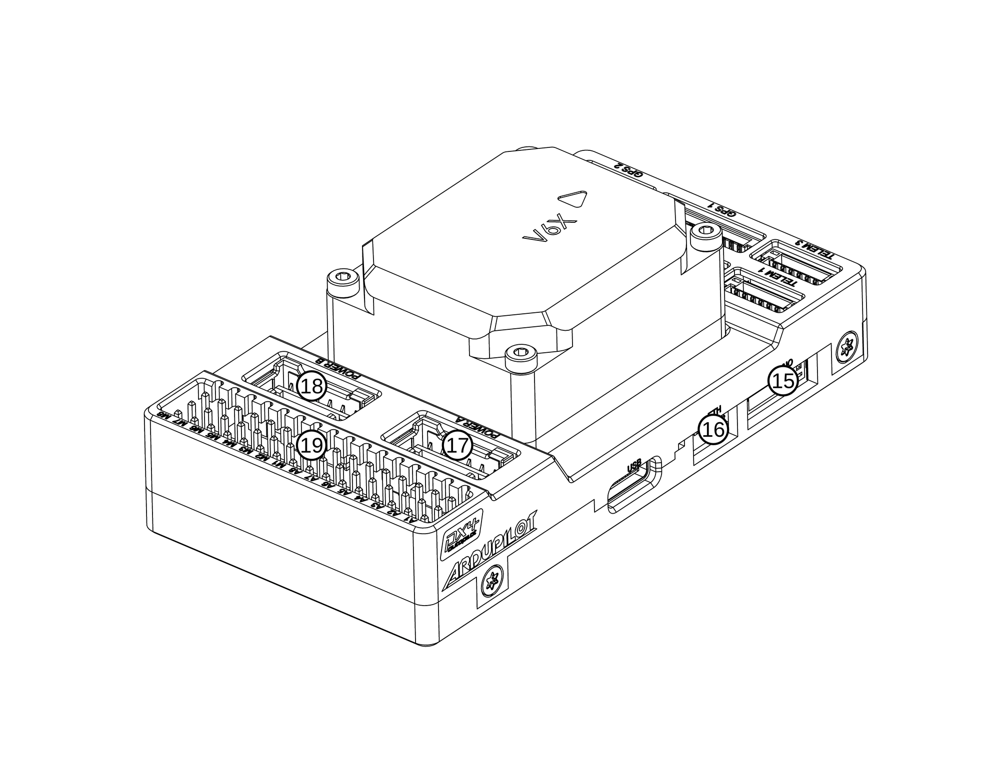
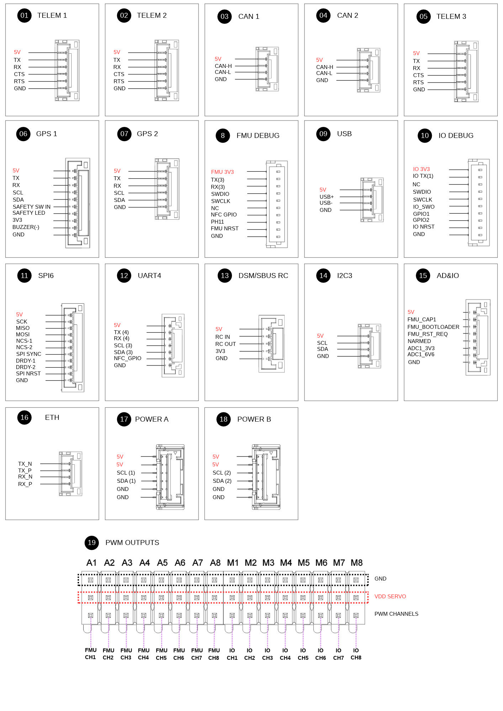
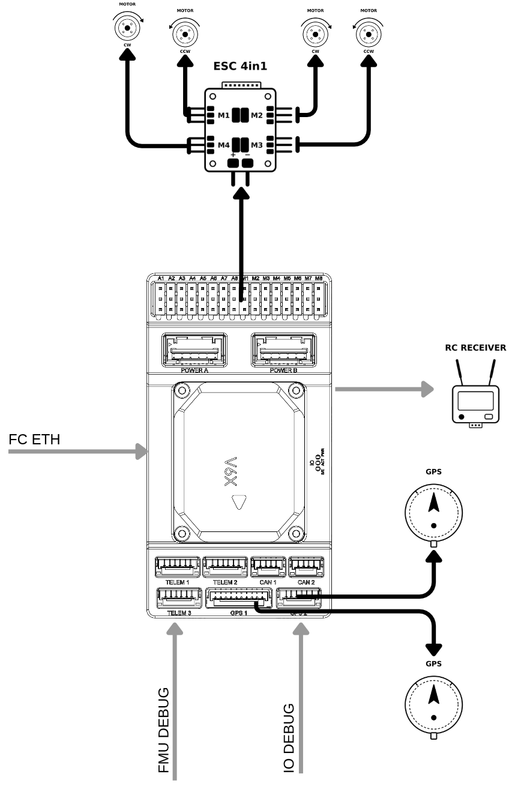

# Lectron V6X Flight Controller

The Lectron V6X is a flight controller designed by [Lectron](https://lectrontech.com/). It follows the Pixhawk Autopilot FMUv6X standard: an STM32H753 FMU module plugs into a carrier (base) board through the Pixhawk Autopilot Bus (PAB) connector. The FMU module carries triple redundant IMUs, dual barometers, a magnetometer, IMU heating, FRAM and the Ethernet PHY. An STM32F103 IO co-processor on the carrier board handles RC input and the M1-M8 PWM outputs.

## Where to Buy

For pricing and purchasing information, please [contact Lectron](https://lectrontech.com/contact-us/).

## Specifications

- **Processor**
  - STM32H753 32-bit processor (FMU), Arm Cortex-M7, 480 MHz, 2 MB flash, 1 MB RAM
  - STM32F103 IO co-processor (IOMCU), Arm Cortex-M3, 72 MHz
- **Sensors**
  - InvenSense ICM-45686 IMU (accel, gyro), SPI2
  - Bosch BMI088 IMU (accel, gyro), SPI3
  - InvenSense ICM-42688-P IMU (accel, gyro), SPI1
  - Bosch BMP581 barometer, I2C4
  - TE MS5611 barometer, I2C2
  - Bosch BMM350 magnetometer, I2C4
- **Onboard storage**
  - FM25V02A FRAM (SPI5) for parameter storage
  - 2x 24LC64 EEPROM (FMU module on I2C4, carrier board on I2C3)
  - microSD card for logging
- **Power**
  - Input voltage: 5 V on POWER A and POWER B
  - 5V peripheral outputs: 1.5 A total
- **Interfaces**
  - 7x UARTs available for customer use (TELEM1, TELEM2, TELEM3, GPS1, GPS2, UART4, FMU DEBUG)
  - 16x PWM outputs (M1-M8 from the IOMCU, A1-A8 from the FMU)
  - DSM/SBUS RC input and S.BUS output (on the IOMCU)
  - 3x external I2C buses
  - 2x CAN buses
  - External SPI port (SPI6) with 2 chip selects, 2 data-ready inputs, reset and sync lines
  - USB Type-C port and JST-GH USB port
  - 10/100 Mbps Ethernet (LAN8742A PHY)
  - AD&IO port with 2 analog inputs, FMU_CAP1 and nARMED
  - 2x power ports (POWER A, POWER B) for I2C digital power modules
  - Buzzer, safety switch and safety LED (on the GPS1 port)
- **Size and Dimensions**
  - Weight: TBD
  - Dimensions: 83.1 x 44.6 x 27.85 mm
  - Mounting: 4x M2, 54.0 x 26.0 mm hole spacing
  - Operating temperature: -40 to 70 C

## Pinout

See [Connectors](#connectors) for connector types.

## UART Mapping

Default mapping and protocols are shown below.

| Serial # | UART   | Protocol | Port      | Function                                    | Notes                               |
| -------- | ------ | -------- | --------- | ------------------------------------------- | ----------------------------------- |
| SERIAL0  | OTG1   | MAVLink2 | USB       | USB                                         | USB Type-C and JST-GH USB ports     |
| SERIAL1  | UART7  | MAVLink2 | TELEM1    | Telemetry port                              | RTS/CTS pins                        |
| SERIAL2  | UART5  | MAVLink2 | TELEM2    | Telemetry port                              | RTS/CTS pins                        |
| SERIAL3  | USART1 | GPS      | GPS1      | GPS, Mag, Safety Switch, Safety LED, Buzzer |                                     |
| SERIAL4  | UART8  | GPS      | GPS2      | GPS, Mag                                    |                                     |
| SERIAL5  | USART2 | None     | TELEM3    | Telemetry port                              | RTS/CTS pins                        |
| SERIAL6  | UART4  | None     | UART4     | User                                        | Same connector as I2C3 and NFC_GPIO |
| SERIAL7  | USART3 | None     | FMU DEBUG | Debug                                       | No DMA                              |

- USART6 provides the internal link between the FMU and the IO co-processor (IOMCU) and is not available as a serial port.
- The USART3 connector is labelled FMU DEBUG, but is available as a general purpose UART with ArduPilot.
- All UARTs except USART3 are DMA capable.

## RC Input

The DSM/SBUS RC connector (`5V / RC IN / RC OUT / 3V3 / GND`) is connected to the IO co-processor. RC IN can be used for all ArduPilot supported unidirectional receiver protocols, such as PPM, S.BUS and DSM. The 3V3 pin supplies Spektrum DSM satellite receivers. RC OUT provides an S.BUS output, enabled with the `BRD_SBUS_OUT` parameter.

FPort connected to RC IN provides RC only, without telemetry. CRSF/ELRS and SRXL2 need a true bi-directional UART and cannot be used on RC IN.

To use CRSF, SRXL2, or FPort with telemetry, connect the receiver to a full UART (see [UART Mapping](#uart-mapping)), such as TELEM1, and set the SERIALn parameters of the UART used:

`SERIALn_PROTOCOL` should be set to `23` (RCIN).

- FPort requires `SERIALn_OPTIONS` be set to `15`.
- CRSF requires `SERIALn_OPTIONS` be set to `0`.
- SRXL2 requires `SERIALn_OPTIONS` be set to `4` and connects only the TX pin.

See [Radio Control Systems](https://ardupilot.org/copter/docs/common-rc-systems.html) for details.

## PWM Output

The Lectron V6X has 16 PWM outputs, labelled M1-M8 and A1-A8 on the board. Outputs within the same timer group need to use the same output rate and protocol. If any output in a group uses DShot then all outputs in the group need to use DShot.

### M1-M8 (IOMCU)

M1-M8 are driven by the IO co-processor and are SERVO1-8 in ArduPilot. They support PWM only; DShot is not supported.

| Output | SERVO   | Timer group | DShot | Bi-Directional DShot |
| ------ | ------- | ----------- | ----- | -------------------- |
| M1     | SERVO1  | 1 (TIM2)    | No    | No                   |
| M2     | SERVO2  | 1 (TIM2)    | No    | No                   |
| M3     | SERVO3  | 2 (TIM4)    | No    | No                   |
| M4     | SERVO4  | 2 (TIM4)    | No    | No                   |
| M5     | SERVO5  | 3 (TIM3)    | No    | No                   |
| M6     | SERVO6  | 3 (TIM3)    | No    | No                   |
| M7     | SERVO7  | 3 (TIM3)    | No    | No                   |
| M8     | SERVO8  | 3 (TIM3)    | No    | No                   |

### A1-A8 (FMU)

A1-A8 are driven directly by the FMU and are SERVO9-16 in ArduPilot. A1-A6 support DShot, and A1-A4 also support Bi-Directional DShot. A7-A8 do not support DShot.

| Output | SERVO   | Timer group | DShot | Bi-Directional DShot |
| ------ | ------- | ----------- | ----- | -------------------- |
| A1     | SERVO9  | 1 (TIM5)    | Yes   | Yes                  |
| A2     | SERVO10 | 1 (TIM5)    | Yes   | Yes                  |
| A3     | SERVO11 | 1 (TIM5)    | Yes   | Yes                  |
| A4     | SERVO12 | 1 (TIM5)    | Yes   | Yes                  |
| A5     | SERVO13 | 2 (TIM4)    | Yes   | No                   |
| A6     | SERVO14 | 2 (TIM4)    | Yes   | No                   |
| A7     | SERVO15 | 3 (TIM12)   | No    | No                   |
| A8     | SERVO16 | 3 (TIM12)   | No    | No                   |

To enable Bi-Directional DShot on A1-A4 (SERVO9-12), set `SERVO_BLH_MASK` and `SERVO_BLH_BDMASK` to `3840` and select a DShot protocol with `SERVO_BLH_OTYPE` (or `MOT_PWM_TYPE` if they are multicopter motors).

## Battery Monitoring

The board has no onboard voltage or current sensor. It has two power ports for external I2C digital power modules: POWER A on I2C1 and POWER B on I2C2. Battery monitoring is disabled by default, and the parameters must be set for the power module connected.

For example, for an INA2xx (INA226, INA228, INA238) based power module on POWER A, set:

- `BATT_MONITOR` = 21
- `BATT_I2C_BUS` = 1
- `BATT_I2C_ADDR` = 0 (probe the supported addresses)

For a second power module on POWER B, set:

- `BATT2_MONITOR` = 21
- `BATT2_I2C_BUS` = 2
- `BATT2_I2C_ADDR` = 0

## I2C Bus Mapping

| ArduPilot Bus | I2C  | Connected to                                                   | Type     |
| ------------- | ---- | -------------------------------------------------------------- | -------- |
| 0             | I2C4 | BMP581, BMM350, 24LC64 EEPROM (FMU module)                     | Internal |
| 1             | I2C1 | GPS1 connector, POWER A connector                              | External |
| 2             | I2C2 | MS5611, GPS2 connector, POWER B connector                      | External |
| 3             | I2C3 | I2C3 connector, UART4 connector, 24LC64 EEPROM (carrier board) | External |

External compasses are probed on buses 1-3.

## Compass

The Lectron V6X has a built-in BMM350 compass. Due to potential interference, the autopilot is usually used with an external I2C compass as part of a GPS/Compass combination.

## IMU Heater

The IMU heater target temperature is set with the `BRD_HEAT_TARG` parameter, in degrees C. The default is 45 C.

## Ethernet

The board has a 10/100 Mbps Ethernet interface on the ETH connector, using a LAN8742A PHY.

Networking is disabled by default. To use it, set `NET_ENABLE` = 1 and reboot. DHCP is enabled by default; for a static address set `NET_DHCP` = 0 and configure `NET_IPADDR0-3`, `NET_NETMASK`, and `NET_GWADDR0-3`. Then configure a network port, for example MAVLink over UDP:

- `NET_P1_TYPE` = 1 (UDP client)
- `NET_P1_PROTOCOL` = 2 (MAVLink2)
- `NET_P1_IP0-3` = IP address of the GCS or companion computer
- `NET_P1_PORT` = 14550

See [Ethernet/Networking](https://ardupilot.org/copter/docs/common-network.html) for details.

## CAN

The Lectron V6X has two independent CAN buses on the CAN1 and CAN2 connectors.

## External SPI

SPI6 is available on the SPI6 connector with two chip selects, two data-ready inputs, a reset line and a sync line. The two chip selects are available as the `external0` (CS1) and `external1` (CS2) SPI devices.

## GPIOs

The A1-A8 PWM outputs and some other pins can be used as GPIOs (relays, buttons, RPM etc). To use an output as a GPIO, set its `SERVOx_FUNCTION` to -1. See [GPIOs](https://ardupilot.org/copter/docs/common-gpios.html) for details.

The numbering of the GPIOs for PIN variables in ArduPilot is:

- A1 50
- A2 51
- A3 52
- A4 53
- A5 54
- A6 55
- A7 56
- A8 57
- FMU_CAP1 58 (AD&IO connector)
- NFC_GPIO 60 (UART4 and FMU DEBUG connectors)
- M1 101
- M2 102
- M3 103
- M4 104
- M5 105
- M6 106
- M7 107
- M8 108

The nARMED pin on the AD&IO connector is an output that is driven low while the vehicle is armed.

## Analog Inputs

The Lectron V6X has the following analog inputs on the AD&IO connector:

- ADC Pin12 -> ADC1_6V6 (up to 6.6 V)
- ADC Pin13 -> ADC1_3V3 (up to 3.3 V)

## Connectors

Unless otherwise noted, all connectors are JST-GH (1.25 mm pitch). Exceptions:

- POWER A and POWER B: 6-pin Molex CLIK-Mate
- PWM outputs (M1-M8, A1-A8): 2.54 mm pin headers
- FMU DEBUG and IO DEBUG (PAB standard): JST-SH
- USB: Type-C (a JST-GH USB port is also provided)

## Typical Wiring Diagram

## Loading Firmware

Firmware for this board can be found at the [ArduPilot firmware server](https://firmware.ardupilot.org) in sub-folders labeled "Lectron-V6X".

The board comes pre-installed with an ArduPilot compatible bootloader, allowing the loading of \*.apj firmware files with any ArduPilot compatible ground station.
