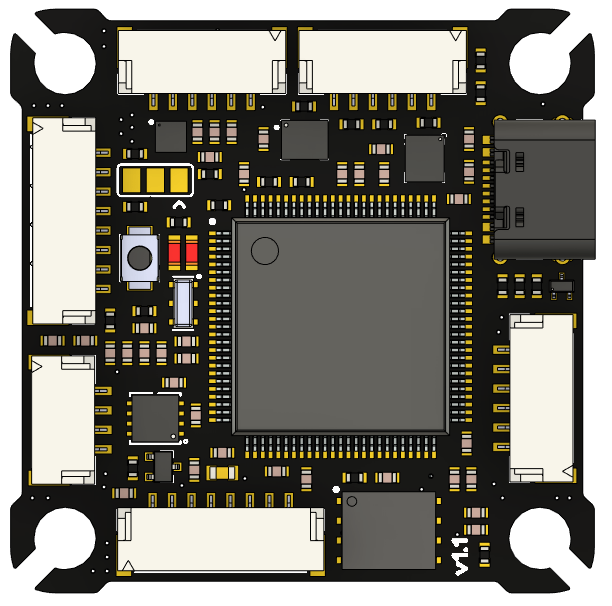
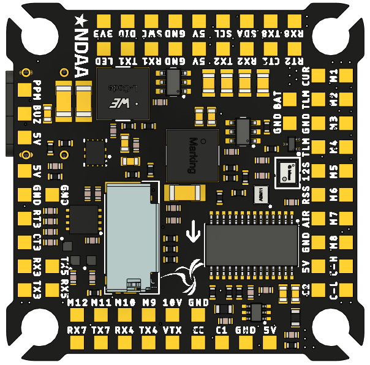
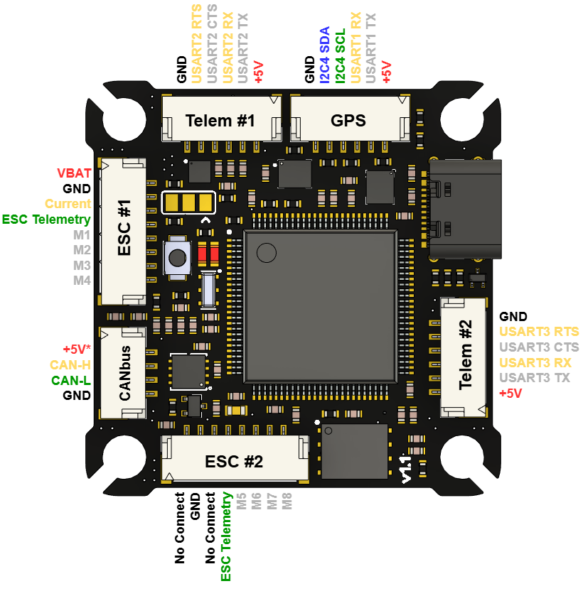
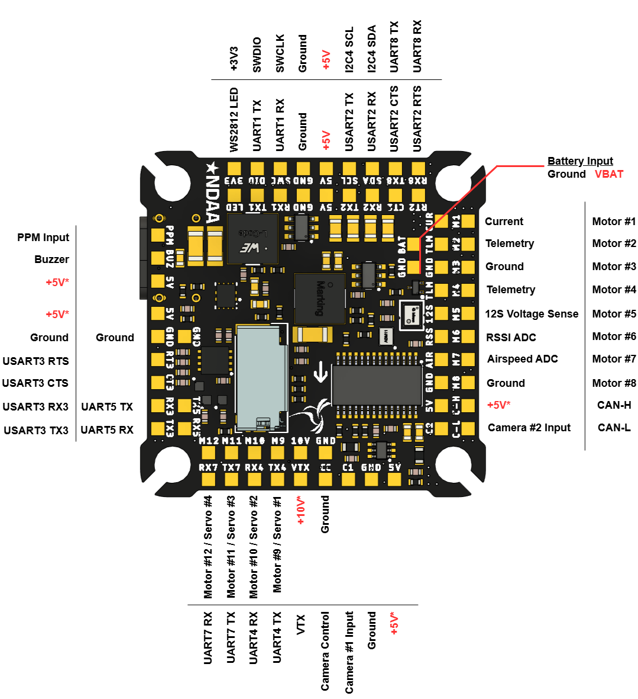

# Lumenier LUX H743 Flight Controller - NDAA

The Lumenier LUX H743 NDAA flight controller is manufactured by
[Lumenier](https://www.lumenier.com/). The manufacturer's manual is
[here](https://lumenier-1.gitbook.io/lumenier-lux-h743-ndaa-manual/).

## Where to Buy

- [Lumenier](https://www.lumenier.com/products/lumenier-lux-h743-flight-controller-ndaa)
- [GetFPV](https://www.getfpv.com/lumenier-lux-h743-flight-controller-ndaa.html)
- [RaceDayQuads](https://www.racedayquads.com/products/lumenier-lux-h743-flight-controller-ndaa)

## Specifications

- Processor

  - STM32H743 32-bit processor, 480MHz
  - 2MB Flash
  - 1MB RAM
  - AT7456E OSD

- Sensors

  - ICM-45686 IMU
  - ICM-42688-P IMU
  - DPS368 Barometer
  - LIS2MDL Magnetometer

- Interfaces

  - microSD card
  - USB-C
  - 12 PWM outputs plus a WS2812 LED output
  - 7 UARTs, two with flow control
  - External I2C port
  - CANbus with built-in 120 Ohm termination
  - ESC connectors with current sense and telemetry inputs
  - Analog airspeed and RSSI inputs
  - Analog video camera switch (C1/C2)
  - W25Q128JV 128Mbit flash

- Power

  - 3S to 8S battery input (up to 12S voltage sensing with a solder jumper)
  - +10V 3A GPIO controlled VTX power output
  - +5V 3A output for board and peripherals

- Dimensions

  - Size: 37.5mm x 37.5mm, 30.5mm mounting holes

- NDAA compliant

## Pinout

Power rails marked with an asterisk (*) need the battery connected to be powered.

### Connectors

All connectors are JST GH 1.25mm pitch.

#### ESC #1 Port

| Pin | Signal | Volt |
| --- | --- | --- |
| 1 | VBAT | VBAT |
| 2 | GND | GND |
| 3 | CURRENT | +3.3V |
| 4 | TELEMETRY (RX8) | +3.3V |
| 5 | MOTOR 1 | +3.3V |
| 6 | MOTOR 2 | +3.3V |
| 7 | MOTOR 3 | +3.3V |
| 8 | MOTOR 4 | +3.3V |

#### ESC #2 Port

| Pin | Signal | Volt |
| --- | --- | --- |
| 1 | NOT CONNECTED | NOT CONNECTED |
| 2 | GND | GND |
| 3 | NOT CONNECTED | NOT CONNECTED |
| 4 | TELEMETRY (RX8) | +3.3V |
| 5 | MOTOR 5 | +3.3V |
| 6 | MOTOR 6 | +3.3V |
| 7 | MOTOR 7 | +3.3V |
| 8 | MOTOR 8 | +3.3V |

#### Telem #1 Port

| Pin | Signal | Volt |
| --- | --- | --- |
| 1 | +5V | +5V |
| 2 | USART2 TX | +3.3V |
| 3 | USART2 RX | +3.3V |
| 4 | USART2 CTS | +3.3V |
| 5 | USART2 RTS | +3.3V |
| 6 | GND | GND |

#### Telem #2 Port

| Pin | Signal | Volt |
| --- | --- | --- |
| 1 | +5V | +5V |
| 2 | USART3 TX | +3.3V |
| 3 | USART3 RX | +3.3V |
| 4 | USART3 CTS | +3.3V |
| 5 | USART3 RTS | +3.3V |
| 6 | GND | GND |

#### GPS Port

| Pin | Signal | Volt |
| --- | --- | --- |
| 1 | +5V | +5V |
| 2 | USART1 TX | +3.3V |
| 3 | USART1 RX | +3.3V |
| 4 | I2C4 SCL | +3.3V |
| 5 | I2C4 SDA | +3.3V |
| 6 | GND | GND |

#### CANbus Port

| Pin | Signal | Volt |
| --- | --- | --- |
| 1 | +5V (needs battery power) | +5V |
| 2 | CAN_H | +5V |
| 3 | CAN_L | +5V |
| 4 | GND | GND |

The board has one built-in 120 Ohm CAN termination resistor, so a second
one is needed at the other end of the bus. To use DroneCAN devices on the
CANbus port, set CAN_P1_DRIVER = 1 and reboot.

### Other pads

The CC (Camera Control) pad is not supported by ArduPilot.

## UART Mapping

The UARTs are marked RXn and TXn in the above pinouts. The RXn pin is the
receive pin for UARTn. The TXn pin is the transmit pin for UARTn.

| Port | UART   | Label            | Protocol      | TX DMA | RX DMA |
| ---- | ------ | ---------------- | ------------- | ------ | ------ |
| 0    | USB    | USB              | MAVLink2      | ✘      | ✘      |
| 1    | USART2 | Telem #1         | MAVLink2      | ✔      | ✔      |
| 2    | USART3 | Telem #2         | MAVLink2      | ✔      | ✔      |
| 3    | USART1 | GPS              | GPS           | ✔      | ✔      |
| 4    | UART5  | TX5/RX5          | GPS           | ✘      | ✘      |
| 5    | UART4  | TX4/RX4          | DisplayPort   | ✘      | ✘      |
| 6    | UART7  | TX7/RX7          | RCIN          | ✔      | ✔      |
| 7    | UART8  | TX8/RX8, ESC TLM | ESC Telemetry | ✘      | ✘      |

USART2 and USART3 have flow control pins. The TLM pins on both ESC
connectors and the RX8 pad are the same UART8 RX.

## RC Input

RC input is configured on UART7 (SERIAL6) by default, and supports all
serial RC protocols, including bi-directional protocols like CRSF/ELRS.
A PPM receiver can be connected to the PPM pad. Any other UART can be used
for RC system connections in ArduPilot and is compatible with all
protocols except PPM. See
[RC systems](https://ardupilot.org/plane/docs/common-rc-systems.html)
for details.

## PWM Outputs

The LUX H743 NDAA supports 12 PWM outputs and a WS2812 LED output.
All outputs are DShot capable. Outputs 1-8 support bi-directional DShot.
Outputs 1-8 are labeled M1 to M8 and are on the ESC connectors and pads.
Outputs 9-12 are on the M9 to M12 pads (Servo 1 to 4 in the pinout).

The PWM outputs are in 4 groups:

- PWM 1-4 in group1 (TIM1)
- PWM 5-8 in group2 (TIM8)
- PWM 9-12 in group3 (TIM4)
- PWM 13 (LED) in group4 (TIM3)

Channels within the same group need to use the same output rate. If any
channel in a group uses DShot then all channels in the group need to use
DShot.

Output 13 is on the pad labeled LED and defaults to NeoPixel serial LED
output (SERVO13_FUNCTION = 120).

An active 5V buzzer connected to the BZ+ and BZ- pads is driven as a GPIO
buzzer (GPIO 80) and is enabled by default.

## OSD Support

The LUX H743 NDAA has an onboard AT7456E analog OSD, which is enabled by
default. Simultaneously, DisplayPort OSD is available on UART4 (SERIAL5),
and OSD_TYPE2 defaults to 5 so the DisplayPort OSD runs alongside the
analog OSD.

Note: if SERIAL5_PROTOCOL is ever changed from MSP DisplayPort, OSD_TYPE2
must be set to 0, or a pre-arm failure will result.

## HD VTX Support

The TX4/RX4 pads, next to the +10V VTX power pads, are intended for an HD
VTX such as a DJI Air Unit and default to MSP DisplayPort on SERIAL5. The
same pads can instead be used for analog VTX control (SmartAudio or Tramp),
in which case SERIAL5_PROTOCOL must be changed to match the VTX that is
connected and OSD_TYPE2 set to 0.

## VTX power control

GPIO 82 controls the +10V VTX power output. RELAY2 controls this GPIO by
default and is configured inverted, so that RELAY2 ON powers the VTX and
RELAY2 OFF removes power. RELAY2 defaults ON, so the VTX is powered at
boot. See [Relay Switch](https://ardupilot.org/copter/docs/common-relay.html)
for how to control it from an RC channel or the ground station.

## Camera Switch

GPIO 81 controls which analog camera input, C1 or C2, is used. RELAY1
controls this GPIO by default. RELAY1 OFF (the boot default) selects C1
and RELAY1 ON selects C2.

## Compass

The LUX H743 NDAA has a built-in LIS2MDL compass. Due to potential
interference, the autopilot is usually used with an external I2C compass
as part of a GPS/Compass combination, connected to the I2C4 pins on the
GPS port.

## RSSI

If the RSS pad is used for analog RSSI input, set RSSI_ANA_PIN to 8 and
RSSI_TYPE to 1.

## Analog Airspeed

If the AIR pad is used for analog airspeed input, set ARSPD_PIN to 4 and
ARSPD_TYPE to 2.

## GPIOs

| Pin     | GPIO Number |
| ------- | ----------- |
| PWM(1)  | 50          |
| PWM(2)  | 51          |
| PWM(3)  | 52          |
| PWM(4)  | 53          |
| PWM(5)  | 54          |
| PWM(6)  | 55          |
| PWM(7)  | 56          |
| PWM(8)  | 57          |
| PWM(9)  | 58          |
| PWM(10) | 59          |
| PWM(11) | 60          |
| PWM(12) | 61          |
| PWM(13) | 62          |
| BUZZER  | 80          |
| CAM SW  | 81          |
| VTX PWR | 82          |

## Battery Monitoring

The board has an internal voltage sensor and a current sensor input on
the ESC #1 connector and the CUR pad.

The default battery parameters are:

- BATT_MONITOR = 4
- BATT_VOLT_PIN = 10 (BAT pad)
- BATT_CURR_PIN = 11 (CUR pad)
- BATT_VOLT_MULT = 10.1
- BATT_AMP_PERVLT = 17.0 (depends on the ESC's current sensor)

The board ships with the voltage sensor set up for batteries up to 8S
(10:1 divider). A solder jumper selects a 20:1 divider for sensing up to
12S, using the 12S pad; this does not make the board itself 12S capable.
See the manufacturer's manual before changing it, and set BATT_VOLT_MULT
to match, calibrating it against a voltmeter.

## Logging

Logs are stored on the microSD card. ArduPilot does not use the onboard
flash chip for logging.

## Firmware

Firmware for the LUX H743 NDAA is available from the
[ArduPilot Firmware Server](https://firmware.ardupilot.org) under the
`LumenierLUXH743-NDAA` target.

## Loading Firmware

To load ArduPilot firmware initially, hold the boot button while plugging
in USB. Then use the STM32CubeProgrammer app to load the "\*\*\*_with_bl.hex"
file. Subsequently, a GCS can update firmware using the \*.apj files.
