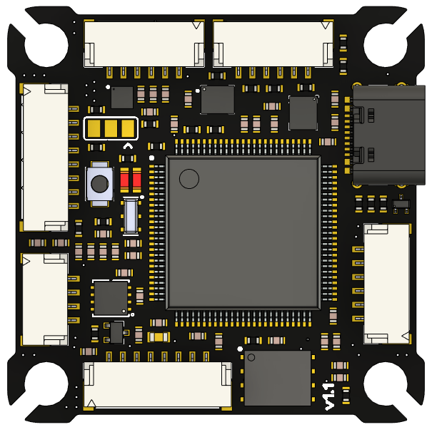
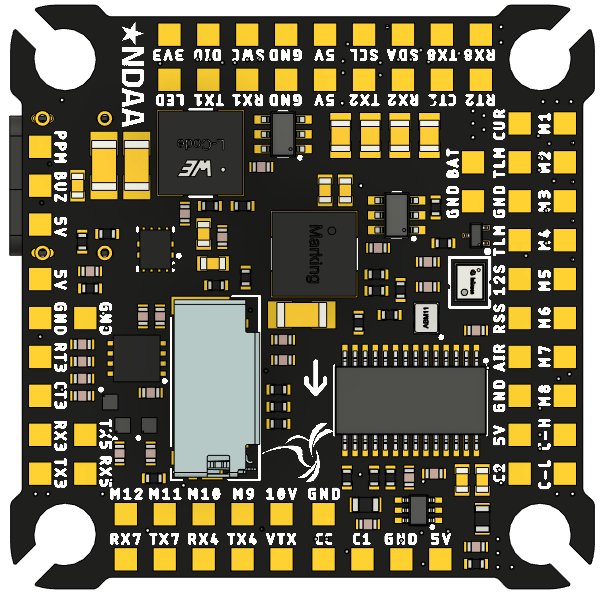
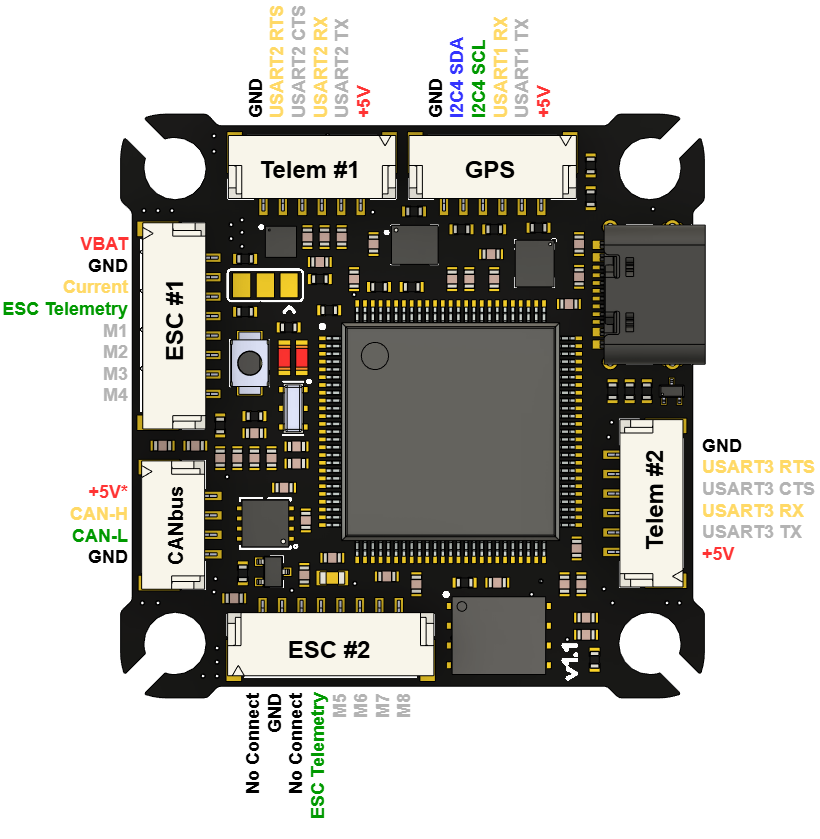
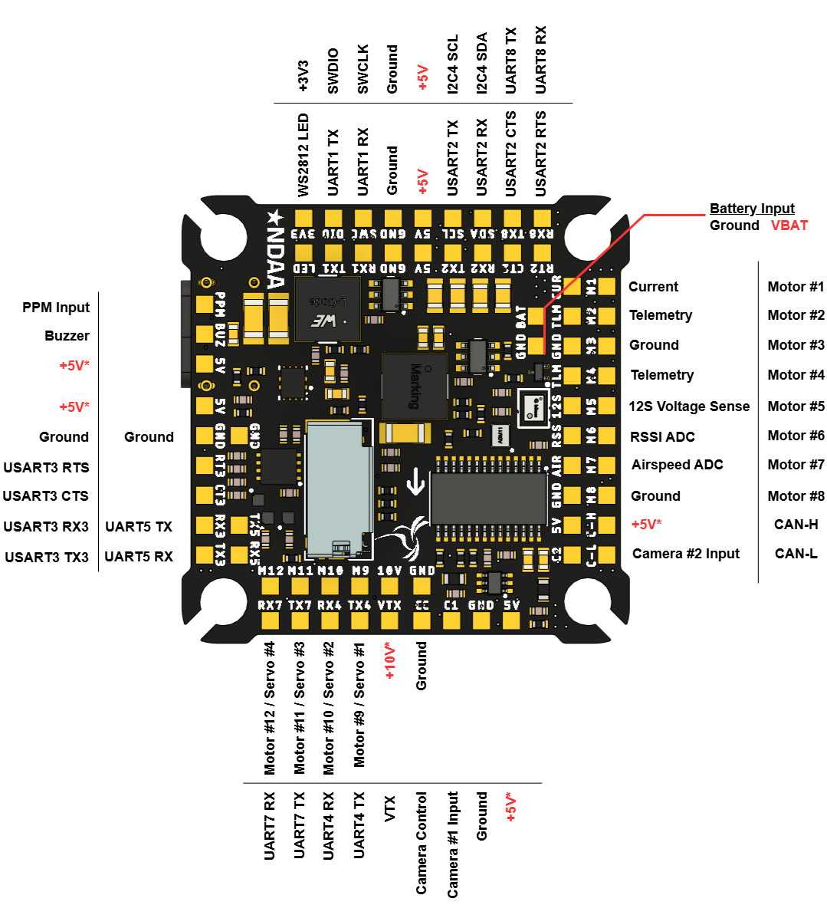

# Lumenier LUX H743 Flight Controller - NDAA

The Lumenier LUX H743 NDAA flight controller is sold by
[GetFPV](https://www.getfpv.com/lumenier-lux-h743-flight-controller-ndaa.html).
The manufacturer's manual is
[here](https://lumenier-1.gitbook.io/lumenier-lux-h743-ndaa-manual/).

## Features

- Processor: STM32H743, 480MHz, 1MB RAM, 2MB Flash
- Dual IMUs: ICM-45686 and ICM-42688-P
- DPS368 Barometer
- LIS2MDL Magnetometer
- AT7456E OSD
- microSD Card Slot
- W25Q128JV Flash (128Mbit)
- 12 PWM Outputs plus a WS2812 LED output
- 7 UARTs, two with flow control
- External I2C Port
- CANbus Support
- Analog Battery Voltage and Current Sensor Inputs
- Airspeed and RSSI Analog Inputs
- Camera Switch and VTX Power Switch
- +5V 3A Regulator for Accessories
- +10V 3A Regulator for VTX Power
- USB Type-C (2.0)
- Power Supply: 3S to 8S Battery Voltage
- Size: 37.5mm x 37.5mm, 30.5mm mounting holes
- NDAA compliant

## Pinout

Power rails marked with an asterisk (*) need the battery connected to be powered.

## UART Mapping

- SERIAL0 -> USB
- SERIAL1 -> USART2 (Telem1, RTS/CTS, DMA enabled)
- SERIAL2 -> USART3 (Telem2, RTS/CTS, DMA enabled)
- SERIAL3 -> USART1 (GPS1, DMA enabled)
- SERIAL4 -> UART5  (GPS2)
- SERIAL5 -> UART4  (DisplayPort)
- SERIAL6 -> UART7  (RC Input, DMA enabled)
- SERIAL7 -> UART8  (ESC Telemetry)

## SPI Mapping

| SPI | Device |
| --- | --- |
| 1 | W25Q128JV Flash |
| 2 | SD Card |
| 3 | ICM-45686 |
| 4 | AT7456E |
| 6 | ICM-42688-P |

## Connectors

All connectors are JST GH 1.25mm pitch.

### ESC #1 Port

| Pin | Signal | Volt |
| --- | --- | --- |
| 1 | VBAT | VBAT |
| 2 | GND | GND |
| 3 | CURRENT | +3.3V |
| 4 | TELEMETRY | +3.3V |
| 5 | MOTOR 1 | +3.3V |
| 6 | MOTOR 2 | +3.3V |
| 7 | MOTOR 3 | +3.3V |
| 8 | MOTOR 4 | +3.3V |

### ESC #2 Port

| Pin | Signal | Volt |
| --- | --- | --- |
| 1 | NOT CONNECTED | NOT CONNECTED |
| 2 | GND | GND |
| 3 | NOT CONNECTED | NOT CONNECTED |
| 4 | TELEMETRY | +3.3V |
| 5 | MOTOR 5 | +3.3V |
| 6 | MOTOR 6 | +3.3V |
| 7 | MOTOR 7 | +3.3V |
| 8 | MOTOR 8 | +3.3V |

### Telem #1 Port

| Pin | Signal | Volt |
| --- | --- | --- |
| 1 | +5V | +5V |
| 2 | USART2 TX | +3.3V |
| 3 | USART2 RX | +3.3V |
| 4 | USART2 CTS | +3.3V |
| 5 | USART2 RTS | +3.3V |
| 6 | GND | GND |

### Telem #2 Port

| Pin | Signal | Volt |
| --- | --- | --- |
| 1 | +5V | +5V |
| 2 | USART3 TX | +3.3V |
| 3 | USART3 RX | +3.3V |
| 4 | USART3 CTS | +3.3V |
| 5 | USART3 RTS | +3.3V |
| 6 | GND | GND |

### GPS Port

| Pin | Signal | Volt |
| --- | --- | --- |
| 1 | +5V | +5V |
| 2 | USART1 TX | +3.3V |
| 3 | USART1 RX | +3.3V |
| 4 | I2C4 SCL | +3.3V |
| 5 | I2C4 SDA | +3.3V |
| 6 | GND | GND |

### CANbus Port

| Pin | Signal | Volt |
| --- | --- | --- |
| 1 | +5V (needs battery power) | +5V |
| 2 | CAN_H | +5V |
| 3 | CAN_L | +5V |
| 4 | GND | GND |

The board has one built-in 120 Ohm CAN termination resistor, so a second
one is needed at the other end of the bus.

## PWM Output

The LUX H743 NDAA supports 12 PWM outputs and a WS2812 LED output.
All outputs are DShot capable. Outputs 1-8 support bi-directional DShot.
Outputs 1-8 are labeled M1 to M8 and are on the ESC connectors and pads.
Outputs 9-12 are on the M9 to M12 pads (Servo 1 to 4 in the pinout).

The PWM outputs are in 4 groups:

- PWM 1-4 in group1 (TIM1)
- PWM 5-8 in group2 (TIM8)
- PWM 9-12 in group3 (TIM4)
- PWM 13 (LED) in group4 (TIM3)

Channels within the same group need to use the same output rate. If any
channel in a group uses DShot then all channels in the group need to use
DShot.

Output 13 is on the pad labeled LED and can drive WS2812 LEDs by setting
SERVO13_FUNCTION to 120 (NeoPixel1).

The buzzer pad is not supported by ArduPilot.

## RC Input

RC input is configured on UART7 (SERIAL6) by default, and supports all
serial RC protocols, including bi-directional protocols like CRSF/ELRS.
A PPM receiver can be connected to the PPM pad.

## OSD Support

The LUX H743 NDAA has an onboard AT7456E analog OSD on SPI4.
UART4 (SERIAL5) defaults to MSP DisplayPort for HD VTX systems, and
OSD_TYPE2 defaults to 5 so the DisplayPort OSD runs alongside the
analog OSD.

## Camera Switch and VTX Power

- RELAY1 (GPIO 81) controls the camera switch
- RELAY2 (GPIO 82) controls the +10V VTX power output

See [Relay Switch](https://ardupilot.org/copter/docs/common-relay.html)
for how to control these from an RC channel.

## Analog Inputs

- PC0 -> Battery Voltage (ADC pin 10)
- PC1 -> Battery Current (ADC pin 11)
- PC4 -> Airspeed (ADC pin 4)
- PC5 -> RSSI (ADC pin 8)

## Battery Monitoring

The board has an internal voltage sensor and a current sensor input on
the ESC #1 connector.

The default parameters are as follows:

- BATT_MONITOR = 4
- BATT_VOLT_PIN = 10
- BATT_CURR_PIN = 11
- BATT_VOLT_MULT = 10.1
- BATT_AMP_PERVLT = 17.0 (depends on the ESC's current sensor)

The board ships with the voltage sensor set up for batteries up to 8S
(10:1 divider). A solder jumper selects a 20:1 divider for sensing up to
12S, using the 12S pad; this does not make the board itself 12S capable.
See the manufacturer's manual before changing it, and set BATT_VOLT_MULT
to match, calibrating it against a voltmeter.

## Compass

The LUX H743 NDAA has a built-in LIS2MDL compass. External compasses can be
connected to the I2C4 pins on the GPS port.

## Logging

Logs are stored on the microSD card. ArduPilot does not use the onboard
flash chip for logging.

## Firmware

Firmware for the LUX H743 NDAA can be found
[here](https://firmware.ardupilot.org) in sub-folders labeled
"LumenierLUXH743-NDAA".

## Loading Firmware

Initial firmware load can be done with DFU by plugging in USB with the
boot button pressed. Then load the "with_bl.hex" firmware, using your
favorite DFU loading tool.

Once the initial firmware is loaded you can update the firmware using
any ArduPilot ground station software. Updates should be done with the
\*.apj firmware files.
