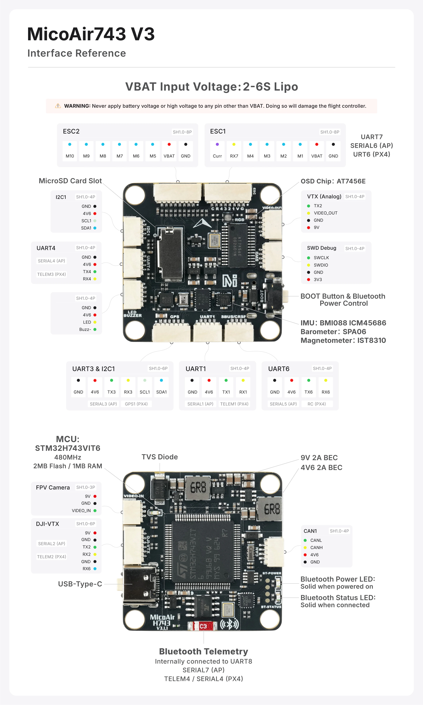
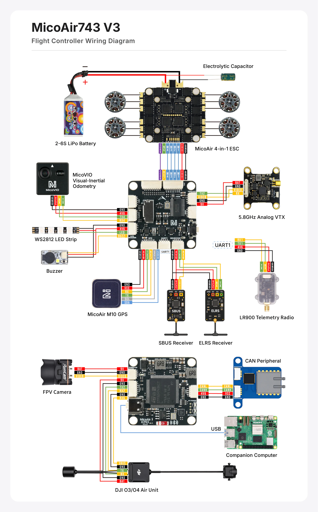

# MicoAir743v3 Flight Controller

The MicoAir743v3 is a flight controller designed and manufactured by [MicoAir Tech](https://micoair.com/). It provides two IMUs, an onboard compass, analog and digital OSD support, and Bluetooth telemetry.

The [manufacturer's user manual](https://micoair.com/en/docs/flight-controller/micoair743/micoair743v3-flight-controller) contains additional hardware and connection information.

## Features

- STM32H743VIT6 microcontroller, 480 MHz, 2 MB flash
- BMI088 and ICM45686 IMUs
- SPA06 barometer
- IST8310 compass
- AT7456E analog OSD and MSP DisplayPort support
- MicroSD card slot for logging
- 7 UARTs, including one RX-only ESC telemetry port and one internal Bluetooth connection
- 10 motor/servo outputs and an additional LED/PWM output
- 1 external I2C bus, 1 CAN interface, and SWD debugging
- USB Type-C connector
- Integrated SPP/BLE Bluetooth telemetry
- 2–6S battery input, 6–27 V
- 4.6 V / 2 A BEC and switchable 9 V / 2 A BEC
- 30.5 x 30.5 mm mounting pattern with 4 mm holes
- Dimensions: 36 x 36 x 8 mm; weight: 10 g

## Where to Buy

- [MicoAir Tech Store](https://store.micoair.com/)

## Pinout

Connector orientation and pin order are shown in the image above. The GPS connector and the separate I2C1 connector share I2C1. The DJI-VTX connector's RX6 pin shares the receiver input on UART6; do not connect two receiver outputs to this signal.

The VTX (Analog), DJI-VTX, and FPV Camera connectors share the switched 9 V supply. Turning this supply off also turns off the connected camera. The receiver, GPS, I2C1, and telemetry connectors use the 4.6 V rail. Check peripheral voltage requirements before connecting them.

## Wiring Examples

This diagram is from the manufacturer's user manual. Receiver and video-system examples show alternative connections; use only one receiver output on RX6 and configure each UART for the connected device.

## UART Mapping

| ArduPilot port | Hardware port | Default function | Notes |
| --- | --- | --- | --- |
| SERIAL0 | USB | MAVLink2 | USB Type-C |
| SERIAL1 | USART1 | MAVLink2 | TX1/RX1, 57600 baud |
| SERIAL2 | USART2 | MSP DisplayPort | TX2/RX2, DJI-VTX connector; TX2 also on VTX (Analog) |
| SERIAL3 | USART3 | GPS | TX3/RX3, GPS connector |
| SERIAL4 | UART4 | MAVLink2 | TX4/RX4, 230400 baud |
| SERIAL5 | USART6 | RC input | TX6/RX6, receiver connector |
| SERIAL6 | UART7 | ESC telemetry | RX7 only, ESC1 connector |
| SERIAL7 | UART8 | MAVLink2 | Internal Bluetooth module, 115200 baud |

UART5 is not connected. UART7 TX is not exposed. UART8 is dedicated to the onboard Bluetooth module. USB and USART1 are also enabled in the bootloader.

All seven hardware UARTs have both TX and RX DMA enabled; only the RX signal of UART7 is available on a connector.

## RC Input

UART6 is the default receiver port (`SERIAL5_PROTOCOL = 23`). PPM input is not supported by this configuration.

- SBUS, DSM, and SRXL receivers connect to RX6.
- CRSF/ELRS receivers connect receiver TX to RX6 and receiver RX to TX6, providing RC input and telemetry.
- FPort receivers connect to TX6. Configure the serial options for the receiver as described in the [FPort documentation](https://ardupilot.org/copter/docs/common-FPort-receivers.html).
- SRXL2 receivers connect to TX6 and require `SERIAL5_OPTIONS = 4`.

Other available UARTs can be configured for serial RC input. See [Radio Control Systems](https://ardupilot.org/copter/docs/common-rc-systems.html) for protocol-specific settings.

## PWM Output

There are 10 motor/servo outputs, M1 through M10, and an additional output on the LED connector, mapped to SERVO11.

M1–M10 support DShot; M1–M8 also support bidirectional DShot. Outputs sharing a timer must use the same output protocol and compatible rates.

| Timer group | Outputs |
| --- | --- |
| TIM1 | M1, M2, M3, M4 |
| TIM3 | M5, M6 |
| TIM4 | M7, M8, LED/SERVO11 |
| TIM15 | M9, M10 |

The serial LED strip shown in the wiring examples is optional and is not enabled by default, leaving M7 and M8 available for motor outputs. When SERVO11 is used for a serial LED strip, M7 and M8 share its timer and cannot simultaneously be used as motor outputs. M9 and M10 remain available for PWM servo or unidirectional DShot outputs; this configuration does not enable bidirectional DShot on those two outputs.

## OSD Support

The onboard AT7456E analog OSD is enabled by default (`OSD_TYPE = 1`). Simultaneous MSP DisplayPort OSD operation is also pre-configured on SERIAL2 at the DJI-VTX connector (`SERIAL2_PROTOCOL = 42`, `OSD_TYPE2 = 5`).

The FPV Camera connector provides 9 V, GND, and VIDEO_IN for the analog camera. Its video passes through the analog OSD to VIDEO_OUT on the VTX (Analog) connector. This analog video path can operate alongside DisplayPort OSD.

TX2 is also present on the VTX (Analog) connector for analog VTX control. This signal shares SERIAL2 with the DJI-VTX connector, so choose either DisplayPort or analog VTX serial control. For an analog VTX using SmartAudio or Tramp, set `SERIAL2_PROTOCOL` to 37 (SmartAudio) or 44 (Tramp).

When changing SERIAL2 from MSP DisplayPort to analog VTX control, also set `OSD_TYPE2 = 0` and reboot to avoid a pre-arm failure.

## VTX Power Control

Relay 1 (GPIO 62) controls the shared 9 V supply for the VTX (Analog), DJI-VTX, and FPV Camera connectors. The firmware configures the relay so ON powers these connectors and OFF removes power from all three, including the camera.

The supply is ON by default when the flight battery is connected and remains ON after startup. No parameter changes are needed to keep the camera and VTX powered.

To control the supply with a two-position RC switch, assign the switch to an unused RC channel. This example uses channel 8:

| Parameter | Value | Purpose |
| --- | --- | --- |
| `RC8_OPTION` | 28 | Assign channel 8 to Relay 1 |

The high switch position turns the supply ON and the low position turns it OFF. For a different channel, set the corresponding `RCx_OPTION` instead of `RC8_OPTION`.

## GPIOs

| Output | ArduPilot GPIO |
| --- | --- |
| M1–M10 | 50–59 respectively |
| LED/SERVO11 | 60 |
| Buzzer | 61 |
| VTX power control | 62 |

PWM outputs can be configured as GPIOs where required. See [GPIOs](https://ardupilot.org/copter/docs/common-gpios.html).

## Battery Monitoring

Battery voltage is measured onboard and can handle up to 6S LiPo batteries. The current-sensor signal is supplied by the ESC through the ESC1 connector. The default parameters are:

| Parameter | Default |
| --- | --- |
| BATT_MONITOR | 4 |
| BATT_VOLT_PIN | 10 |
| BATT_CURR_PIN | 11 |
| BATT_VOLT_MULT | 21.12 |
| BATT_AMP_PERVLT | 40.2 |

Calibrate the voltage reading against a meter and adjust the current scale for the connected ESC. These ADC inputs are dedicated to battery monitoring; there is no separately configured analog RSSI or analog airspeed input.

## Compass

The MicoAir743v3 has a built-in IST8310 compass on the internal I2C bus. Due to potential interference, the autopilot is usually used with an external I2C compass as part of a GPS/Compass combination, connected to SDA1/SCL1 on the GPS or I2C1 connector.

## CAN

The CAN1 connector provides CANH, CANL, 4V6, and GND. DroneCAN is not enabled by default; set `CAN_P1_DRIVER = 1` and reboot to use DroneCAN peripherals. See the [DroneCAN documentation](https://ardupilot.org/copter/docs/common-uavcan-setup-advanced.html).

## Bluetooth

The onboard SPP/BLE module is connected to UART8 (`SERIAL7`). Its firmware defaults are MAVLink2 at 115200 baud. Use a compatible ground station or the manufacturer's Bluetooth-capable tools. The module appears as `MicoAir743v3-xxxxx`.

Bluetooth power is controlled by the board's BOOT button after startup. See the manufacturer's manual for pairing and power-control instructions.

## Firmware

Firmware for the MicoAir743v3 is available from the [ArduPilot Firmware Server](https://firmware.ardupilot.org) under the `MicoAir743v3` target.

## Loading Firmware

The board is supplied with an ArduPilot-compatible bootloader. Use an ArduPilot ground station such as Mission Planner to load or update the vehicle's `.apj` firmware file.

If recovery is needed, disconnect power, hold BOOT, and connect USB to enter STM32 DFU mode. Use STM32CubeProgrammer to load the vehicle's `*_with_bl.hex` file, which includes both the ArduPilot bootloader and firmware, then power-cycle the board. Subsequent updates can use `.apj` files through a ground station.

See [Loading Firmware onto Boards without an ArduPilot Compatible Bootloader](https://ardupilot.org/copter/docs/common-loading-firmware-onto-chibios-only-boards.html) for details.
