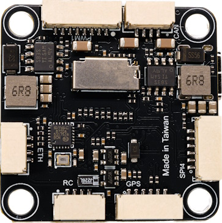
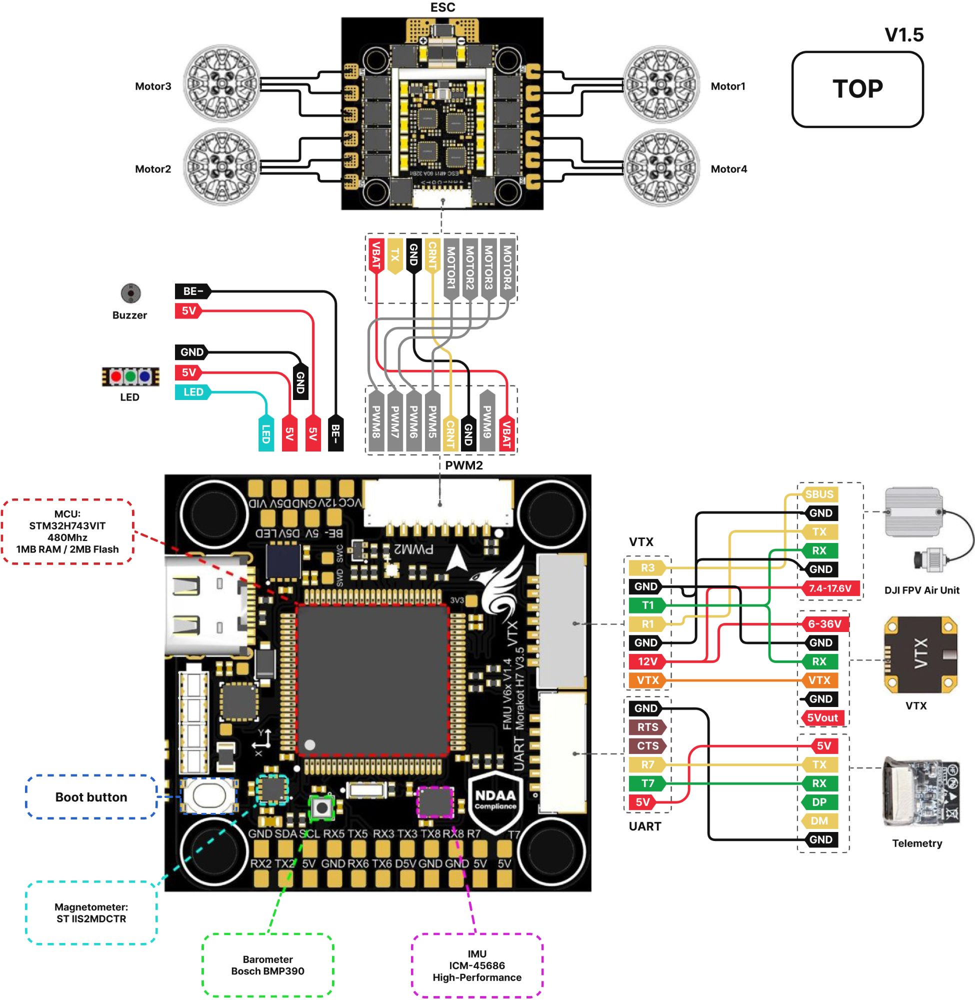
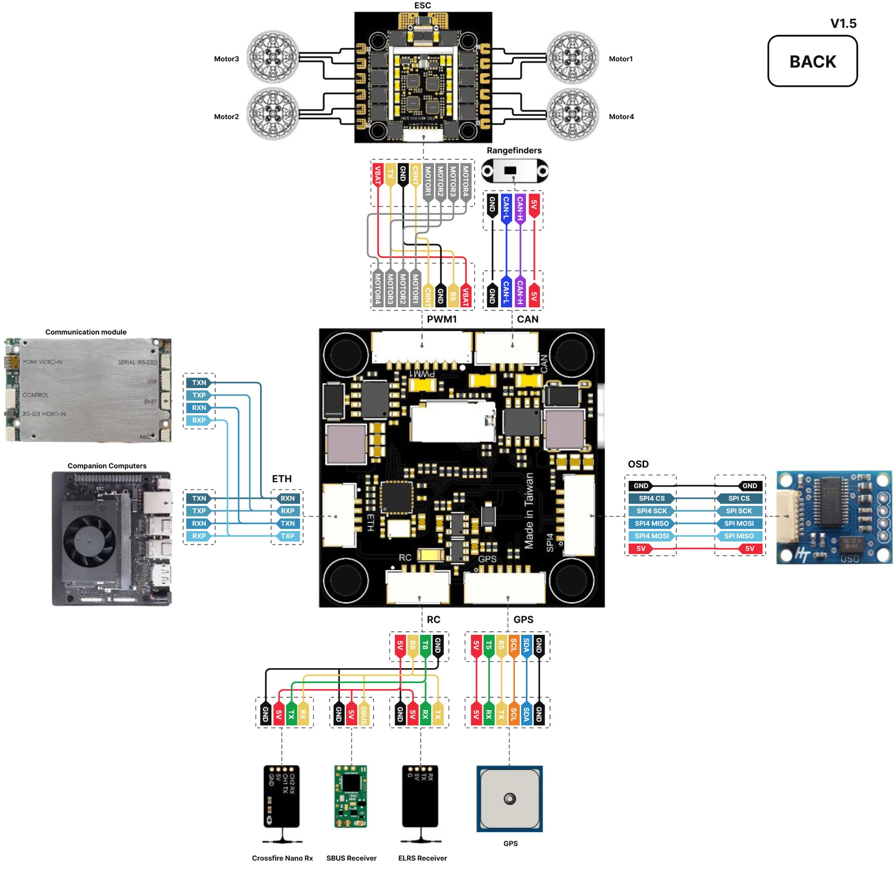

# Morakot Flight Controller Overview

The Morakot is a flight controller designed and produced by [Taiphoon](https://taiphoon.com.tw/)

Morakot Flight Controller - **NDAA-Compliant. Made in Taiwan.** Built for Performance.
Engineered, tested, and manufactured in Taiwan, the Morakot Flight Controller meets full NDAA compliance, ensuring trusted quality and security for professional applications. With an integrated Ethernet interface, it delivers high-speed, reliable connectivity for next-generation FPV and unmanned aerial systems.

## Where to Buy

- [Morakot Flight Controller](https://taiphoon.com.tw/morakot-flight-controllor)

## Pinout

## Features

### Sensors

- [ICM-45686 High-Performance IMU](https://invensense.tdk.com/products/motion-tracking/6-axis/icm-45686/)
- [Bosch BMP390 Barometer](https://www.bosch-sensortec.com/products/environmental-sensors/pressure-sensors/bmp390/) or [Bosch BMP581 Barometer](https://www.bosch-sensortec.com/products/environmental-sensors/pressure-sensors/bmp581/), depending on board version
- [ST IIS2MDC Magnetometer](https://www.st.com/en/mems-and-sensors/iis2mdc.html)

### Microprocessor

- [STM32H743VIT MCU](https://www.st.com/en/microcontrollers-microprocessors/stm32h743vi.html)
- 480Mhz / 1MB RAM / 2MB Flash

### Power

- 3S-8S DC Input power
- 5V 2A BEC peripherals power
- 12V 2A BEC video power

### Other

- LED Indicators
- Battery voltage indicator LED
- MicroSD Slot
- 9x motor outputs
- 1x serial LED output
- 8x serial ports (USB + 7 UARTs)
- 1x I2C
- 1x CAN
- 1x Ethernet

### UART Mapping

The UARTs are marked Rn and Tn in the above pinouts. The Rn pin is the receive pin for UARTn. The Tn pin is the transmit pin for UARTn.

| Port | UART   | Protocol          | TX DMA | RX DMA |
|------|--------|-------------------|:------:|:------:|
| 0    | USB    | MAVLink2          |   ✘    |   ✘    |
| 1    | USART1 | MSP DisplayPort   |   ✔    |   ✔    |
| 2    | USART2 | MAVLink2          |   ✔    |   ✔    |
| 3    | USART3 | None              |   ✔    |   ✔    |
| 4    | UART5  | GPS               |   ✔    |   ✔    |
| 5    | USART6 | ESCTelemetry      |   ✔    |   ✔    |
| 6    | UART7  | MAVLink2          |   ✔    |   ✔    |
| 7    | UART8  | RCIN              |   ✔    |   ✔    |

USART2 (SERIAL2) is only available on the RX2/TX2 solder pads.

RTS/CTS flow control is available on UART7.

### VTX Support

The JST-GH 7p connector supports compatible DJI Air Unit / HD VTX devices. SERIAL1 defaults to MSP DisplayPort (`SERIAL1_PROTOCOL=42`) and DisplayPort OSD is enabled by default. See [OSD Support](#osd-support).

Pin 1 is VIDEO and pin 2 supplies 12V. Check the connector pin numbering before wiring. Do not connect the 12V supply to a device that cannot tolerate it.

## Additional Information

- Dimensions: 38.5 x 30.5 mm
- Height: up to 8.5 mm
- Mounting: 30.5 x 30.5 mm (M3/M4 with dampers)
- Weight: 7 g

## More Information

- [Morakot documentation](https://taiphoon-com.gitbook.io/taiphoon.com-docs)

## Connections

### ESC1 - 8 Pin JST-GH

| Pin | Signal Name     | Voltage      |
|-----|-----------------|--------------|
| 1   | VBAT IN         | 12V-33.6V    |
| 2   | UART6_RX        | 3.3V         |
| 3   | GND             | GND          |
| 4   | CURRENT         | 3.3V         |
| 5   | MOTOR/SERVO 1   | 3.3V         |
| 6   | MOTOR/SERVO 2   | 3.3V         |
| 7   | MOTOR/SERVO 3   | 3.3V         |
| 8   | MOTOR/SERVO 4   | 3.3V         |

### ESC2 - 8 Pin JST-GH

| Pin | Signal Name     | Voltage      |
|-----|-----------------|--------------|
| 1   | VBAT IN         | 12V-33.6V    |
| 2   | MOTOR/SERVO 9   | 3.3V         |
| 3   | GND             | GND          |
| 4   | CURRENT         | 3.3V         |
| 5   | MOTOR/SERVO 5   | 3.3V         |
| 6   | MOTOR/SERVO 6   | 3.3V         |
| 7   | MOTOR/SERVO 7   | 3.3V         |
| 8   | MOTOR/SERVO 8   | 3.3V         |

### CAN - 4 Pin JST-GH

| Pin | Signal Name | Voltage |
|-----|-------------|---------|
| 1   | 5.0V        | 5.0V    |
| 2   | CAN1_H      | 5.0V    |
| 3   | CAN1_L      | 5.0V    |
| 4   | GND         | GND     |

### GPS - 6 Pin JST-GH

| Pin | Signal Name         | Voltage |
|-----|---------------------|---------|
| 1   | 5.0V                | 5.0V    |
| 2   | UART5_TX            | 3.3V    |
| 3   | UART5_RX            | 3.3V    |
| 4   | I2C1_SCL            | 3.3V    |
| 5   | I2C1_SDA            | 3.3V    |
| 6   | GND                 | GND     |

### UART(TELEM) - 6 Pin JST-GH

| Pin | Signal Name           | Voltage |
|-----|-----------------------|---------|
| 1   | 5.0V                  | 5.0V    |
| 2   | UART7_TX              | 3.3V    |
| 3   | UART7_RX              | 3.3V    |
| 4   | UART7_CTS             | 3.3V    |
| 5   | UART7_RTS             | 3.3V    |
| 6   | GND                   | GND     |

### VTX - 7 Pin JST-GH

The connector pinout differs from standard HD VTX cabling. Check every connection before applying power.

| Pin | Signal Name           | Voltage |
|-----|-----------------------|---------|
| 1   | VIDEO                 |         |
| 2   | 12.0V                 | 12.0V   |
| 3   | GND                   | GND     |
| 4   | USART1_RX             | 3.3V    |
| 5   | USART1_TX             | 3.3V    |
| 6   | GND                   | GND     |
| 7   | USART3_RX             | 3.3V    |

### SPI (external OSD or IMU) - 6 Pin JST-SH

| Pin | Signal Name         | Voltage |
|-----|---------------------|---------|
| 1   | 5.0V                | 5.0V    |
| 2   | SPI4_MOSI           | 3.3V    |
| 3   | SPI4_MISO           | 3.3V    |
| 4   | SPI4_SCK            | 3.3V    |
| 5   | SPI4_CS             | 3.3V    |
| 6   | GND                 | GND     |

### RC - 4 Pin JST-GH

| Pin | Signal Name         | Voltage |
|-----|---------------------|---------|
| 1   | 5.0V                | 5.0V    |
| 2   | UART8_RX            | 3.3V    |
| 3   | UART8_TX            | 3.3V    |
| 4   | GND                 | GND     |

### ETH - 4 Pin JST-GH

| Pin | Signal Name         | Voltage |
|-----|---------------------|---------|
| 1   | RXN                 | 3.3V    |
| 2   | RXP                 | 3.3V    |
| 3   | TXN                 | 3.3V    |
| 4   | TXP                 | 3.3V    |

### Solder Pads

The following solder pads are on the top side of the board.

| Pad         | Function                                              |
|-------------|-------------------------------------------------------|
| RX2 / TX2   | USART2 (SERIAL2)                                      |
| RX3 / TX3   | USART3 (SERIAL3), RX3 is also on the VTX connector    |
| RX5 / TX5   | UART5 (SERIAL4), also on the GPS connector            |
| RX6 / TX6   | USART6 (SERIAL5), RX6 is also on the ESC1 connector   |
| R7 / T7     | UART7 (SERIAL6), also on the TELEM connector          |
| RX8 / TX8   | UART8 (SERIAL7), also on the RC connector             |
| SDA / SCL   | I2C1, also on the GPS connector                       |
| VID         | Analog video, connected to VTX connector pin 1        |
| 12V         | 12V BEC output                                        |
| VCC         | Battery voltage                                       |
| 5V / D5V    | 5V output                                             |
| LED         | Serial LED output (PWM10)                             |
| BE-         | Buzzer negative, use with a 5V pad                    |
| GND         | Ground                                                |

## RC Input

RC input is via SERIAL7(UART8) on the RC connector. Unidirectional protocols can be connected to R8. Bi-Directional Protocols will use the T8 pin also.

- PPM is not supported.
- SBUS/DSM/SRXL connects to the RX8 pin.
- FPort requires connection to TX8. Set [SERIAL7_OPTIONS](https://ardupilot.org/copter/docs/parameters.html#serial7-options-serial7-options) = 7
- CRSF/ELRS also requires both TX8 and RX8 connections and provides telemetry automatically.

In order to use the SBUS pin on the HD VTX connector, you must change SERIAL7_PROTOCOL to something other than "23" and set [SERIAL3_PROTOCOL](https://ardupilot.org/copter/docs/parameters.html#serial3-protocol-serial-3-gps-protocol-selection) to "23".

See [Radio Control Systems](https://ardupilot.org/copter/docs/common-rc-systems.html) for details on connecting receivers.

## PWM Output

The Morakot supports up to 9 PWM outputs with DShot and bidirectional DShot support, plus a serial LED output on the LED pad.

The PWM outputs are in 4 timer groups:

- PWM 1-4 in group1 (TIM1)
- PWM 5-8 in group2 (TIM2)
- PWM 9 in group3 (TIM3)
- PWM 10 (LED pad) in group4 (TIM4)

Channels within the same group need to use the same output rate. If any channel in a group uses DShot then all channels in that group need to use DShot.

## Serial LED

The LED pad is PWM output 10. To drive serial LEDs (e.g. WS2812), set `SERVO10_FUNCTION` to 120 (NeoPixel1) and enable NeoPixel in `NTF_LED_TYPES`.

## GPIOs

All PWM outputs can be used as GPIOs (relays, buttons, RPM etc). To use them you need to set the output's SERVOx_FUNCTION to -1.

| Pin         | GPIO |
|-------------|------|
| PWM1        | 50   |
| PWM2        | 51   |
| PWM3        | 52   |
| PWM4        | 53   |
| PWM5        | 54   |
| PWM6        | 55   |
| PWM7        | 56   |
| PWM8        | 57   |
| PWM9        | 58   |
| PWM10 (LED) | 59   |

## CAN

DroneCAN is enabled by default on CAN1 (`CAN_P1_DRIVER=1`). DroneCAN devices can be connected to the CAN connector.

## Barometer

Depending on the board version, the Morakot is fitted with either a BMP390 or a BMP581 barometer on I2C1. Both versions use the same firmware: the BMP390 is detected at address 0x76 and the BMP581 at address 0x46, with no parameter changes needed.

## Compass

The Morakot has a built-in IIS2MDC compass. Supported external I2C compasses connected through the GPS connector are detected automatically.

Due to potential interference, an external I2C compass in a GPS/Compass combination is commonly used with the internal compass disabled.

## OSD Support

The Morakot has no onboard OSD chip. DisplayPort OSD on the HD VTX connector (SERIAL1) is enabled by default (`OSD_TYPE=5`).

An external AT7456E analog OSD module can be connected to the SPI4 connector. To use it together with DisplayPort OSD, set `OSD_TYPE2=1`. To use it without an HD VTX, set `OSD_TYPE=1` and `OSD_TYPE2=0`.

Note: if `SERIAL1_PROTOCOL` is ever changed from MSP DisplayPort, set `OSD_TYPE` to `0`, or to `1` if the external OSD module is used.

Morakot firmware up to 4.7.2 defaulted to `OSD_TYPE=1` and `OSD_TYPE2=5`; re-check both after upgrading.

## Battery Monitoring

The board has a built-in voltage sensor and a current sensor input on the CURRENT pin of the ESC connectors. The voltage sensor can handle 3S to 8S LiPo batteries.

The battery monitor is enabled by default with these settings:

- BATT_MONITOR 4
- BATT_VOLT_PIN 10
- BATT_CURR_PIN 12
- BATT_VOLT_MULT 11.07
- BATT_AMP_PERVLT 40

`BATT_AMP_PERVLT` (and `BATT_AMP_OFFSET`) will need to be adjusted for the current sensor of the attached ESC.

Morakot firmware up to 4.7.2 used a different ADC scaling; re-check `BATT_VOLT_MULT` and `BATT_AMP_PERVLT` after upgrading.

## Firmware

Firmware for the Morakot is available from [ArduPilot Firmware Server](https://firmware.ardupilot.org) under the `Morakot` target.

## Loading Firmware

To load ArduPilot firmware, hold the boot button while connecting USB. The boot button is the white button on the top side, below the USB-C connector. Then use the STM32CubeProgrammer app to load the "***_with_bl.hex" file, see [Loading Firmware to Boards without an ArduPilot Compatible Bootloader](https://ardupilot.org/copter/docs/common-loading-firmware-onto-chibios-only-boards.html). Subsequently, a GCS can update firmware using the *.apj files.
