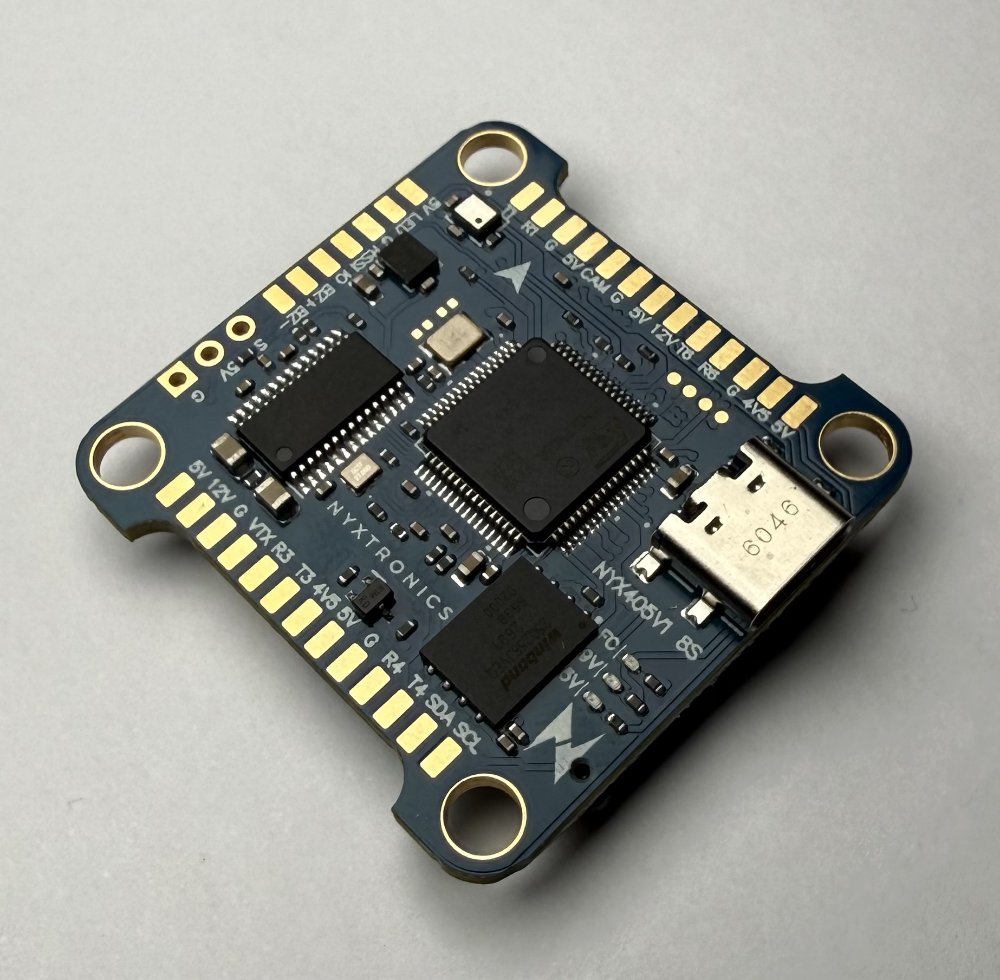
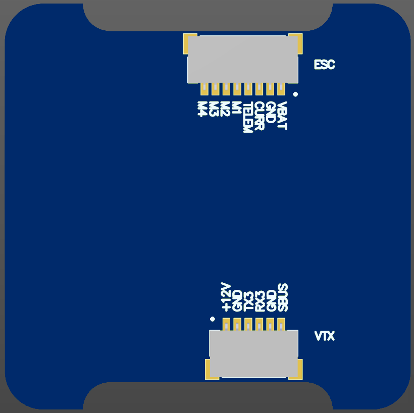

# Nyxtronics NYX405V1 Flight Controller

The NYX405V1 is a flight controller manufactured by [Nyxtronics](https://nyxtronics.com/).

## Where to Buy

Contact [Nyxtronics](https://nyxtronics.com/contact/).

## Specifications

- Processor

  - STM32F405 168Mhz, 1MB 32-bit processor
  - W25Q256JVEIQ Flash
  - AT7456E OSD

- Sensors
  - ICM-42688-P or BMI270 IMU
  - DPS368 Barometer

- Interfaces

  - USB-C
  - 6 PWM
  - 5 UARTs (UART5 is RX only, on the TELEM pin of the ESC connector)
  - ESC Connector with current sense and telemetry inputs
  - Analog Video In/Out with OSD
  - HD VTX connector
  - SWD debug port

- Power

  - Integrated voltage monitor 5.5V - 33.6V (2S - 8S) input
  - GPIO controlled 12V power BEC, 3A output
  - 5V, 3A output for board and peripheral

- Dimensions

  - Size: 37 × 37 × 8 mm
  - Weight: 8.4g

## Pinout

All solder pads are labeled on the board next to the pad. The ESC and HD VTX connectors are not labeled on the board, because they use the standard Betaflight connector pinouts. Their pinouts are shown below:

## Debug Port

The four unlabeled round pads next to the R6 pad are an SWD debug port, with 1.27 mm pitch. With the board's arrow pointing forward, the pads are, from left to right:

| Pad | Signal |
|-----|--------|
| 1   | GND    |
| 2   | SWCLK  |
| 3   | SWDIO  |
| 4   | +3.3V  |

## UART Mapping

The UARTs are marked Rn and Tn in the above pinouts. The Rn pin is the receive pin for UARTn. The Tn pin is the transmit pin for UARTn

|Port  | UART    |Protocol            |TX DMA |RX DMA |
|------|---------|--------------------|-------|-------|
|0     |  USB    |  MAVLink2          |  ✘    |   ✘   |
|1     |  USART1 |  None              |  ✔    |   ✔   |
|3     |  USART3 |  MSP DisplayPort   |  ✘    |   ✘   |
|4     |  UART4  |  GPS               |  ✘    |   ✘   |
|5     |  UART5  |  ESC Telemetry     |  ✘    |   ✘   |
|6     |  USART6 |  RCin              |  ✔    |   ✔   |

SERIAL port numbers match the UART numbers on the pads. SERIAL2 is not used. UART5 is RX only, on the TELEM pin of the ESC connector; there is no T5 pad. No UARTs have flow control pins.

SERIAL3 (USART3) is on both the R3/T3 pads and the HD VTX connector; use only one of them. It defaults to MSP DisplayPort for an HD VTX. To use T3 for SmartAudio control of an analog VTX instead, set SERIAL3_PROTOCOL to 37 and OSD_TYPE2 to 0.

## RC input

RC input is configured on SERIAL6, using the R6 and T6 pads. SERIAL6_PROTOCOL defaults to "23" (RCIN), and this UART has DMA. It supports the serial RC protocols listed below. PPM is not supported.

- CRSF/ELRS: connect the receiver TX to R6 and the receiver RX to T6. No further setup is needed.
- FPort: requires using a bi-directional inverter, see [Radio Control Systems](https://ardupilot.org/plane/docs/common-rc-systems.html) for details.
- SBUS: connect to the SBUS pin on the HD VTX (JST-SH) connector. That pin goes through an onboard inverter to the same input as the R6 pad, so standard inverted SBUS works without setup. Do not connect SBUS directly to the R6 pad.
- SRXL2: connect to T6 and set SERIAL6_OPTIONS to "4" (half-duplex).

The R6 pad and the HD VTX connector SBUS pin share the same UART input. Use only one of them at a time.

Any UART can be used for RC system connections in ArduPilot, and is compatible with all protocols except PPM. See [RC systems](https://ardupilot.org/plane/docs/common-rc-systems.html) for details.

## PWM Outputs

The NYX405V1 supports up to 6 PWM outputs:

- Outputs 1-4: motor pads M1-M4
- Output 5: servo pad S1
- Output 6: LED strip pad

All outputs support normal PWM and DShot. Outputs 1-4 support Bi-Directional DShot.

The PWM outputs are in 4 groups, one per hardware timer:

| Group   | Outputs | Timer |
|---------|---------|-------|
| M1, M2  | 1, 2    | TIM3  |
| M3, M4  | 3, 4    | TIM2  |
| S       | 5       | TIM4  |
| LED     | 6       | TIM8  |

Channels within the same group need to use the same output rate. If any channel in a group uses DShot then all channels in the group need to use DShot.

## OSD Support

Onboard OSD using MAX7456 driver is supported by default. Simultaneously, DisplayPort OSD is also available on the HD VTX connector.

Note: if `SERIAL3_PROTOCOL` is ever changed from MSP DisplayPort, `OSD_TYPE2` must be set to `0`, or a pre-arm failure will result.

## HD VTX Support

The 6pin JST-SH connector supports a DJI Air Unit / HD VTX connection. Protocol defaults to DisplayPort. Pin 1 of the connector supplies 12V. Do not connect peripherals rated for 5V to this connector. DisplayPort OSD is enabled by default on SERIAL3.

## VTX power control

GPIO 81 controls the VTX BEC output to pins marked "12V" and is included on the HD VTX connector. Setting this GPIO low removes voltage supply to this pin/pad. By default RELAY1 is configured to control this pin, and the 12V output is ON at boot (RELAY1_DEFAULT = 1).

## Compass

No compass is provided on board. An external compass can be connected to the SDA and SCL I2C pads, and is detected automatically.

## RSSI

Analog RSSI can be connected to the RSSI pad. Set RSSI_TYPE to "1" and RSSI_ANA_PIN to "15". Set RSSI_TYPE to "3" instead if the RC protocol provides RSSI data.

## Analog Airspeed

An analog airspeed sensor can be connected to the RSSI pad. Set ARSPD_TYPE to "2" and ARSPD_PIN to "15". The pad cannot be used for analog RSSI and analog airspeed at the same time.

## GPIOs

The pads and internal controls below have GPIO numbers, for use with relays or as digital outputs:

| Pad / function   | GPIO |
|------------------|------|
| M1               | 50   |
| M2               | 51   |
| M3               | 52   |
| M4               | 53   |
| S                | 54   |
| LED              | 58   |
| 12V BEC control  | 81   |
| IO               | 82   |

The IO pad is a general-purpose output, controlled by RELAY2. It is LOW at boot (RELAY2_DEFAULT = 0).

## Buzzer

Connect an active buzzer to the BZ+ (positive) and BZ- (negative) pads. The buzzer is enabled by default.

## Battery Monitoring

The board has a internal voltage sensor and connections on the ESC connector for an external current sensor input.
The voltage sensor can handle up to 8S LiPo batteries.

The default battery parameters are:

- BATT_MONITOR = 4
- BATT_VOLT_PIN = 14
- BATT_CURR_PIN = 13 (ESC CURR pin)
- BATT_VOLT_MULT = 11.0
- BATT_AMP_PERVLT = 125.0

The current sensor is on the ESC, not on the flight controller. BATT_AMP_PERVLT must be set to match the ESC or current sensor actually used. The default value is `Nyxtronics AM32 4-in-1 80A 8S` and `Nyxtronics AM32 4-in-1 75A 6S` ESCs current sensor value.

## Firmware

Firmware for the NYX405V1 is available from [ArduPilot Firmware Server](https://firmware.ardupilot.org) under the `Nyxtronics_NYX405V1` target.

## Loading Firmware

To flash firmware initially, connect USB while holding the bootloader button and use DFU to load the `*_with_bl.hex` file. Subsequent updates can be applied using `*.apj` files through a ground station.
