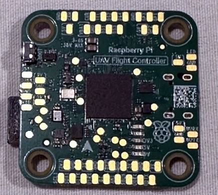
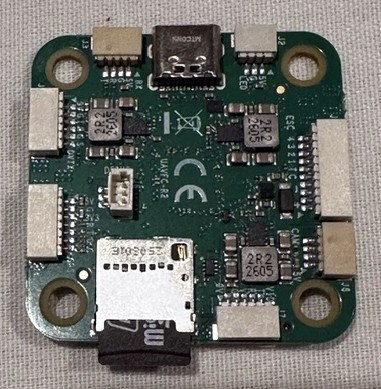

# Raspberry Pi UAV Flight Controller

The Raspberry Pi UAV Flight Controller (`RPI_UAVFC`) is an RP2350B flight
controller from Raspberry Pi. It is a revision of the Laurel board with a
different pinout.




The GPIO assignments are in [HARDWARE.md](HARDWARE.md). Notes for
developers working on the port are in
`libraries/AP_HAL_ChibiOS/rp2350/DEVELOPMENT.md`.

## Features

- MCU - RP2350B dual-core Cortex-M33 running at 225 MHz (the RP2350
  datasheet limit is 150 MHz), 520 KB SRAM
- 4 MB QSPI flash for firmware and parameters
- ICM-56686 IMU (early samples carry an ICM-42688-P)
- DPS368 barometer
- microSD card slot (SPI) for logging
- 2 UARTs and 2 PIO UARTs, plus USB
- 2 I2C buses (internal barometer, external GPS/compass)
- 4 PWM outputs with DShot600 and bidirectional DShot
- WS2812 LED strip connector
- Analog OSD generated by the RP2350
- Switched 5 V and 9 V rails

## UART Mapping

- SERIAL0 -> USB (MAVLink2)
- SERIAL1 -> UART0, DVTX connector (DisplayPort, DMA-enabled)
- SERIAL2 -> UART1, GPS connector (GPS, DMA-enabled)
- SERIAL3 -> PIO UART0, RADIO connector (RC Input)
- SERIAL4 -> PIO UART1, VID connector (Spare)

SERIAL4 is off by default because a floating RX input on an unconnected
header can generate enough interrupts to stall startup. Set
`SERIAL4_PROTOCOL` = 2 for MAVLink once it is wired.

## RC Input

RC input is on SERIAL3, the RADIO connector, which defaults to
`SERIAL3_PROTOCOL` = 23.

- CRSF requires `SERIAL3_OPTIONS` = 0
- FPort requires `SERIAL3_OPTIONS` = 15
- SRXL2 requires `SERIAL3_OPTIONS` = 4, and connects only the TX pin
- SBUS requires `SERIAL3_OPTIONS` = 1 (the port inverts the pad itself).
  It also needs ArduPilot/ardupilot#33057, without which frames are
  dropped.

The board's separate SBUS pad on the DVTX connector is not used.

## PWM Output

The RPI_UAVFC supports 4 PWM or DShot outputs plus the LED strip output, in
three groups:

- PWM 1-2 in group1
- PWM 3-4 in group2
- PWM 5 in group3, the LED strip connector

Channels within the same group need to use the same output rate. If any
channel in a group uses DShot then all channels in the group need to use
DShot.

DShot is generated by the RP2350 PIO and DShot600 is the only rate
available; any other rate raises a configuration error at boot. Set
`MOT_PWM_TYPE` = 6 for DShot600. Bidirectional DShot is supported on all
four motor outputs: select them with `SERVO_BLH_BDMASK` and set
`SERVO_BLH_POLES` to match the motors. The eRPM it returns allows RPM-based
harmonic notch tracking (`INS_HNTCH_MODE` = 3); the board has no serial ESC
telemetry input.

## Battery Monitoring

The default battery parameters are:

- `BATT_MONITOR` = 4
- `BATT_VOLT_PIN` = 6
- `BATT_CURR_PIN` = 7
- `BATT_VOLT_MULT` = 11.1
- `BATT_AMP_PERVLT` = 50

The voltage scale has been checked against a bench supply. The current
signal comes from the ESC, and 50 A/V assumes a 20 mV/A ESC output. On the
vehicles tested the current input has shown a large temperature-dependent
offset and does not track load, so do not rely on reported current,
consumed capacity or voltage sag compensation until the ESC output has been
checked with a meter. Voltage monitoring is unaffected.

## Analog RSSI input

Analog RSSI uses `RSSI_PIN` 0, the AN1 pad.

## Serial LED output

The LED strip connector is output 5, and `SERVO5_FUNCTION` defaults to 120
(NeoPixel). To drive a strip, add the NeoPixel bit (256) to
`NTF_LED_TYPES`, which is not set by default, and set `NTF_LED_LEN` to the
number of LEDs; both need a reboot. The connector's 5 V comes from the
switched peripheral rail, so check a long strip's current against that
regulator. ProfiLED is not supported.

## Compass

The RPI_UAVFC does not have a builtin compass. Attach one on the I2C1 bus
on the GPS connector; without one the EKF stays in constant-position mode.

## OSD Support

The default OSD is DisplayPort on SERIAL1, the DVTX connector (`OSD_TYPE` =
5).

The board can also overlay an analog OSD on the camera video, generated by
the RP2350 and selected with `OSD_TYPE` = 6. It has been used with an NTSC
camera; PAL is untested. The analog OSD and the LED strip output use the
same RP2350 PIO block, so the LED strip does not work while OSD_TYPE is 6.

## VTX control (SmartAudio)

Both PIO UARTs support half duplex, so SmartAudio can go on SERIAL3 or
SERIAL4. Connect the single SmartAudio wire to the TX pad of the port, not
the RX pad, and set that port's `SERIALn_PROTOCOL` = 37 and
`VTX_ENABLE` = 1. With the pull-down SmartAudio asks for, also set bit 4
of `VTX_OPTIONS`.
Not every VTX sold as SmartAudio answers; this has been checked with a
SmartAudio v2 VTX.

## VTX power control

The 9 V rail on the VID connector is switched by GPIO19 (RELAY3), and the 5
V peripheral rail by GPIO18 (RELAY2). Both are on by default. Switching
them from software has not yet been confirmed at the regulators, so check
with a meter before relying on it.

## Logging

Logs are written to the microSD card (`LOG_BACKEND_TYPE` = 1, the default
on this board).

The card write rate is limited by the RP2350 rather than by the card, and
high-rate tuning logs can drop ordinary messages. Use the `ISBH`/`ISBD`
batch sampler for spectral analysis, and check `DSF.Dp` before trusting
requested message rates.

## Loading Firmware

Firmware for this board can be found [here](https://firmware.ardupilot.org)
in sub-folders labeled "RPI_UAVFC".

To install the bootloader the first time, hold the `BOOT` button while
plugging in USB to start the RP2350 ROM bootloader, then either copy
`Tools/bootloaders/RPI_UAVFC_bl.uf2` to the drive that appears or, with
`picotool` on the path, run:

```bash
./waf configure --board RPI_UAVFC --bootloader
./waf bootloader --upload
```

Alternatively, write `Tools/bootloaders/RPI_UAVFC_bl.bin` at 0x10000000
over SWD (see `libraries/AP_HAL_ChibiOS/rp2350/DEVELOPMENT.md`).

Once the bootloader is installed, load the `*.apj` firmware with any
ArduPilot ground station.

## Known Limitations

- The 225 MHz clock is above the 150 MHz datasheet limit. It has been
  flight-tested on the bring-up boards only.
- DShot600 is the only DShot rate.
- BLHeli passthrough is not supported.
- CAN is not available on the RP2350.
- The battery current input does not track load on the vehicles tested.
- ESC calibration works with the throttle-high procedure only;
  `ESC_CALIBRATION` 2 or 3 makes the board reboot repeatedly.
- The buzzer and output 5 share a PWM slice, and whichever starts it last
  sets its clock, so output 5 should not be used as a PWM output. A
  NeoPixel strip there comes from the PIO and leaves the slice to the
  buzzer; that has not been checked on hardware.
