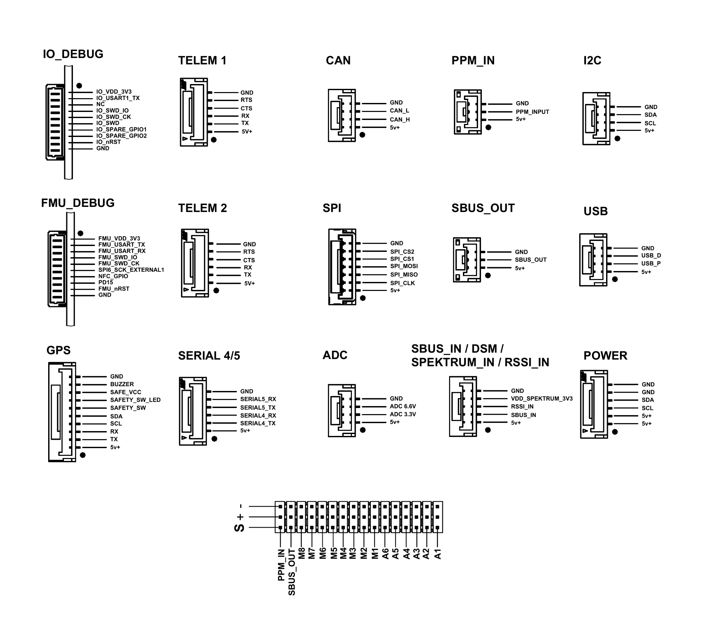

# Simplifly Neo

The Simplifly Neo autopilot is manufactured by [MACFOS LTD](https://www.robu.in).

It is built to the
[FMUv6X and Pixhawk Autopilot Bus open source specifications](https://github.com/pixhawk/Pixhawk-Standards).

> **Note:** this board has a single IMU. There is no IMU redundancy and the EKF
> runs a single lane.

## Where to Buy

[MACFOS LTD](https://www.robu.in)

## Specifications

- Processor

  - STM32H753 32-bit processor, 480 MHz
  - STM32F103 IOMCU
  - 2 MB Flash
  - 1 MB RAM

- Sensors

  - Bosch BMI088 IMU (accelerometer, gyroscope) with heater
  - Bosch BMP390 barometer
  - Bosch BMM150 magnetometer
  - FRAM for parameter storage

- Interfaces

  - Micro SD card
  - USB
  - 14 PWM outputs
  - 7 serial ports: 5 UARTs on connectors, two with flow control, plus 2 USB
  - CAN
  - External SPI connector
  - External I2C connector
  - RC input, SBUS input, PPM input and SBUS output connectors
  - Safety switch with LED, buzzer, RGB status LED
  - ADC connector with 3.3 V and 6.6 V analog inputs
  - FMU and IOMCU debug connectors

- Power

  - POWER connector with I2C (INA2xx) power monitor
  - Brick-valid sensing on the POWER connector and on the servo rail
  - Independent peripheral and high-power 5 V rails, each with software enable
    and over-current sensing

## Board

## Pinout

## UART Mapping

| Port | UART | Protocol |
|---|---|---|
| SERIAL0 | USB (OTG1) | MAVLink2 |
| SERIAL1 | UART7 | MAVLink2 (Telem1) |
| SERIAL2 | UART5 | MAVLink2 (Telem2) |
| SERIAL3 | USART1 | GPS |
| SERIAL4 | USART2 | GPS |
| SERIAL5 | USART3 | None |
| SERIAL6 | USB (OTG2) | MAVLink2 |

All UARTs have DMA in both directions.

TELEM1 and TELEM2 have flow control pins. The SERIAL4/5 connector carries TX
and RX for both ports only, with no flow control lines. SERIAL5 is also
available on the FMU debug connector.

USART6 is used for the link to the IOMCU and is not available as a serial port.

## RC Input

RC input is handled by the IOMCU, and is brought out in three places:

| Connection | Notes |
|---|---|
| RC_IN pin on the output header | Same net as the PPM_IN connector |
| PPM_IN connector | Same net as the RC_IN header pin |
| SBUS_IN / DSM / SPKT connector | Serial receivers, with a switched 3.3V supply |

RC_IN and PPM_IN are the same signal broken out twice for convenience, so
connect a receiver to one or the other, never to both at once.

These inputs handle unidirectional protocols only, such as SBUS, PPM and DSM.
FPort connected here will provide RC without telemetry.

Pin 4 of the SBUS_IN connector carries a switched 3.3V supply for a Spektrum
DSM satellite receiver, enabled at boot. Binding a satellite is supported and is
started from the ground station, which sends `MAV_CMD_START_RX_PAIR`.

Bi-directional protocols, including CRSF/ELRS, SRXL2 and FPort with telemetry,
require a full UART. Set `SERIALx_PROTOCOL` to "23" on the chosen port, for
example SERIAL4 on the SERIAL4/5 connector:

- `SERIAL4_PROTOCOL` = 23
- FPort requires `SERIAL4_OPTIONS` = 15
- CRSF/ELRS requires `SERIAL4_OPTIONS` = 0
- SRXL2 requires `SERIAL4_OPTIONS` = 4, and connects only the TX pin

Any UART can be used for RC in ArduPilot, and is compatible with all protocols
except PPM. See
[RC systems](https://ardupilot.org/copter/docs/common-rc-systems.html) for
details.

## PWM Outputs

The Simplifly Neo supports 14 PWM outputs. The output header carries 16 pins.
Viewed from above with the forward arrow pointing away from you, they read
left to right: RC_IN, SBUS_OUT, M8 down to M1, then A6 down to A1.

The 8 main outputs (M1-M8) are controlled by the STM32F103 IOMCU and are
ArduPilot outputs SERVO1 to SERVO8. The 6 auxiliary outputs (A1-A6) are
attached to the STM32H753 FMU and are ArduPilot outputs SERVO9 to SERVO14.

The 8 main outputs (M1-M8) are in 3 groups:

- M1, M2 in group1
- M3, M4 in group2
- M5, M6, M7, M8 in group3

The 6 auxiliary outputs (A1-A6) are in 2 groups:

- A1, A2, A3, A4 in group4
- A5, A6 in group5

Channels within the same group need to use the same output rate. If any
channel in a group uses DShot then all channels in the group need to use
DShot.

M1-M8 support Bi-Directional DShot. A1-A6 support DShot but not Bi-Directional
DShot.

## CAN

DroneCAN is enabled by default on the CAN connector:

- `CAN_P1_DRIVER` = 1

## SPI connector

The external SPI connector brings out SPI6 and two chip selects, but no
`SPIDEV` is declared for it. Standard firmware therefore cannot use a device
on this connector; attaching one requires a custom build that adds an
appropriate `SPIDEV` entry.

## Compass

The Simplifly Neo has a built-in compass. Due to potential interference, the
autopilot is usually used with an external I2C compass as part of a
GPS/Compass combination.

## Analog inputs

The ADC connector has two analog inputs:

- ADC Pin 12 -> ADC 6.6V sense
- ADC Pin 13 -> ADC 3.3V sense

Use these numbers for `BATT_VOLT_PIN`, `BATT_CURR_PIN`, `ARSPD_PIN` and
`RSSI_ANA_PIN`.

The RSSI_IN pin on the SBUS_IN connector is sampled by the IOMCU. To use it set
`RSSI_TYPE` = 1 and `RSSI_ANA_PIN` = 103.

## GPIOs

| Pin | GPIO Number |
|---|---|
| A1 | 50 |
| A2 | 51 |
| A3 | 52 |
| A4 | 53 |
| A5 | 54 |
| A6 | 55 |
| NFC_GPIO | 60 |
| ALARM | 77 |
| HEATER_EN | 80 |
| M1 | 101 |
| M2 | 102 |
| M3 | 103 |
| M4 | 104 |
| M5 | 105 |
| M6 | 106 |
| M7 | 107 |
| M8 | 108 |

To use an output as a GPIO, set its `SERVOx_FUNCTION` to -1.

## Battery Monitoring

The board has a POWER connector for an I2C (INA2xx) power monitor, which is
enabled by default.

The default battery parameters are:

- `BATT_MONITOR` = 21

## Other connectors

| Connector | Purpose |
|---|---|
| GPS | GPS1 serial (SERIAL3), I2C for an external compass, and the safety switch, safety LED and buzzer |
| POWER | Power input with valid sensing, and I2C for the INA2xx power monitor |
| FMU_DEBUG | FMU SWD and console UART (SERIAL5) |
| IO_DEBUG | IOMCU SWD, its UART and reset |

The safety switch, its LED and the buzzer are all on the GPS connector rather
than on a connector of their own.

## Firmware

Firmware for the Simplifly Neo is available from
[ArduPilot Firmware Server](https://firmware.ardupilot.org) under the
`SimpliflyNeo` target.

## Loading Firmware

The board comes pre-installed with an ArduPilot compatible bootloader,
allowing the loading of `*.apj` firmware files with any ArduPilot compatible
ground station.
