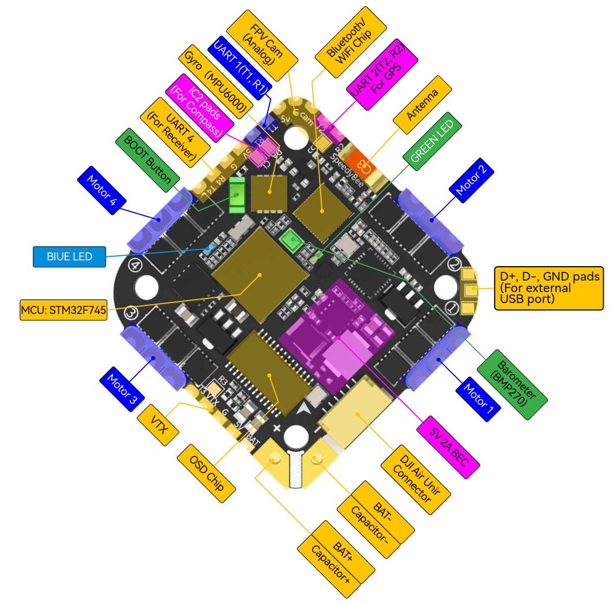
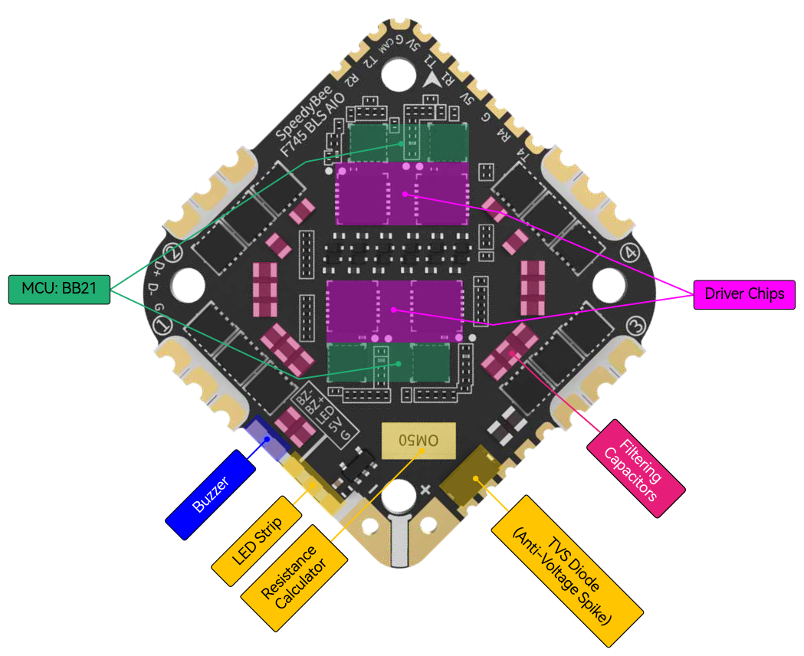

# SpeedyBee F745 AIO Flight Controller

The SpeedyBee F745 35A BLS AIO is a flight controller produced by [SpeedyBee](http://www.speedybee.com/).

## Features

- MCU: STM32F745  32-bit processor, 216MHz, 1M Flash
- IMU: MPU6000
- Barometer: BMP280
- LED pad: WS2812
- Onboard 8 Mbytes for blackbox logging
- Current sensor. Scale=256
- OSD: MAX7456
- 4 UARTs available (6 used internally)
- Built-in 4-in-1 ESC
- ESC protocol: DSHOT300/600
- Continuous current: 35A * 4
- Input Voltage: 3-6S Lipo
- ESC Firmware: BLHeli_S J-H-40 (default) or Bluejay (Note: this firmware enables bi-directional DShot, so **flashing the ESC with BlueJay is required**)

## Pinout

## UART Mapping

The UARTs are marked Rn and Tn in the above pinouts. The Rn pin is the
receive pin for UARTn. The Tn pin is the transmit pin for UARTn.

|Name|Pin|Function|
|:-|:-|:-|
|SERIAL0|COMPUTER|USB|
|SERIAL1|RX1/TX1|UART1 (User) |
|SERIAL2|TX2/RX2|UART2 (GPS)|
|SERIAL3|TX3/RX3|UART3 (User -- note RX placement: next to TX is the VTX pad, RX is placed _behind_ TX)|
|SERIAL4|TX4/RX4|UART4 (Receiver)|
|SERIAL5| unavailable |UART5 (connected to internal BT module -- an ESP32 U4WD -- not currently usable by ArduPilot)|
|SERIAL6|TX6/RX6|UART6 (DisplayPort)|

## RC Input

RC input is configured on the R4, which supports serial RC protocols. PPM is not supported.
For CRSF/ELRS/SRXL2 connection of the receiver to T4 will also be required.

## Camera Control pad

The Betaflight camera control pad is available as a general
purpose GPIO output (relay). It can be toggled by assigning a
servo function to Relay2.

## OSD Support

The SpeedyBee F745 AIO supports OSD using [OSD_TYPE](https://ardupilot.org/copter/docs/parameters.html#osd-type-osd-type) =  1 (MAX7456 driver). The defaults are also setup to allow DJI Goggle OSD support on UART6. Both the internal analog OSD and the DisplayPort OSD can be used simultaneously by setting [OSD_TYPE2](https://ardupilot.org/copter/docs/parameters.html#osd-type2-osd-type-2)= 5

## PWM Output

The SpeedyBee F745 AIO has 4 ESC motor outputs and one additional
PWM output. The pads for motor output ESC1 to ESC4 are the first 4
outputs; the LED-strip pad provides PWM 5. All 4 motor outputs
support DShot (including bi-directional DShot when the ESCs run
Bluejay firmware); the LED pad is intended for a
WS2812 NeoPixel strip via the NeoPixel LED driver.

The PWM outputs are in 3 groups:

- PWM 1-2: Group 1 (TIM3)
- PWM 3-4: Group 2 (TIM1)
- LED-strip pad (PWM 5): Group 3 (TIM4)

Outputs within the same group must share the same output frequency.
When using bi-directional DShot, all outputs in a group must use
DShot as their protocol.

## WS2812 LED (NeoPixel)

The LED pad supports a WS2812 NeoPixel LED strip on PWM output 5.
To use Board and NeoPixel notification:

1. Connect WS2812 LED strip data line to the PWM5 / LED output.
2. Check NeoPixel is enabled in `NTF_LED_TYPES`, should be set by default.
3. `SERVO5_FUNCTION` = 120 (NeoPixel) is set in `defaults.parm`.
4. Set `NTF_LED_LEN` to the number of LEDs, and `NTF_LED_BRIGHT` to desired brightness.

The LED will indicate flight status (e.g., red when disarmed, green when armed).

## I2C

The board provides SDA and SCL pads on I2C1 for external
compasses (or other I2C peripherals). Internal I2C mask is set
to 0 and compass probing is enabled, so an external compass on
these pads will be detected automatically.

## Battery Monitoring

The board has an internal voltage sensor and connections on the ESC
connector for an external current sensor input.
The voltage sensor can handle up to 6S.
LiPo batteries.

The default battery parameters are:

- BATT_MONITOR 4
- BATT_VOLT_PIN 13
- BATT_CURR_PIN 12
- BATT_VOLT_MULT 11.0
- BATT_AMP_PERVLT around 39.1 (will need to be adjusted for whichever current sensor is attached)

## Sensor Orientation

Note that the default orientation assumes a 45 degrees mounting position.
An arrow pointing forward is printed on both sides of the board.
Depending on your mounting position, set `AHRS_ORIENTATION`.

## Compass

The SpeedyBee F745 AIO does not have a builtin compass, but you can attach an external compass using I2C on the SDA and SCL pads.

## Loading Firmware

Initial firmware load can be done with DFU by plugging in USB with the
bootloader button pressed (the only button on the board). Then you should load the "with_bl.hex"
firmware, using your favourite DFU loading tool.
Note that a USB port first needs to be soldered to D+/D-/GND points. The board gets power from the battery, not USB.

Once the initial firmware is loaded you can update the firmware using
any ArduPilot ground station software. Updates should be done with the
*.apj firmware files.
