# Godot and Jolt physics backend for SITL

A physics simulator for ArduPilot SITL, built on
[Godot](https://godotengine.org) 4.4 or later and its bundled
[Jolt](https://github.com/jrouwe/JoltPhysics) physics engine: free, open
source, and flexible enough to model the physics of just about anything.
If it can be put together from bodies, joints, wings, propellers, wheels
and floaters, it can be flown, driven, sailed or walked here.

Each vehicle is one glTF file, and the Godot editor is also a great
vehicle editor because we wrote plugins for it. The simulator plugs into
SITL through its [JSON interface](../readme.md).


To use it, install [Godot](https://godotengine.org/download) 4.4 or
later, then add `--godot` to `sim_vehicle.py` or `autotest.py`, or run
`test-all.sh` to watch one test of every kind of vehicle:

```sh
Tools/autotest/sim_vehicle.py -v ArduCopter --godot --map --console
Tools/autotest/autotest.py --godot build.Plane test.Plane.AerobaticsScripting
libraries/SITL_Godot/test-all.sh
```

It flies a quadcopter and a helicopter with ArduCopter; an aeroplane, an
aerobatic aeroplane, a glider and a quadplane with ArduPlane; a buggy, a
speedboat, a balance bot, a sailboat and a six-legged walking robot with
Rover; a vectored ROV with ArduSub; an AntennaTracker; and a Blimp. What
you get:

- real collisions: fly into the ground, a tree, a building or another
  vehicle and it hits it
- multiple aircraft in the same physics, and they can interact, i.e.
  crash into each other
- propellers and rotors which behave like them: thrust which takes a
  moment to build, falls away with speed, and twists the airframe the
  other way
- wings, tails and fins which work from their shape and where they are
  put, so an aeroplane stalls, a tail keeps it straight, and a rudder in
  the propeller's wash still bites at low speed
- servos which move things: control surfaces, tilting motors, steering,
  a tracker's dish, the legs of a walking robot
- wheels on suspension, to take off from, land on and drive about on
- things which float: boats and submarines in water, airships in air
- a helicopter rotor with collective and cyclic, worked by its
  swashplate servos

How each of those is worked out is under
[Physics models](#physics-models).

The default world is level ground with a lake, trees and two buildings,
draped with satellite imagery of wherever home is; it is described with
the backend's options under [Running](#running).

## What it needs

- **Godot 4.4 or later** (tested with 4.7), from
  [godotengine.org/download](https://godotengine.org/download): the
  plain build, not the .NET one. Put it on the `PATH` as `godot`, or
  name it in `$GODOT`. An editor older than 4.7 warns that the project
  is newer than it is, and opens it anyway.
- **SITL**, built as usual: `./waf configure --board sitl && ./waf copter
  plane`, adding `rover`, `sub`, `blimp`, `heli` or `antennatracker` for
  those vehicles.
- **A display**, for the window. Without one, pass `--headless` to Godot
  or `--godot-headless` to the autotest suite.
- **Network access on the first run at a given location**, for the
  ground imagery, unless `--tiles=off` is given.
- **pymavlink**, which the autotest suite already requires.

Nothing else: Jolt ships inside Godot, and the one editor add-on the
vehicle editor uses is in `addons/` here. The first run imports the
project, which takes a few seconds and writes a `.godot/` cache
directory; `autotest.py --godot` does that import itself if it is
missing.

`project.godot` selects Godot's bundled Jolt (`"Jolt Physics"`) as the
physics engine; the vehicle files and the aerodynamics here are written
against it, so leave it set.

## Running

The usual way to run is `sim_vehicle.py` with `--godot`, which starts the
backend and SITL together and stops both on Ctrl-C (see
[the next section](#with-sim_vehiclepy-and-the-autotest-suite) for the
frames it covers):

```sh
Tools/autotest/sim_vehicle.py -v ArduCopter --godot --map --console
Tools/autotest/sim_vehicle.py -v ArduPlane -f plane --godot --map --console
```

To start the two by hand instead — under a debugger, say — start the
backend, which waits for SITL on UDP port 9002:

```sh
godot --path libraries/SITL_Godot -- --vehicle=res://models/quadx.gltf
```

then SITL:

```sh
sim_vehicle.py -v ArduCopter -f quad --model JSON:127.0.0.1 \
    --add-param-file=Tools/autotest/default_params/copter.parm \
    --add-param-file=libraries/SITL_Godot/models/quadx.parm --map --console
```

For the aeroplane, use `--vehicle=res://models/plane.gltf` and:

```sh
sim_vehicle.py -v ArduPlane -f plane --model JSON:127.0.0.1 \
    --add-param-file=Tools/autotest/models/plane.parm \
    --add-param-file=libraries/SITL_Godot/models/plane.parm --map --console
```

SITL looks up a frame's standard parameters by the model name, which for
`JSON` matches no frame, so they are given explicitly before the model's
own.

The plane faces north on the ground at home and takes off from there.
In the backend's window the camera starts behind the vehicle, sized to
it; right-drag (or Ctrl-drag) orbits around the vehicle and the scroll
wheel zooms.

Two things are there to make a small fast vehicle possible to follow. A
100 m tall yellow mark is stood through each vehicle, so it can be seen
once the aircraft itself is a few pixels across, and the ground carries a
reference grid through home - 100 m apart at the default zoom, closer in
when the imagery is finer - to judge height and motion against.


Each servo packet from SITL advances the physics by exactly one step, so
the backend runs in lockstep with ArduPilot and physics pauses when SITL
stops. Godot normally paces its physics against the wall clock; to go
faster than real time with SITL's `--speedup`, run Godot with a fixed
frame rate, and headless if no view is needed:

```sh
godot --headless --fixed-fps 50 --path libraries/SITL_Godot -- --vehicle=res://models/plane.gltf
```

### Debugging the first vehicle

Lockstep makes SITL easy to debug: while the first vehicle sits at a
breakpoint the world, and every other vehicle in it, freezes, and
everything resumes together. Add `-D --gdb` to `sim_vehicle.py --godot`,
or `--debug --gdb` to `autotest.py --godot`; with `--godot-vehicles` only
the first vehicle runs under gdb and the others fly on. To attach to a
fleet already flying, the first vehicle is the SITL listening on TCP
5760, the `ardu*` process without `-I` in its command line.

### Backend options

The backend's own options go after `--` on Godot's command line:

| Option | Default | Meaning |
| --- | --- | --- |
| `--vehicle=` | `res://models/quadx.gltf` | `.gltf`, `.glb` or a Godot scene; up to five comma-separated share the world |
| `--world=` | flat ground | scenery: a `.gltf`/`.glb` whose colliders have no `motion`, or a scene |
| `--port=` | `9002` | UDP port to listen on; vehicle i listens on port + 10 x i |
| `--spacing=` | `5,0` | east,north from one vehicle's spawn to the next (m) |
| `--wind=` | `0,0,0` | wind velocity, north, east, down (m/s); SITL's `SIM_WIND_*` parameters do not reach the backend |
| `--spawn-height=` | `0` | start this far above the position in the file (m) |
| `--spawn-speed=` | `0` | start moving forward at this speed (m/s), for air starts |
| `--reverse=` | none | servo outputs to reverse about 1500 µs, such as `2,4` |
| `--view=` | behind | starting camera as yaw,pitch,distance (deg, deg, m) |
| `--water=` | from the vehicle | water surface level (m, world Y), for custom worlds |
| `--home=` | CMAC | home `latitude,longitude`, which places the ground imagery |
| `--tiles=` | `on` | ground imagery: `on`, `off`, or an XYZ tile URL with `{z}`, `{x}`, `{y}` |
| `--tiles-zoom=` | `16` | imagery zoom level |
| `--tiles-radius=` | `3000` | distance from home the imagery covers (m) |
| `--launcher=` | none | how to start flying without a ground run: `sled,15,5,15` catapult, `ramp,7,10,15` bungee, `drop[,400[,25]]` released high up, `toss[,2,2]` thrown from a hand |
| `--lake=` | 170 east, 40 south | where the lake is, as east,north metres from home |
| `--lake-depth=` | `2.2` | how deep the lake is (m) |
| `--lake-radius=` | `45` | how far the lake reaches from its centre (m) |
| `--control-port=` | port + 5 | UDP port on which the autotest suite asks a running backend for a different simulation |
| `--sitl-timeout=` | `0` | quit this long after a connected SITL stops sending (s); 0 waits forever, as a breakpoint needs |

The default world is level ground with a round lake sunk into a dished
shore, and trees and two buildings near it, a few hundred metres
south-east of home, clear of the runway line north of the spawn and of
the autotests' missions. When a window is shown the ground is draped with
satellite imagery around home —
[Esri World Imagery](https://www.arcgis.com/home/item.html?id=10df2279f9684e4a9f6a7f08febac2a9)
unless `--tiles=` names another XYZ tile server — with the attribution on
the HUD. It is a texture, not terrain: the ground stays flat under it.
Tiles are fetched a few at a time, nearest first, which tells the tile
server where is being flown, and cached under Godot's `user://tiles`, so
later runs there work offline; a missing tile leaves plain grass, and
headless runs fetch none. `sim_vehicle.py --godot` passes its
`-L`/`--custom-location` home through, as does the autotest suite.

The lake is in the same place whatever is flown, and `--lake=` moves it,
which is how to stand it on real water in the imagery. The exception is a
vehicle which floats: it has to start on water, so unless `--lake=` is
given the lake is centred on home and the vehicle spawns in it.

With `--godot`, extra backend options are taken from `$GODOT_SIM_ARGS`:

```sh
GODOT_SIM_ARGS="--wind=0,5,0" Tools/autotest/sim_vehicle.py -v ArduPlane -f plane --godot --map --console
```

Up to five vehicles can share one world and collide with each other:

```sh
Tools/autotest/sim_vehicle.py -v ArduCopter --godot -n 3 --auto-sysid --map --console
Tools/autotest/autotest.py --godot --godot-vehicles 3 test.Copter.TakeoffAlt
```

Each SITL instance drives its own vehicle, spawned `--spacing` apart
with all homes shared, so each GPS shows its vehicle's own spot. The
world steps once every SITL has sent its servos, keeping the whole
fleet in lockstep: it pauses until every instance is up — note each
SITL also waits for a client on its serial port before starting, which
`sim_vehicle.py` handles — and while any of them reboots. The camera
starts on a fleet view, turned 45 degrees from the spawn line and as
close as keeps every vehicle in frame; the wheel zooms around that
fit, and Tab cycles the fleet view and each vehicle.

With `--auto-sysid` each vehicle gets its own MAVLink system id, so
MAVProxy's `vehicle 2` switches which one the sticks and commands drive;
without it they all answer as system 1 and cannot be flown apart. An
autotest with `--godot-vehicles` sends every vehicle in the fleet the
same commands and RC as the one under test, so they fly the test
together on the following SITL instances.

A fleet flying identical plans keeps its spawn separation only as well
as each vehicle tracks its own path: when individual path errors grow
to the spacing, neighbours meet, and collisions here are real. Give
demanding flights room with `--godot-spacing` (autotest) or the
backend's `--spacing=` — the aerobatics schedule wants 50 m or more —
and expect more tracking error per vehicle as the fleet grows, since
the instances share the machine. The autotest suite also sets each
following vehicle's `ALT_OFFSET` 5 m above the one before, so a fleet
sent to one position does not meet there.

### With sim_vehicle.py and the autotest suite

`sim_vehicle.py` and `autotest.py` take a `--godot` option which starts
the backend, with its window, and uses it in place of SITL's built-in
physics for frames that have a Godot model:

| Vehicle | Frame | Model |
| --- | --- | --- |
| ArduCopter | `+`, `quad`, `X` | `quadx` |
| ArduCopter, Helicopter | `heli` | `heli`, a conventional single-rotor helicopter |
| ArduPlane | `plane`, `plane-elevrev` | `plane` |
| ArduPlane | `plane-catapult` | `plane`, on a catapult |
| ArduPlane | `plane-bungee` | `plane`, on a bungee |
| ArduPlane | `plane-3d` | `plane3d`, an aerobatic plane |
| ArduPlane | `glider` | `glider`, with no motor, dropped from 400 m |
| ArduPlane | `quadplane` | `quadplane`, a twin-boom quadplane |
| Rover | `rover` | `buggy`, a four-wheeled dune buggy |
| Rover | `motorboat` | `speedboat`, with a steerable outboard |
| Rover | `balancebot` | `balancebot`, balancing on two wheels |
| Rover | `sailboat`, `sailboat-motor` | `sailboat`, on a wider lake in a 3 m/s wind |
| ArduSub | `vectored` | `sub`, a vectored ROV, in a lake 60 m deep |
| Blimp | `blimp`, `blimp-motor` | `blimp`, the four-motor frame (`FRAME_CLASS` 2) |
| AntennaTracker | `tracker` | `tracker`, a dish on a mount which turns and tilts it |
| Rover | `rover-hexapod` | `hexapod`, a six-legged walking robot |

```sh
Tools/autotest/sim_vehicle.py -v ArduPlane -f plane-3d --godot --map --console
Tools/autotest/sim_vehicle.py -v Rover -f motorboat --godot --map --console
Tools/autotest/sim_vehicle.py -v Helicopter --godot --map --console
Tools/autotest/sim_vehicle.py -v Blimp --godot --map --console
Tools/autotest/autotest.py --godot build.Copter test.Copter.TakeoffAlt
Tools/autotest/autotest.py --godot test.Plane.AerobaticsScripting
Tools/autotest/autotest.py --godot test.Rover.DriveRTL
Tools/autotest/autotest.py --godot test.QuadPlane.Mission
Tools/autotest/autotest.py --godot test.Helicopter.PosHoldTakeOff
Tools/autotest/autotest.py --godot build.Tracker test.Tracker.TrackPlane
Tools/autotest/autotest.py --godot test.Hexapod.Walk
```

`libraries/SITL_Godot/test-all.sh` runs one autotest for each kind of
vehicle: it builds each firmware in turn and flies its tests with
`--godot` at ten times real time, each under a time limit, then lists any
which failed. `SPEEDUP=` in the environment overrides the speed, and its
arguments, such as `--godot-headless`, are passed on to `autotest.py`.

`--godot-headless` runs the autotest backend without its window. A test
which asks for a frame with no Godot model falls back to SITL's own
physics and says so. `plane-elevrev`, the default for the ArduPlane
tests, reverses the elevator and rudder outputs in its parameters; the
backend's `--reverse=2,4` option reverses them back, as SITL's model
does. The backend's log is `godot-<vehicle>.log` in the autotest's build
logs directory, `buildlogs` beside the ArduPilot tree unless `$BUILDLOGS`
says otherwise.

The `plane` model is sized like SITL's plane, so the ArduPlane tests'
airspeeds, throttle settings and takeoff technique suit it: 2 kg, a
34 N propeller, cruising at 22 m/s and topping out above 30 m/s, with grass
rolling resistance for the CMAC strip. Unlike SITL's plane it is a free
body on the ground, with a steerable nose wheel, so a takeoff can swing or
lift off early, and a stalled wing can drop.

How fast it runs depends on the airframe, from 2x to about 10x real
time; see
[How fast the physics runs](#how-fast-the-physics-runs-and-why-a-model-says-so).

A test tuned against SITL's own models can need the airframe tuned to
it: `models/plane3d.lua` raises `AEROM_ERR_COR_P`, which a defaults file
cannot reach, to keep `test.Plane.AerobaticsScripting` inside its 15 m
path error limit.

### Launchers: catapults, bungees, drops and tosses

`--launcher=kind,acceleration,length,angle`: the acceleration in m/s^2,
the length of the run in metres, and the slope in degrees.

- **`sled`, a catapult.** A shuttle rides the rail with the aeroplane
  resting on it, as a separate body, and drives it up the slope. The
  shuttle lets go when it runs out of rail, and the aeroplane carries on
  with whatever speed it has.
- **`ramp`, a bungee.** The ramp is a real surface the aeroplane sits on
  and rolls up, and the pull is applied to the aeroplane itself for as
  long as it is still within the length of the run. Nothing rides with
  it.

Two more kinds put nothing in the world at all: the vehicle simply starts
in the air, held still until it is let go.

- **`drop[,height[,speed]]`, let go high up.** For a balloon release, a
  glider, or anything dropped by a larger aircraft. 400 m by default, at
  rest. The third field is a forward speed in m/s which the vehicle has
  when it is let go, as something released by an aircraft already flying
  does; it adds to `--spawn-speed=`. Dropped at rest an aeroplane has no
  airflow, and so no control, until it has fallen far enough to get some.
- **`toss[,height,up]`, thrown from a hand.** 2 m by default with 2 m/s
  upwards. The forward part of the throw comes from `--spawn-speed=`,
  and without it a toss is just a vehicle dropped from two metres.

All four fire on servo 7 going above 1700, the same output SITL's
launcher uses, so a mission or a test releases them the same way. That
matters most for a drop: held until the trigger, the vehicle can be
armed and flying before anything lets go of it.

| Frame | Launcher | Leaves at |
| --- | --- | --- |
| `plane-catapult` | `sled,15,5,15` - 15 m/s^2 up 5 m of rail at 15 degrees | 12.2 m/s |
| `plane-bungee` | `ramp,7,10,15` - 7 m/s^2 up 10 m of ramp at 15 degrees | 11.8 m/s |
| `glider` | `drop,400,25` - held at 400 m until released | 25 m/s |

```sh
Tools/autotest/autotest.py --godot test.Plane.TakeoffBungee
Tools/autotest/autotest.py --godot test.Plane.TakeoffAuto1
Tools/autotest/autotest.py --godot test.Plane.GliderDrop
godot --path libraries/SITL_Godot -- --vehicle=res://models/plane.gltf --launcher=sled,15,5,15
godot --path libraries/SITL_Godot -- --vehicle=res://models/glider.gltf --launcher=drop,400,25
godot --path libraries/SITL_Godot -- --vehicle=res://models/plane.gltf --launcher=toss --spawn-speed=12
```

## Models

**Write it as a script.** A `tools/make_*.py` lays out the geometry,
mass and aerodynamics in a page of Python and writes the glTF. A span or
a thrust is one number to change and a second to rebuild, and a diff
shows exactly what moved. This is the quicker path, and the right one
for a straightforward airframe or for one still being tuned. Sixteen of
the models here are written this way.

**Draw it, and finish it in the editor.** Model the airframe in Blender
or any glTF modeller, then hang the parts on it in the Godot editor -
see [Editing vehicles](#editing-vehicles). This is the path for a real
aircraft, for a shape that matters, and for any layout a script would be
awkward to describe. It is also how a converted RealFlight model gets
adjusted. The five converted aircraft below live on this side.

The sixteen written as scripts are generic vehicles, so their geometry,
mass and aerodynamics can be read and changed as code rather than edited
by hand:

| Model | Written by |
| --- | --- |
| `quadx` | `tools/make_quadx.py` |
| `plane` | `tools/make_plane.py` |
| `plane3d` | `tools/make_plane3d.py` |
| `quadplane` | `tools/make_quadplane.py` |
| `heli` | `tools/make_trad_heli.py` |
| `blimp` | `tools/make_blimp.py` |
| `buggy` | `tools/make_rover_buggy.py` |
| `speedboat` | `tools/make_rover_boat.py` |
| `glider` | `tools/make_glider.py` |
| `sub` | `tools/make_sub.py` |
| `balancebot` | `tools/make_balancebot.py` |
| `sailboat` | `tools/make_sailboat.py` |
| `tracker` | `tools/make_tracker.py` |
| `hexapod`, `quadruped`, `three-legged-bot` | `tools/make_hexapod.py` |

Two of those are made of more than one body. The antenna tracker is a
base, a post which turns on it and a dish which tilts on the post; the
walking robots are a body and six, four or three legs of three segments
each. Every piece is a rigid body with mass of its own, joined to the
next by a joint which a `hinge` drives as a servo would, so a foot is a
real thing standing on the ground and the robot goes forward because its
feet push on it. `make_hexapod.py` writes each robot's gait beside it as
a Lua script, which turns the throttle and steering ArduPilot asks of
any rover into leg servos; ArduPilot itself does not know it has legs.
Only the six-legged one is flown and tested; the four- and three-legged
models the script also writes are not.

The other five are real aircraft, converted from the RealFlight models
ArduPilot publishes in
[ArduPilot/SITL_Models](https://github.com/ArduPilot/SITL_Models),
models: `acromaster`, `raptor720`, `quadcopterx`, `griffin`,
`titancobra`.
(published with permission; see that repository for details)

Any model can be flown in place of the one its frame maps to, with its
`.parm` applied:

```sh
Tools/autotest/autotest.py --godot --godot-model griffin test.QuadPlane.Mission
Tools/autotest/autotest.py --godot --godot-model acromaster test.Plane.LOITER
GODOT_SIM_ARGS="--vehicle=res://models/titancobra.gltf" \
    Tools/autotest/sim_vehicle.py -v ArduPlane -f quadplane --godot --map --console
```

## Axes

glTF axes are used throughout: +Y up, +Z forward and +X to the left. A
vehicle's origin is its IMU and should be its centre of mass. In the world,
+Z is north and -X is east, so a vehicle with no rotation faces north.


## Vehicle files

Vehicle models are prettified to help readability and line count:

```sh
cd libraries/SITL_Godot
tools/json_pretify.py < exported.gltf > models/mine.gltf
```

### Rigid bodies

From `KHR_physics_rigid_bodies` and `KHR_implicit_shapes` the backend
supports:

- `motion`: `mass`, `inertiaDiagonal`, `centerOfMass`, `isKinematic`,
  `gravityFactor`, initial velocities. Zero mass or inertia means infinite.
- `collider` with implicit `box`, `sphere`, `capsule`, `cylinder`
  (including cones) and `plane` shapes, or a `mesh` (convex hull on moving
  bodies)
- `physicsMaterials`: friction and restitution
- `joint`: a node carrying one, with a `connectedNode`, joins the body it
  is under to the body named, as a hinge about the node's local X axis.
  The bodies so joined to the vehicle are simulated with it and put back
  with it. A joint is free to turn until a `hinge` on the same node
  drives it; its limits and drives in `physicsJoints` are not read.

Not all imaginable joint types are implemented, but we have enough.

### Parts: the ARDUPILOT_sitl extension

A glTF file is a tree of **nodes**: named points, each with a position and
rotation relative to its parent, which may carry a mesh to draw and may
have children. A wing node sits on the fuselage; an aileron node sits on
the wing.

A **part** is a node which does something physical - a motor, a lifting
surface, a servo-driven pivot, a wheel, a floater. Parts are where the
aircraft stops being a shape and starts being a vehicle: they are what
turns ArduPilot's servo outputs into forces, and the airflow into lift and
drag. A plain node is scenery; a node with a part on it flies.


A node becomes a part by carrying an `ARDUPILOT_sitl` extension with one
of the members below in it. This is the front-right motor of the
quadcopter in `models/quadx.gltf`:

```json
{
  "name": "motor1",
  "translation": [-0.12, 0.025, 0.12],
  "extensions": {
    "ARDUPILOT_sitl": {
      "rotor": { "servo": 1, "maxThrust": 9.8, "diameter": 0.254,
                 "direction": "ccw" }
    }
  }
}
```

A node 120 mm forward and 120 mm to the right of the vehicle's origin
(+Z is forward and +X is to the left), 25 mm above it, which pushes along
its own +Y - upwards - with up to 9.8 N when `SERVO1` is at full throttle.
Four of those at the corners, diagonally opposite pairs sharing a
`direction` so the reaction torques cancel, make a quadcopter. Every
field has a default, so only what differs from it needs writing; the
tables below give them all.

Two things to know about where a part acts. It acts on the nearest rigid
body **above** it in the tree, so a motor under a tilting nacelle pushes
the aircraft while the nacelle aims it. And its forces are applied at its
own position and along its own axes, so moving or turning the node is how
geometry becomes behaviour - no moment arms to work out by hand.

Servo numbers are 1-based, as in `SERVOn_FUNCTION`.

Hand-writing this is not the expected way to work: the Godot editor adds
and edits parts through the panel described under
[Editing vehicles](#editing-vehicles), and the `tools/make_*.py` scripts
write whole vehicles.

`rotor`: a propeller and motor. Thrust acts along the node's +Y.

| Field | Default | Meaning |
| --- | --- | --- |
| `servo` | 1 | servo output |
| `pwmMin`, `pwmMax` | 1000, 2000 | PWM for zero and full throttle |
| `maxThrust` | 10 | static thrust at full throttle (N) |
| `thrustExpo` | 0.65 | 0 = thrust linear in throttle, 1 = quadratic, as `MOT_THST_EXPO` |
| `bidirectional` | false | mid PWM is zero thrust and the lower half reverses it |
| `torqueRatio` | 0.016 | reaction torque per unit thrust (N.m/N) |
| `direction` | `ccw` | spin seen from the tip of the thrust axis, `ccw` or `cw` |
| `timeConstant` | 0.03 | motor lag (s) |
| `diameter` | 0.25 | propeller diameter (m) |
| `pitchSpeed` | 0 | inflow at which full-throttle thrust falls to zero (m/s); 0 disables |
| `inplaneDrag` | 0 | rotor drag in edgewise flow, force per unit thrust per m/s |

`surface`: a lifting surface. Span along +X, chord along Z with the leading
edge forward (+Z), lift towards +Y; the origin is the quarter chord.

| Field | Default | Meaning |
| --- | --- | --- |
| `span`, `chord` | 1, 0.2 | size (m) |
| `aspectRatio` | span/chord | aspect ratio of the whole wing a panel belongs to |
| `cl0` | 0 | lift coefficient at zero angle of attack |
| `cd0` | 0.015 | zero-lift drag coefficient |
| `cm0` | 0 | pitching moment coefficient |
| `oswald` | 0.85 | span efficiency for induced drag |
| `stallAngle` | 15 | angle of attack at the stall (deg) |
| `downwash` | 0 | dε/dα from the wing ahead; about 0.45 for a tailplane |
| `flapServo` | 0 | servo driving a trailing-edge flap, 0 for none |
| `flapPwmMin`, `flapPwmMax` | 1000, 2000 | PWM range of the flap servo |
| `flapAngleMin`, `flapAngleMax` | -20, 20 | flap angle at those PWMs (deg, positive trailing edge down) |
| `flapChordFraction` | 0.25 | flap chord as a fraction of the chord |

`hinge`: a servo-driven pivot. The node and everything below it rotate
about its local X axis by the right-hand rule. Colliders do not follow it.

| Field | Default | Meaning |
| --- | --- | --- |
| `servo` | 1 | servo output |
| `pwmMin`, `pwmMax` | 1000, 2000 | PWM range |
| `angleMin`, `angleMax` | -30, 30 | angle at those PWMs (deg) |
| `maxRate` | 300 | slew rate (deg/s), 0 for instant |
| `maxTorque` | 2.0 | on a joint: the most torque the servo makes (N.m) |
| `continuous` | false | on a joint: a servo which turns at a rate and has no end; mid travel is stopped and `maxRate` is flat out |
| `builtAngle` | 0 | on a joint: the angle the joint stands at as built (deg), for a servo which does not start at mid travel |

Put a `hinge` on a node which also carries a `KHR_physics_rigid_bodies`
joint and it drives that joint rather than turning the nodes below it:
the two bodies are separate masses, and the hinge is a servo between
them, turning towards the angle asked for as fast as `maxRate` and as
hard as `maxTorque` allow. What it cannot lift it does not lift. With no
signal it holds where it is.

`wheel`: a wheel on a suspension. The origin is the wheel centre with the
suspension fully extended; it compresses along +Y and rolls along +Z. Put
it under a hinge with a vertical axis to steer it.

| Field | Default | Meaning |
| --- | --- | --- |
| `radius` | 0.05 | wheel radius (m) |
| `travel` | 0.05 | suspension travel (m) |
| `spring`, `damping` | 500, 20 | suspension rate (N/m) and damping (N.s/m) |
| `rollingResistance` | 0.02 | rolling resistance coefficient |
| `grip` | 0.9 | sideways friction coefficient |
| `driveServo` | 0 | servo driving the wheel, 0 for none; mid PWM is stopped |
| `drivePwmMin`, `drivePwmMax` | 1000, 2000 | PWM for full reverse and full forward |
| `maxDriveForce` | 0 | driving force at full throttle (N) |

`floater`: a buoyancy element, part of a hull's displacement or a
lighter-than-air envelope. In water, buoyancy ramps from nothing to the
full volume as the node's origin passes from `height`/2 above the surface
to `height`/2 below it, so floaters spread along a hull give it heave
stiffness and righting moments. In air the floater is always fully immersed
and lifts with the vehicle's air density — gravity still acts on the body,
so a blimp's IMU feels it as on the real vehicle.

| Field | Default | Meaning |
| --- | --- | --- |
| `fluid` | `water` | `water` or `air` |
| `volume` | 0.001 | displaced volume when fully immersed (m³) |
| `height` | 0.1 | vertical extent of the volume (m), water only |
| `dragArea` | 0, 0, 0 | quadratic fluid drag area (Cd × A, m²) along local X, Y, Z |
| `damping` | 0 | linear damping (N.s/m) along each local axis |

`heliRotor`: a helicopter main rotor. Thrust acts along the node's +Y,
tilted by the tip path plane. The swashplate mixing matches ArduPilot's
default H3-120 and SITL's built-in helicopter: collective is the mean of
the three servos, roll cyclic follows servo1 − servo2 and pitch cyclic
their mean against servo3. The tip path plane follows the cyclic with a
first-order flapping lag and stays behind the body's rotation, which with
`hubStiffness` gives the rotor its rate damping. Use a `bidirectional`
rotor for the tail.

| Field | Default | Meaning |
| --- | --- | --- |
| `swashServo1..3` | 1, 2, 3 | swashplate servo outputs |
| `rscServo` | 8 | rotor speed control (throttle) servo |
| `pwmMin`, `pwmMax` | 1000, 2000 | servo PWM range |
| `collectiveMin`, `collectiveMax` | -25, 25 | blade pitch at `pwmMin`/`pwmMax` (deg) |
| `cyclicScale` | 10 | cyclic blade pitch for full differential swash (deg) |
| `nominalRpm` | 1500 | rotor speed at full throttle; reached at the default `H_RSC_SETPOINT` of 66% |
| `spoolTime` | 5 | time to spool from stopped to nominal rpm (s) |
| `thrustScale` | 9 | thrust per degree of collective at nominal rpm (N/deg) |
| `torqueRatio` | 0.035 | reaction torque per unit thrust (N.m/N) |
| `hubStiffness` | 15 | hub moment per radian of tip path plane tilt (N.m/rad) |
| `flapTimeConstant` | 0.04 | first-order flapping lag of the tip path plane (s) |
| `direction` | `cw` | spin seen from above |
| `diameter` | 1.4 | rotor diameter (m) |

`drag`, on the vehicle's body: `area` is the quadratic drag area (Cd × A,
m²) along the body's X, Y and Z axes, and `airDensity` defaults to 1.225.

`water`, on the vehicle's body: the vehicle floats, so the backend puts
open water in the world. `level` (default 0) is the surface's world Y and
`density` defaults to 1000. On the default world the lake sets the level;
the backend's `--water=` option overrides both, and enables water under a
vehicle that does not ask for it.

## Editing vehicles

This is the second of the two ways of making a vehicle described under
[Models](#models): draw the airframe and hang the parts on it here.

Open this directory as a project in the Godot editor. The ArduPilot SITL
add-on, enabled in `project.godot`, makes it a vehicle editor:

- `.gltf` and `.glb` files in the project are imported with their bodies,
  colliders and parts
- `ArduPilotVehicle`, `ArduPilotRotor`, `ArduPilotSurface`,
  `ArduPilotHinge`, `ArduPilotWheel`, `ArduPilotFloater` and
  `ArduPilotHeliRotor` are in the Add Node dialog, with every parameter in
  the inspector
- gizmos draw rotor discs with thrust and spin direction, surface outlines
  with their flap hinge line and travel, hinge axes with their travel,
  wheels with their suspension, floaters with their displaced volume, and
  the vehicle's forward axis and centre of mass
- a hinge's `preview_angle` shows its deflection in the editor without
  changing the model
- to see the shapes without the boxes, the 3D viewport's View > Gizmos
  menu cycles **CollisionShape3D** (the impact boxes) and **ArduPilot
  vehicle parts** (the part outlines) between visible, icon and hidden,
  leaving the generated airfoil and part meshes
- Project > Tools has three commands:
  - **ArduPilot: vehicle report** lists the parts and estimates thrust to
    weight, wing loading, stall speed and static margin from the same
    models the simulation uses
  - **ArduPilot: convert glTF vehicle to scene** turns an imported glTF,
    which can only be inherited, into a scene you can change freely
  - **ArduPilot: export vehicle as glTF** writes the open scene back to a
    self-describing glTF file

A typical workflow is to model and texture the airframe in Blender,
optionally adding colliders and mass with the
[glTF physics add-on](https://github.com/eoineoineoin/glTF_Physics_Blender_Exporter),
export glTF, convert it to a scene here, add and place the parts, check the
report, run it, and export glTF to share. A scene can be flown directly
with `--vehicle=res://path/to/vehicle.tscn`.

### Step by step


The GIF above runs through the steps below in the editor. `tools` also has
the scripts that wrote the models and a reader for flight logs; see
`tools/README.md`.

1. Open the project: `godot --editor --path libraries/SITL_Godot`,
   or Import it in the Project Manager. The vehicles are in `models`.
2. Project > Tools > **ArduPilot: convert glTF vehicle to scene...** and pick,
   say, `models/plane.gltf`. It saves `models/plane.tscn` beside it and opens
   it.
3. The Scene tree shows the vehicle body, an `ArduPilotVehicle` with its mass,
   inertia and drag, and under it the parts and colliders. Select a node to
   see its settings in the Inspector.
4. Change a part by typing in the Inspector. For the propeller, Max Thrust
   and Pitch Speed set its static thrust and how it falls off with speed; the
   thrust arrow in the 3D view follows.
5. Move a part with the gizmo arrows in the 3D view or with Transform >
   Position, in metres from the vehicle origin: +Z forward, +Y up, +X left.
6. A wing panel is an `ArduPilotSurface`. Span and chord size it; set Flap
   Servo and the flap angles and chord fraction, in the Flap group, to make
   it a control surface.
7. Parts under an `ArduPilotHinge` pivot about the hinge's X axis, driven by
   its servo. Drag Preview Angle to see the movement; the simulation and
   the exported glTF start from the hinge at rest.
8. To add a part, select its parent, click + (Add Child Node), search for
   ArduPilot and pick a rotor, surface, hinge or wheel. Give it a servo and
   set that output's `SERVOn_FUNCTION` in ArduPilot. For a tilt rotor, add
   an `ArduPilotHinge` at the pivot and an `ArduPilotRotor` under it.
9. Project > Tools > **ArduPilot: vehicle report** checks the design: thrust
   to weight, wing loading, stall speed and static margin.
10. Save with Ctrl+S and fly the scene with
    `--vehicle=res://models/plane.tscn`, or use **ArduPilot: export vehicle
    as glTF...** to write a glTF file. To fly it with `--godot`, export it
    and pipe it through `tools/json_pretify.py`, as under
    [Vehicle files](#vehicle-files), over the model in `models` named in
    `Tools/autotest/pysim/godot.py`.

Godot's importer treats some node name suffixes as import hints, such as
`-col`, `-rigid`, `-vehicle` and `-wheel` (also with `_`), and renames
those nodes; avoid them in vehicle files.

The editor shows models through Godot's import cache, which only
refreshes when a model file's content changes — not when this backend's
scripts do. After updating the scripts, right-click a model in the
FileSystem dock and Reimport, or delete `.godot/imported`, to see the
current stand-in visuals; the simulation itself always loads model
files directly and is never stale.

## Physics models

Rotor: throttle t from the PWM gives a static thrust
`maxThrust × ((1 - expo) t + expo t²)` through a first-order lag. With a
pitch speed, thrust is scaled by `1 - inflow / (pitchSpeed × √(T/maxThrust))`,
the propeller's pitch speed scaling with rpm. Rotor drag opposes the
edgewise flow in proportion to thrust. The reaction torque is
`torqueRatio × thrust` about the thrust axis.

Surface: the air velocity at the aerodynamic centre, including the body's
rotation and the wind, is resolved into the surface's chord plane. The flap
adds `τ δ` to the angle of attack, where τ is the flap effectiveness from
thin aerofoil theory. Lift uses the finite wing lift slope
`2π AR / (2 + √(AR² + 4))`, blended into flat plate lift past the stall
with the sigmoid of Beard and McLain's *Small Unmanned Aircraft*. Drag is
`cd0` plus induced drag before the stall and flat plate drag after it,
plus a flap drag increment. Tailplanes subtract `downwash × α` of the
vehicle from their angle of attack.

Wheel: a ray from the top of the suspension travel finds the ground. The
spring and damper force acts along the suspension; side friction and
rolling resistance act in the ground plane, smoothed near zero speed.

Propwash: momentum theory gives the induced velocity at the disc from the
thrust and the inflow, and the fully developed slipstream is twice that.
It is applied along the thrust axis to surfaces behind the rotor, over the
part of their span inside a cylinder of half the disc's area, the fully
developed slipstream, giving the span's mean dynamic pressure.

Floater: buoyancy is the weight of the displaced fluid, `ρ g V` scaled by
the submerged fraction, applied upward at the node's origin — so floaters
off the centre of mass right the hull, and a lighter-than-air envelope
above it hangs the gondola like a pendulum. Quadratic drag by `dragArea`
and linear `damping` act on the fluid-relative velocity at each floater.
There are no waves, wakes or currents, and buoyancy does not change with
altitude.

Helicopter rotor: collective and cyclic blade pitch come from the swash
servos as SITL's helicopter derives them. Thrust is linear in collective
and quadratic in rotor speed, with the climb inflow angle at 75% radius
subtracted from the collective. The tip path plane tracks the cyclic
through a first-order flapping lag and lags the body's rotation; the
thrust vector tilts with it and the hub moment is `hubStiffness` times the
tilt, which together give control moments and rate damping. The shaft
reaction torque is `torqueRatio` times thrust plus a profile-drag floor,
for the tail rotor to balance.

Not modelled yet: ground effect, propeller gyroscopic and P-factor
effects, motor and battery electrics, moving mass in hinges, waves and
water currents, rotor vortex ring state and autorotation.

## Gotchas

Jolt is simulating contact, and the vehicles are real bodies with real
mass, real collision shapes and real wheels on real ground. That buys the
things worth having - landing gear that takes the load, a hull that
floats, a rover that can be driven into a kerb - and it buys the
consequences with them. Everything below looks like a fault and is not:
it is physics being applied where SITL's own models did not bother to
apply it.

- **A vehicle whose balance is wrong will not sit still.** A model whose
  centre of mass falls outside its contact points, or whose suspension
  is too soft for its weight, skitters or flaps about on the ground
  instead of resting on it. That is the honest response to the mass and
  the geometry it was given, and it is a sign to fix the model rather
  than the backend: the vehicle report prints the mass, the centre of
  mass and where every wheel and floater sits, which is what it takes to
  see why.

- **An aeroplane without a nose wheel can go over on its nose.** With
  nothing ahead of the main wheels to stop a pitch-down, an airframe
  which is nose-heavy, or whose wheels sit too far aft, tips forward on
  a firm touchdown or under braking. Real aeroplanes do this, which is
  why real ones put the wheels where they do.

- **Landing is not the end of the roll.** The aeroplane is a free body
  on its wheels, so after touchdown it rolls until rolling resistance
  stops it rather than stopping because it has been declared landed. A
  test which waits for the disarm straight after a landing can time out
  on that.

- **A firm landing can read as a crash.** The harness fails the running
  step as soon as the backend reports an impact above a gentle touch.
  That bias catches a real crash early instead of grinding on to a
  timeout, at the cost of the occasional heavy but survivable arrival
  being called one.

### How fast the physics runs, and why a model says so

The simulation is in lockstep.
One servo packet is one physics step.
The physics rate is also the rate the autopilot's loop and its simulated
gyro run at.
It sets the speedup a model can reach.
A model's `.parm` should consider setting `SIM_RATE_HZ`, because
forgetting it causes ArduPilot's default of 1200 Hz.

The vehicle's control loop affects the ability to speed up. Rover and
Plane run their loops at 50 Hz by default and Copter at 400, so the
quadcopter, quadplane and helicopter models may lower `SCHED_LOOP_RATE`
to 100 to achieve, say, a `--speedup=10`. That is not what the vehicle
flies on real hardware. These tests mostly do not exercise the 400 Hz
path because "flying" and speedup are deemed more important here.

A simple airframe holds the `--speedup` it is given up to about 10x on a
desktop machine; a heavy one - the tilt-rotor Griffin, the 800 Hz
helicopter - manages 2x to 6x. SITL measures the rate it is really
getting and paces itself to that, logging
`JSON: rate 9.4x real time (asked 10.0x)` or
`JSON: cannot hold 30.0x, backing off to 2.1x`. I.e. if you are bogged
down when trying to run `--speedup` at 10 or above, try using
`SCHED_LOOP_RATE=100`.

## Ideas for further work

- joints other than hinges, and joint limits, from
  `KHR_physics_rigid_bodies`, for slung loads and articulated landing
  gear
- cameras declared as parts on the vehicle - nose, belly, gimbal - and
  cycled with Tab along with the chase and fleet views
- rangefinder, optical flow and camera sensors from ray casts and rendering
- motor and battery electrical models feeding the JSON `battery` fields
- glTF 2.1 external asset references, so a world file can place vehicles
  and scenery from separate files
- the same glTF vehicles in a native SITL backend linking Jolt directly,
  for use without Godot
- getting anything over `--speedup=10` to work; perhaps `--headless`
  might help, or a backend linking Jolt directly

## Other related work

[BlueSim](https://github.com/bluerobotics/bluesim) is Blue Robotics'
Godot simulator for ArduSub, also driven through SITL's JSON interface.
It models one vehicle, the BlueROV2 Heavy, in detail and for a person to
fly; for that vehicle BlueSim is where to go. It is GPL-2.0.

## Licence

Copyright (C) 2026 David Buzz <davidbuzz@gmail.com>. This backend is free
software, released under the GNU General Public License, version 3 or
later, the same licence as the rest of ArduPilot: see `COPYING.txt` at the
top of the tree.

The five converted aircraft (`acromaster`, `raptor720`, `quadcopterx`,
`griffin`, `titancobra`) may be licensed differently. They are models of
real aircraft, published with their owners' permission, and the details
of which are stored in the original repo above,
[ArduPilot/SITL_Models](https://github.com/ArduPilot/SITL_Models).

The ground in some of the pictures here is
[Esri World Imagery](https://www.arcgis.com/home/item.html?id=10df2279f9684e4a9f6a7f08febac2a9).

## Gallery

One frame of each vehicle from a run of its autotest on the backend,
as the window showed it. Each picture links to itself at full size.

| [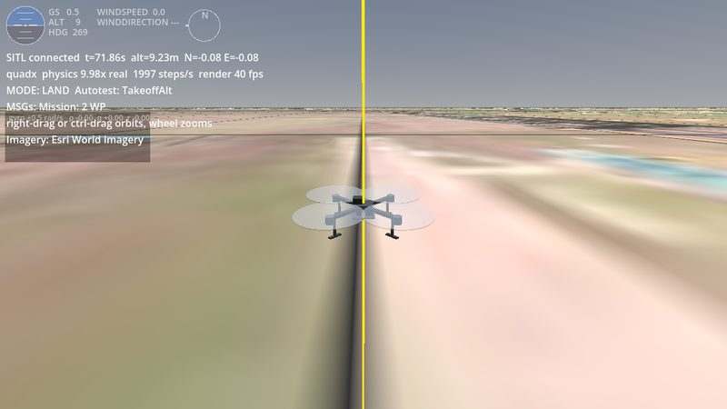](docs/gallery/quadx.jpg) | [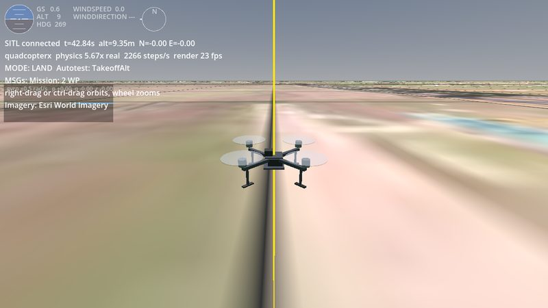](docs/gallery/quadcopterx.jpg) | [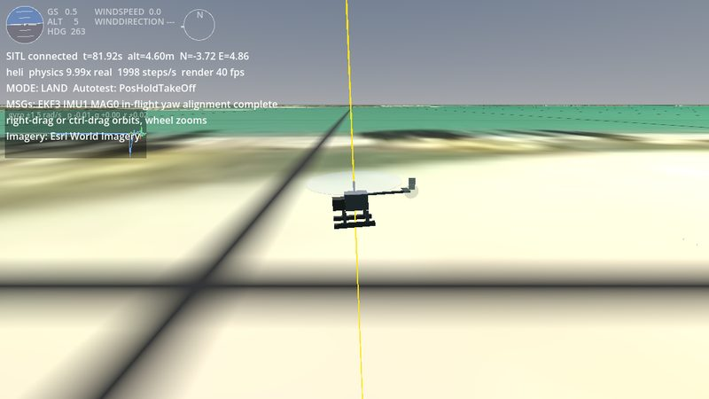](docs/gallery/heli.jpg) |
| --- | --- | --- |
| `quadx`, the quadcopter, a few metres up in `TakeoffAlt` | `quadcopterx`, converted from RealFlight, a few metres up | `heli`, the single-rotor helicopter, in the air after a POSHOLD takeoff |
| [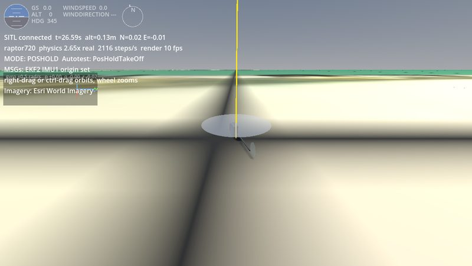](docs/gallery/raptor720.jpg) | [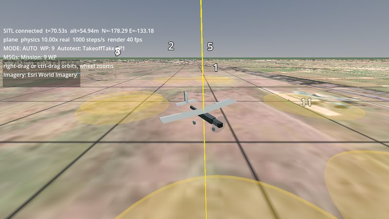](docs/gallery/plane.jpg) | [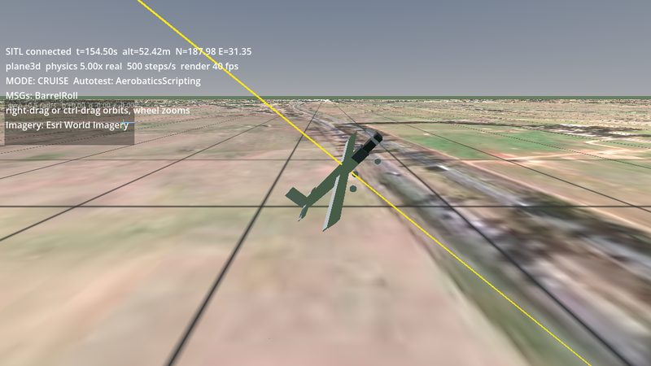](docs/gallery/plane3d.jpg) |
| `raptor720`, converted from RealFlight, running up on the ground | `plane`, climbing away from a catapult launch | `plane3d`, half way round a scripted barrel roll |
| [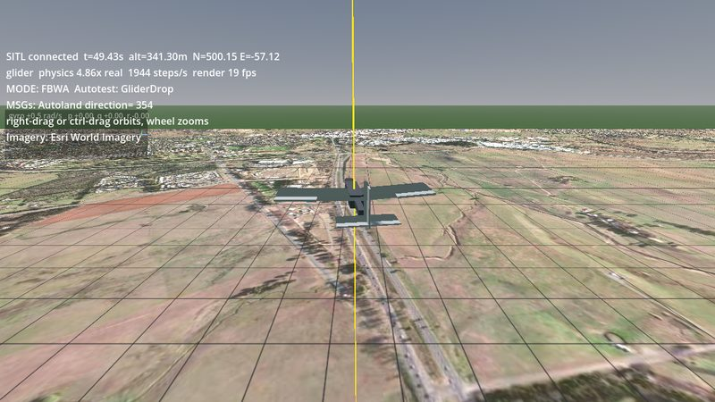](docs/gallery/glider.jpg) | [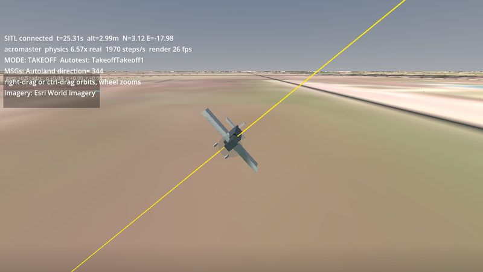](docs/gallery/acromaster.jpg) | [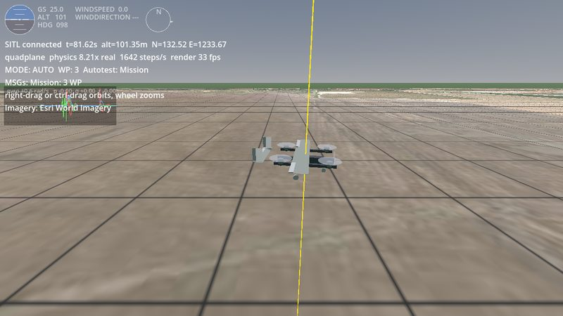](docs/gallery/quadplane.jpg) |
| `glider`, released at 400 m and flying down | `acromaster`, converted from RealFlight, banking after takeoff | `quadplane`, in forward flight after its transition |
| [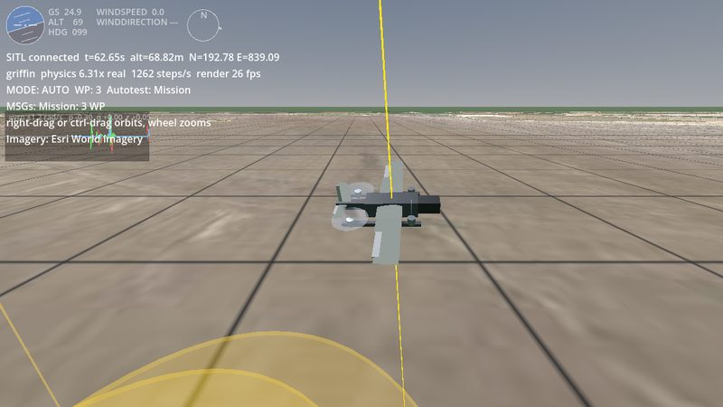](docs/gallery/griffin.jpg) | [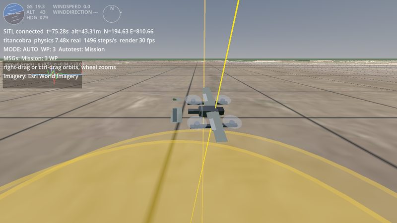](docs/gallery/titancobra.jpg) | [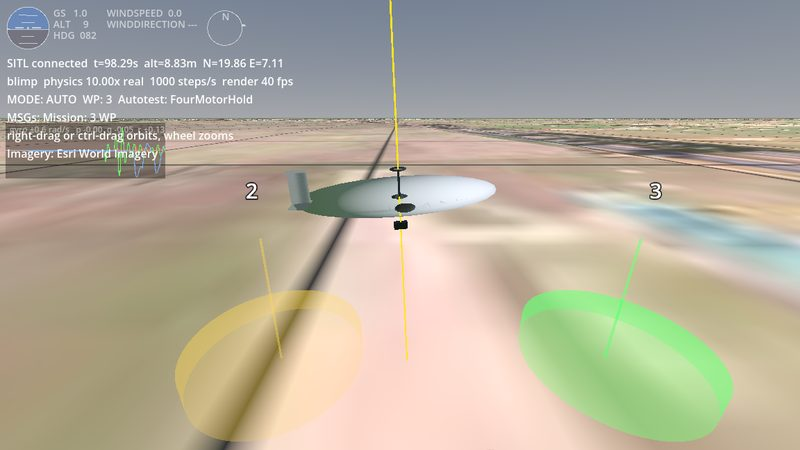](docs/gallery/blimp.jpg) |
| `griffin`, a RealFlight tilt-rotor, flying its mission | `titancobra`, a RealFlight quadplane, after its transition | `blimp`, flying between waypoints in AUTO |
| [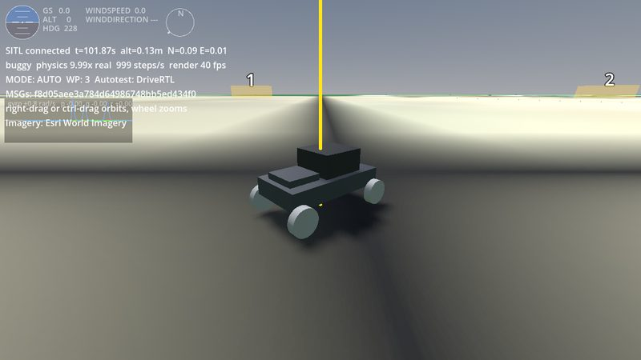](docs/gallery/buggy.jpg) | [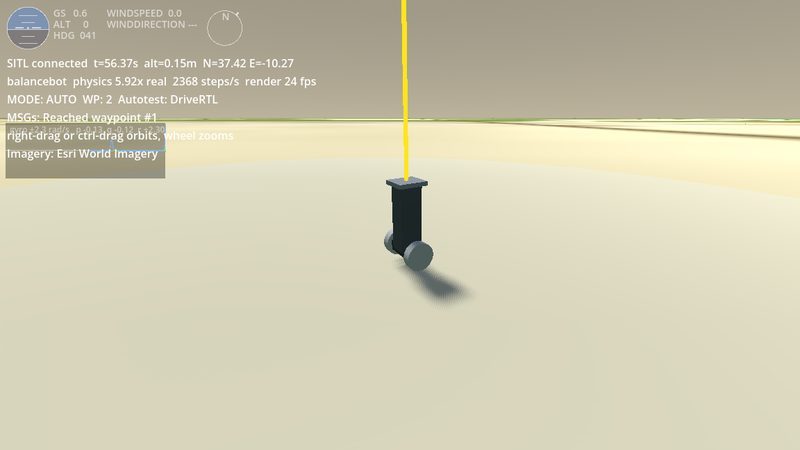](docs/gallery/balancebot.jpg) | [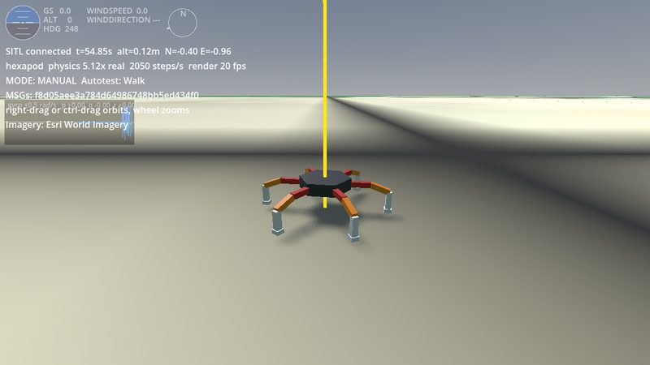](docs/gallery/hexapod.jpg) |
| `buggy`, the rover, driving a mission | `balancebot`, balancing on two wheels on its way to a waypoint | `hexapod`, walking on eighteen servos |
| [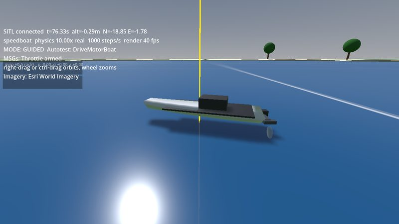](docs/gallery/speedboat.jpg) | [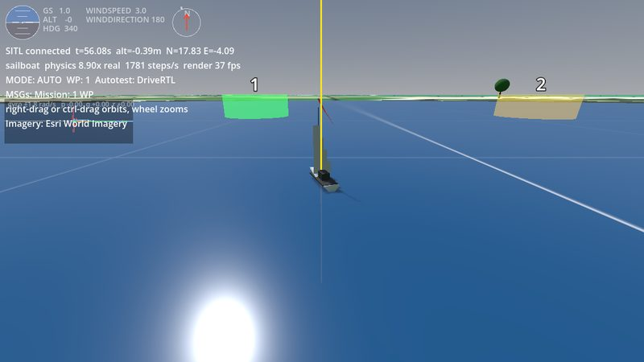](docs/gallery/sailboat.jpg) | [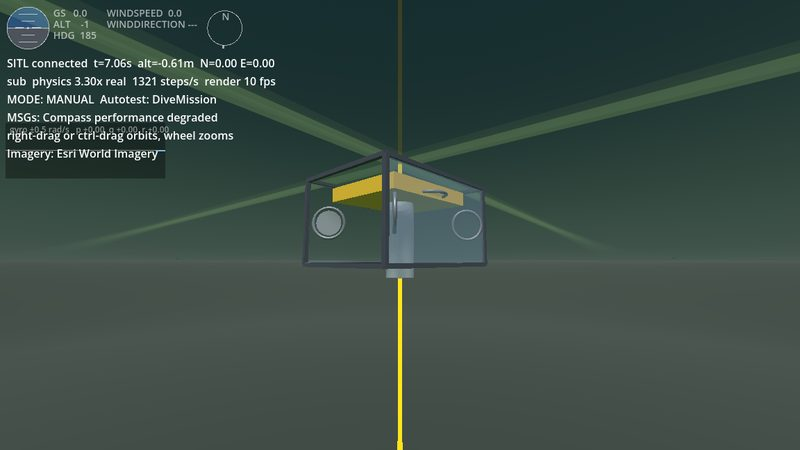](docs/gallery/sub.jpg) |
| `speedboat`, under way on the lake | `sailboat`, sailing for its first waypoint | `sub`, the vectored ROV, seen from below just under the surface |
| [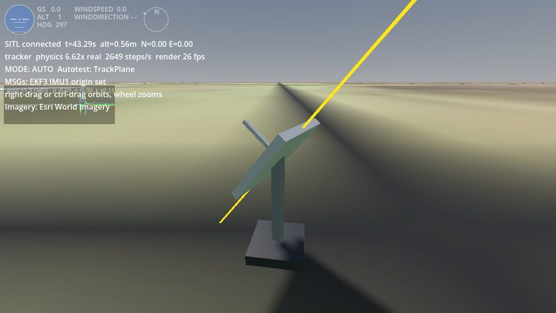](docs/gallery/tracker.jpg) | [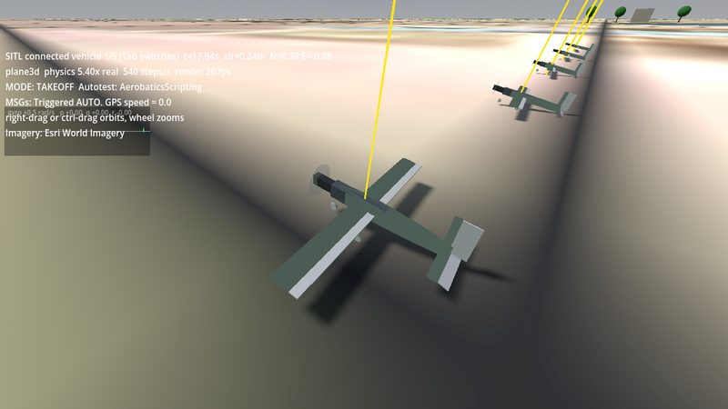](docs/gallery/fleet.jpg) | [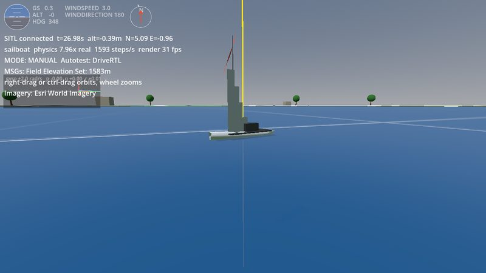](docs/gallery/sailboat-close.jpg) |
| `tracker`, swinging its dish after an aeroplane overhead | five `plane3d` sharing one world, 5 m apart, at the start of their takeoff roll | `sailboat` from close to, its telltale at the masthead |
